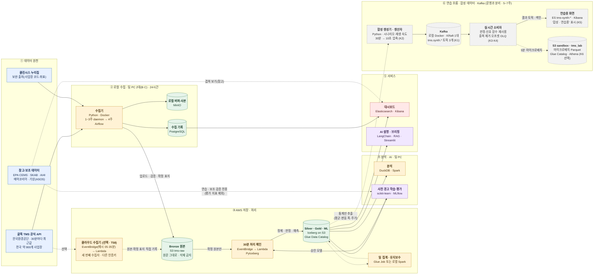
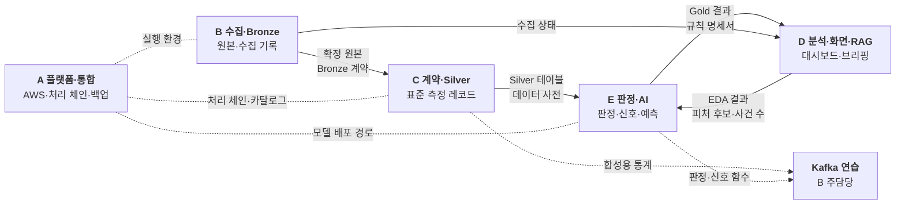

# 굴뚝 TMS 데이터 파이프라인 및 AI 사전 경고 시스템

## 프로젝트 계획서 (Kick-Off 교육생 발표용 · 2026-10-28)

| 항목 | 내용 |
|---|---|
| 기간 | 2026-10-28(수) ~ 2026-12-16(수), 6주 + 마감 주간(7주차) |
| 최종 발표 | 2026-12-17(목) |
| 팀 | 5명(A~E) |
| 저장소 | GitHub `TMS-202610` (`main` 보호, PR로만 합침) |
| 원본 문서 | [Kick-Off 요약본(05)](__TMS_KickOff_프로젝트계획서_검토반영_05.md), [브리핑 문서](__굴뚝_TMS_데이터_파이프라인_및_AI_사전_경고_시스템_브리핑_문서.md), [실행계획서 정본](TMS%20프로젝트%20실행계획서_정본_20261025.md), [실행일정표](TMS_Task별_사람별_실행일정표.md) |
| 한 장 그림 | [간략 흐름도](간략_흐름도.md) |

> 이 문서는 위 두 문서(05 요약본 + 브리핑 문서)를 합친 **오늘 발표용 계획서**입니다. 세부 규칙이 서로 다르면 정본 → 실행일정표 → 이 문서 순서로 따릅니다.

---

## 0. 한 문장으로

> **"전국 굴뚝의 30분 측정값을 빠짐없이 모으고, 허용기준에 가까워지는 배출구를 1시간 먼저 알려 주고, 그 이유를 근거와 함께 설명하는 시스템"** 을 7주 동안 5명이 만듭니다.

**오늘 꼭 기억할 세 가지**

1. **10/30(금)부터 수집을 켭니다.** 놓친 데이터는 다시 받을 수 없습니다.
2. **각자 맡은 영역의 주담당은 끝까지 책임집니다.** 대신 부담당이 항상 따라갑니다.
3. **매주 수요일에 시작해 다음 주 화요일에 끝냅니다.** 화요일마다 데모로 확인합니다.

---

## 1. 왜 이 프로젝트를 하나

전국 약 900개 사업장, 약 3,500개 굴뚝(배출구)에는 자동측정기기(**TMS**)가 붙어 있고, 한국환경공단이 **30분마다** 측정값을 공개합니다. 그런데 지금의 공개 데이터에는 빈자리가 세 개 있습니다.

| 빈자리 | 지금 상황 | 우리가 채우는 방법 |
|---|---|---|
| **① 과거가 없다** | API는 최근 30분 값 하나만 준다. 어제 값은 다시 못 받는다 | 30분마다 모아 **6주 이상 이력**을 쌓는다 |
| **② 해석이 없다** | 숫자가 문자열이고 `보수중`, `미수신` 같은 글자가 섞여 있다 | 표준화하고 **기준대비율로 자동 판정**한다 |
| **③ 예고가 없다** | 기준을 넘은 **뒤에야** 알 수 있다 | **"1시간 안에 기준 90%에 들어갈 배출구"** 를 미리 찾는다 |

> **예시:** 어떤 배출구의 질소산화물(NOx) 기준대비율이 `72% → 76% → 81% → 85%`로 오르고 있다면, 지금은 '주의' 단계지만 곧 '경고(90%)'에 들어갑니다. 이 상황을 **미리** 알려 주는 것이 목표입니다.

그래서 우리가 만드는 것은 네 가지입니다.

| # | 만드는 것 | 한 줄 설명 |
|---|---|---|
| 1 | 수집 파이프라인 | 30분 값을 빠짐없이 모아 쌓기 |
| 2 | 판정·이상 신호 | 허용기준 대비 몇 %인지 판정하고 이상한 흐름 찾기 |
| 3 | AI 사전 경고 | "1시간 안에 경고 단계(90%)에 들어갈 굴뚝" 미리 알리기 |
| 4 | 대시보드·AI 설명 | 결과를 화면으로 보여 주고, 근거를 대며 설명하기 |
| + | **Kafka 스트림 연습** | 합성 데이터를 Kafka로 흘려 실시간 처리 체험하기 (10장) |

---

## 2. 최종 발표(12/17)에서 보여 줄 것

### 2-1. 시연 5장면

| # | 장면 | 무엇을 보여 주나 | 주로 준비 |
|---|---|---|---|
| 1 | **관제 대시보드** | 마지막 갱신 시각, 6주 누락률(1% 이하), 울산 배출구별 기준대비율·단계 | D (B·E 지원) |
| 2 | **사전 경고 목록** | 1시간 안에 경고 진입이 예상되는 배출구, 최근 추세·이상 신호·예측 결과 | E (D 지원) |
| 3 | **AI 브리핑(RAG)** | 질문에 수치와 함께 "판정 규칙 명세서 3.2절", "데이터 기준 시각 14:30" 같은 출처 표시 | D |
| 4 | **계보 추적** | 경고 1건을 골라 Gold → Silver → Bronze → API 원문까지 거슬러 올라가기 | C (A 지원) |
| 5 | **정직한 평가표** | 규칙 vs 머신러닝의 재현율·정밀도·평균 선행 시간 비교 | E |
| + | (부록) Kafka 연습 | 합성 데이터가 실시간으로 판정되는 "합성 · 연습용" 화면 | B (E·D 지원) |

### 2-2. 성공 기준

| 영역 | 성공 기준 |
|---|---|
| 지속 수집 | 수집 누락률 **1% 이하**, 6주 이상 누적 |
| 표준화 | 검수 표본 변환 정확도 100%, 처음 보는 값은 격리·보고 |
| 판정 | 기준대비율 계산 오차 0, 같은 입력·같은 규칙이면 항상 같은 판정 |
| 이상 신호 | 심어 둔 이상 4종을 **90% 이상** 찾아냄 |
| 사전 경고 | **규칙 vs 머신러닝 비교표**(재현율·정밀도·선행 시간)를 대시보드에 표시 |
| 재현성 | 같은 기간을 다시 돌리면 같은 결과, 실험은 MLflow에 기록 |
| AI 설명 | 질문 10개 모두 근거 표시 |
| 개발 품질 | 핵심 로직 테스트 커버리지 80% 이상 |
| Kafka (가급적) | 합성 시나리오별 기대 신호를 소비자가 모두 잡음, 재시작·중복에도 결과 동일 |

**하지 않는 것:** 법적 위반 판단(공개값은 확정 전 자료), 특정 사업장을 오염 원인으로 단정하기, 실제 알림 발송 서비스, 실측 데이터를 Kafka로 운영하기.

---

## 3. 어떤 데이터를 쓰나

데이터는 성격에 따라 **세 칸**으로 나누고, 절대 섞지 않습니다.

| 구분 | 데이터 | 용도 | 평가에 쓰나 |
|---|---|---|---|
| **① 실측 (주 데이터)** | 한국환경공단 굴뚝 TMS 실시간 API (30분, 7개 항목: 먼지·SOx·NOx·HCl·HF·NH3·CO + 허용기준) | 모든 처리·평가의 기준 | ✅ |
| | 클린시스 누리집(사업장 코드·좌표·가동중지), 연간 배출량 통계, 법령·판정 규칙 문서 | 보완 정보, AI 설명 근거 | ✅(보조) |
| **② 참고 (연습용)** | 미국 EPA CEMS, 에어코리아, 기상청(ASOS), Kaggle 서울, SKAB, AI4I | 실측이 쌓이기 전 코드 연습, 겹쳐 보기 화면 | ❌ |
| **③ 우리가 만드는 것** | 이상 주입 자료, 사전 경고 정답(자동 계산), 검수 표본 | 규칙·모델 검증 | ✅(검증용) |
| | **합성 데이터** (운전 지표, **Kafka 스트림용**) | 새 기술 연습 | ❌ |

- **핵심 관제 지역:** **울산광역시** (사업장 94개소, 배출구 약 490개)
- 참고·합성 데이터는 `sandbox/` 같은 별도 공간에만 둡니다.

> 💡 **주입 ≠ 합성**
> - **주입**: 실측 **복사본**의 몇 개 값을 바꿔 "정답 위치를 아는 이상"을 만드는 것 → 규칙이 잘 동작하는지 확인
> - **합성**: 공개 자료에 없는 값을 **새로 만드는 것** → 기술 연습용(Kafka 등), 성능 지표에 넣지 않음

---

## 4. 전체 흐름

### 4-1. 큰 그림 — 간략 흐름도

상자 하나가 "무엇을 하는가 · 어떤 도구로"를 뜻합니다. 원본 그림은 [간략 흐름도](간략_흐름도.md)이며, 그림을 고치면 두 문서를 함께 고칩니다.

- **실선**: 반드시 만드는 운영 경로(Must)
- **점선**: 선택 또는 검증 결과에 따라 쓰는 경로(PoC 통과 시 Glue·S3 Tables, 클라우드 수집, 참고 데이터 연습)
- **회색 상자(⑥)**: 합성 데이터 · Kafka 연습 흐름. 운영 Bronze·Silver·Gold와 **데이터가 섞이지 않음**



**한 줄씩 읽기**

| 단계 | 하는 일 | 핵심 도구 | 담당 |
|---|---|---|---|
| ① 원천 | 공식 API가 30분마다 **가장 최근 값만** 준다. 지난 값은 다시 받을 수 없다 | 공공데이터포털 API | B |
| ② 로컬 수집 | 장비 2대가 같은 구간을 함께 받아 원본을 보존하고, 수집 성공·실패를 기록한다 | Python, Docker Compose, MinIO, PostgreSQL, Airflow | B (C 부담당) |
| ③-0 클라우드 수집 (선택) | 두 PC가 함께 멈춘 구간을 메울 세 번째 수집자. 같은 30분 API를 Lambda가 받아 S3에 바로 쓴다 | EventBridge Scheduler, Lambda, S3 | B (A) |
| ③-1 Bronze | 원본을 S3에 올리고 다시 읽어 검증한 뒤 **확정 표지**를 남긴다. 고치거나 지우지 않는다 | Amazon S3 | B·A |
| ③-2 처리 체인 | 매시 15·45분, 확정 원본으로 표준화(Silver) → 판정·이상 신호·사전 경고(Gold) | EventBridge, Lambda, PyIceberg, Iceberg | A·C·E |
| ③-3 배치 | 전국 일 집계, 테이블 유지보수 | Glue Job(검증 통과 시) 또는 로컬 Spark | D·C·A |
| ④ 분석·AI | 탐색 분석, "1시간 안에 경고 단계 진입" 예측 모델 학습·평가 | DuckDB, Spark, scikit-learn, MLflow | E·D |
| ⑤ 서비스 | 누락·신선도·판정·경고를 화면으로, 근거가 붙은 AI 설명 | Elasticsearch, Kibana, LangChain, Streamlit | D |
| ⑥ 연습 흐름 | Silver 통계로 만든 합성 측정값을 Kafka로 흘리고, 같은 판정·신호 함수로 실시간 처리 | Kafka, ES·Kibana, (선택) S3·Glue Catalog·Athena | B (A·C·E·D 지원) |

### 4-2. 30분 동안 무슨 일이 일어나나 (14:00 구간 예시)

```text
14:00 ── 구간 시작 (측정기가 14:00~14:30 평균값을 만든다)
14:05 ── ① 수집기(장비 B·C)가 공식 API 호출 → 전국 응답(약 1.8MB) 원문 저장
14:06 ── ② S3 업로드 + SHA-256 대조 → 통과하면 Bronze 확정 표지(_SUCCESS) 기록
14:15 ── ③ 처리 체인 자동 실행: Silver 표준화 → Gold 기준대비율·단계·신호·사전 경고
14:25 ── ④ Elasticsearch 색인 → 대시보드 갱신
14:30 ── 다음 구간 시작 (실패하면 14:25까지만 재시도)
```

### 4-3. 메달리온 구조 쉽게 보기

| 층 | 비유 | 내용 | 담당 |
|---|---|---|---|
| Bronze | 원재료 창고 | API 응답을 **받은 그대로** 보관. 절대 고치지 않음 | B · A |
| Silver | 손질한 재료 | 가로 14열 → 세로 행, 상태 글자 분리, KST 시각, 이상한 값 격리 | C |
| Gold | 완성 요리 | 기준대비율, 4단계 판정, 이상 신호 4종, 사전 경고 | E |
| 서비스 | 차린 상 | 대시보드 10요소, 근거 연동 RAG 브리핑 | D |

- 수집은 **팀 PC**(24시간), 처리는 **AWS**, 분석·학습·화면·Kafka는 **팀 PC**에서 돌립니다.
- AWS가 안 되면 같은 코드를 팀 PC의 Docker로 돌리는 **대체 경로**가 있습니다.

### 4-4. 수집 경로 두 가지 — Airflow(주력) vs Lambda(보험)

먼저 두 가지를 분명히 해 둡니다.

- **이 프로젝트에는 실측 "실시간 수집"이 없습니다.** API가 30분에 한 번 값을 주므로, 두 경로 모두 **30분마다 도는 정기 수집**입니다.
- **Glue는 수집하지 않습니다.** AWS에서 API를 부르는 것은 **EventBridge → Lambda**입니다. Glue는 쌓인 데이터를 **목록으로 관리(Glue Catalog)** 하고 **묶어서 처리(Glue Job)** 합니다.

그래서 두 경로의 차이는 "실시간이냐"가 아니라 **"어디서, 누가 30분마다 API를 부르느냐"** 입니다.

| 구분 | **Airflow 수집** (로컬) | **클라우드 수집** (EventBridge·Lambda) |
|---|---|---|
| Task | T24(3주 초안) → T32(4주 전환) | T58 (1주, 선택) |
| 어디서 | **팀 PC 2대**(장비 B·C), Docker | **AWS 안** (PC가 꺼져도 돎) |
| 누가 30분마다 깨우나 | Airflow 스케줄러 | EventBridge Scheduler (매시 05·35분, KST) |
| 누가 API를 부르나 | Airflow DAG 안의 수집 태스크 | Lambda 함수 1개 |
| 원본 저장 순서 | MinIO 로컬 버퍼 → S3 업로드 → SHA 검증 → 확정 표지 | S3에 원본·매니페스트·확정 표지를 **바로** 기록 |
| 인증키 | 장비별 각자 키 | 장비들과 **다른 키** |
| 위상 | **주 수집 경로 (Must)** | **세 번째 보험 (선택)** — G1에서 채택 여부 결정 |
| 장점 | 재시도·실패 알림·실행 이력이 화면에 보임, 교육 과정의 Airflow 학습 | PC 정전·절전·재부팅과 무관, 비용 거의 0 |
| 위험 | 두 PC가 동시에 꺼지면 그 구간은 영구 누락 | 해외 IP로 보이면 API가 거부할 수 있음(T58에서 확인), IAM 권한 필요 |
| 주담당 | B (C 부담당) | B (A 지원) |

```text
                    ┌─ 장비 B: Airflow DAG ─► MinIO ─► S3 업로드·검증 ─┐
 공식 API (30분) ───┼─ 장비 C: Airflow DAG ─► MinIO ─► S3 업로드·검증 ─┼─► S3 Bronze ─► 처리 체인 ─► Silver·Gold
                    └─ (선택) EventBridge ─► Lambda ─► S3 직접 기록 ───┘                            │
                                                                                     Glue Catalog로 테이블 관리
                                                                                     Glue Job·Spark로 일 집계
```

- 세 경로 모두 **같은 S3 Bronze**에 들어갑니다. 원본마다 `collector`(장비 B / 장비 C / lambda) 표시가 붙습니다.
- 같은 구간이 여러 번 들어와도 **하나로만 확정**합니다(멱등성).

### 4-5. 진짜 "실시간"은 Kafka 연습 하나뿐

| | 정기 수집 (Airflow·Lambda) | Kafka 연습 (K1~K6) |
|---|---|---|
| 데이터 | 실측 | 합성 |
| 간격 | 30분 | 10초 (시간 압축) |
| 목적 | 6주 이력 쌓기·평가 | 스트림 처리 체험 |
| 저장 위치 | 운영 Bronze·Silver·Gold | `sandbox/`, `tms_lab`만 |
| S3·Glue와의 관계 | Bronze는 S3, Silver·Gold는 Glue Catalog에 등록 | (K6) 5분 묶음 Parquet → S3 sandbox → Glue Catalog `tms_lab` |

> **세 문장 요약:** 수집은 Airflow가 주력이고 Lambda는 보험이다. 둘 다 30분 주기다. 실시간은 Kafka로만 연습한다.

---

## 5. 핵심 처리 방법 (개념만)

### 5-1. 판정 — 기준대비율

```text
기준대비율(%) = 측정값 ÷ 허용기준 × 100
```

| 단계 | 기준대비율 |
|---|---|
| 🟢 정상 | 80% 미만 |
| 🟡 주의 | 80 ~ 90% |
| 🟠 경고 | 90 ~ 100% (← 사전 경고의 목표선, 팀 내부 기준) |
| 🔴 초과 | 100% 이상 ("확인 대상"으로만 표시) |
| ⚪ 판정 제외 | 가동중지·보수중·미수신·허용기준 미설정 (사유 기록) |

규칙 숫자는 코드가 아니라 `config/rules.yaml`에 두고 버전으로 관리합니다.

### 5-2. 이상 신호 4종

| 신호 | 규칙(초안) | 예시 | 잡고 싶은 것 |
|---|---|---|---|
| 기준 근접 `MARGIN_ALERT` | 80% 이상 | 78% → **82%** | 허용기준에 가까움 |
| 연속 상승 `TREND_RISE` | 4회 연속 상승 | 22% → 24% → 26% → 28% | 서서히 오름 |
| 급변 `RATE_SPIKE` | 직전 대비 +30% 이상 | 40% → **55%** | 갑자기 튐 |
| 변동성 `VOLATILITY_SURGE` | 표준편차가 평소의 2배 초과 | 흔들림 폭이 커짐 | 불안정해짐 |

검증 방법: 실측 **복사본**에 4종 이상을 일부러 심고 → 신호 모듈이 몇 %를 찾는지 측정(목표 90%).

### 5-3. AI 사전 경고 — 어떤 머신러닝 모델을 쓰나

**① 무엇을 맞히나**

| 항목 | 방법 |
|---|---|
| 질문 | 이 배출구·항목이 지금부터 **60분 안에** 기준대비율 90% 이상(경고 단계)에 들어가는가? → **예/아니오 분류** |
| 정답(라벨) | 실제로 그 뒤 60분 값(`base_time < measured_at ≤ base_time + 60분`)을 보고 **자동 계산** (사람이 붙이지 않음) |
| 예측 대상에서 빼는 것 | 이미 90% 이상인 표본은 `already_warning`으로 표시해 빼고 "경고 지속" 건수로 따로 보고. 미래 값이 없어 정답을 못 만드는 표본도 빼고 제외 건수·사유를 보고 |
| 입력(피처) | 최근 기준대비율, 변화율, 기울기, 표준편차, 시각·요일, 가동 재개 후 경과 시간 |

> 💡 이미 경고 중인 표본을 넣으면 "맞히기 쉬운 정답"이 섞여 재현율이 부풀려집니다. 그래서 **"새로 진입하는 경우"만** 맞히는 문제로 정했습니다.

**② 비교하는 모델**

| 구분 | 모델 | 역할 |
|---|---|---|
| 기준선 | **규칙**: 최근 기울기를 그대로 연장해 60분 뒤 90%를 넘는지 계산 | 머신러닝이 이것보다 나은지 재는 잣대 |
| **주력 ML** | **로지스틱 회귀** (scikit-learn) | 정식 비교 대상, 최종 평가표(T49)에 들어감 |
| 보조 (여유 시) | Random Forest | 같은 조건에서 추가 실험 |

딥러닝(LSTM 등), XGBoost·LightGBM은 이번 계획에 넣지 않습니다.

**③ 왜 로지스틱 회귀인가**

- **데이터가 적습니다.** 6주치이고 경고 진입은 드문 사건이라, 복잡한 모델은 금방 과적합됩니다.
- **설명이 쉽습니다.** 계수로 "기울기가 클수록 경고 확률이 오른다"처럼 말할 수 있어 RAG 브리핑·발표에서 근거를 대기 좋습니다.
- **목표가 정직한 비교입니다.** 단순한 모델로 규칙과 공정하게 비교하는 것이 먼저입니다.

**④ 어떻게 평가하나**

| 항목 | 방법 |
|---|---|
| 분할 | **시간 순서로만** — 앞 4주 학습, 뒤 2주 평가. 하이퍼파라미터 조정이 필요하면 학습 구간 안에서 시간 순서 교차검증 |
| 누수 방지 | 피처는 예측 시점 이전 자료로만 만든다(테스트로 고정, T89). 학습 구간 마지막 1시간은 정답이 평가 구간 값을 보므로 학습에서 뺀다(엠바고). 판정 제외 구간을 사이에 둔 값끼리는 기울기를 계산하지 않는다 |
| 불균형 | 경고 진입은 드문 사건 → 정확도(accuracy)가 아니라 아래 지표로 본다 |
| 지표 | 재현율, 정밀도, PR 곡선, **평균 선행 시간**, 오탐·미탐 건수, 평가 가능 표본 수, 제외 건수 |
| 기록·배포 | 모든 실험은 MLflow에 기록. **AI 준비도 게이트(T90) → 학습·평가(T44) → 2인 확인 후 승인 모델 배포(T45)** |

**⑤ 사건이 너무 적으면 (4주차 T31·T81에서 판단)**

1. 전국 자료로 학습하고, 최종 평가는 울산으로 유지한다.
2. **보조 실험으로만** 주의 단계(80%) 기준 라벨을 따로 평가한다(90% 결과와 합치지 않음).
3. 그래도 비교가 어렵다면 그 사실을 밝히고, 규칙 기준선·재현성·평가 절차 검증을 중심 결과로 보고한다. **EPA 데이터로 사건 수를 채우지 않는다.**

**⑥ 헷갈리기 쉬운 것**

| 이것은 | 머신러닝인가? |
|---|---|
| 이상 신호 4종 (`MARGIN_ALERT` 등, 5-2절) | ❌ `rules.yaml`의 **규칙**으로 판정 |
| 60분 사전 경고 | ✅ 규칙 vs **로지스틱 회귀** 비교 |
| SKAB·AI4I 실험 (T85·T86, 선택) | 연습용. 외부 검증·불균형 다루기 연습일 뿐 성능 보고에 넣지 않음 |
| EPA로 만든 평가 골격 (T78) | 코드 연습용. EPA 성능 수치는 보고하지 않음 |

> 모델이 규칙보다 못해도 **실패가 아닙니다.** 같은 조건에서 정직하게 비교·보고하는 것이 목표입니다.

### 5-4. 실측이 쌓이기 전에는? — EPA로 미리 연습

울산 실측은 5주차에야 3~4주치가 됩니다. 그 전에 미국 EPA 굴뚝 데이터로 **같은 함수**를 미리 만들고 시험합니다. 5주차에 EPA를 끝내고 같은 함수를 울산 실측에 그대로 적용합니다.

### 5-5. AI 설명(RAG)

판정 규칙 명세서·데이터 사전·평가 보고서를 검색 색인에 넣고, 질문("울산 주의 배출구 현황은?")에 **수치와 근거 출처를 함께** 답합니다. 근거가 없으면 답을 보류합니다.

---

## 6. 도구 — 언제 무엇을 쓰나

| 시기 | 도구 | 목적 | 주담당 |
|---|---|---|---|
| **1주~ (전원)** | Git·GitHub, Spec Kit + Claude Code, Python·pytest·ruff, Docker Compose | 협업·명세·코드·테스트·로컬 환경 | A |
| **1주~ (수집)** | 공공데이터포털 API, MinIO, PostgreSQL, Amazon S3 | 수집·원본 보관·수집 기록 | B |
| **2주 PoC → 4주 운영** | Iceberg·PyIceberg·Glue Catalog, EventBridge·Lambda | 테이블 관리, 30분 처리 자동 실행 | A · C |
| **3~4주** | Apache Airflow | 수집 스케줄·재시도·감시 | B |
| **1주~ (분석)** | DuckDB, Spark, (Athena) | 탐색 분석, 집계, 엔진 비교 | D |
| **5~7주** | pandas·scikit-learn, MLflow | 피처·학습·평가·실험 기록 | E |
| **5~6주** | Elasticsearch·Kibana, LangChain·Streamlit | 대시보드, AI 설명 화면 | D |
| **5~7주 (가급적)** | **Apache Kafka**, `confluent-kafka` | 합성 데이터 스트림 주입·실시간 처리 연습 | B |

> Glue Job·S3 Tables 같은 **조건부 도구는 2주차 PoC를 통과해야** 씁니다. 결과는 `docs/decision-log.md`에 남깁니다.

---

## 7. 팀원별 역할 (R&R)

### 7-1. 한눈에 보기

| 담당 | 역할 | 한 줄 미션 | 부담당(제안) | 매일·매주 상시 업무 |
|---|---|---|---|---|
| **A** | 플랫폼·AWS·통합 | 모두가 같은 환경에서, AWS든 대체 경로든 **끊김 없이 돌게** 한다 | B | 관문 리뷰 진행(G1·G3·MVP), 주간 통합 점검, AWS 비용 점검 |
| **B** | 수집·Bronze (+Kafka) | 놓친 데이터는 다시 못 받는다 — **누락을 1% 이하로** | C | 매일 아침 전날 누락 확인, 매주 수집 점검(T08) |
| **C** | 데이터 계약·Silver·Iceberg | 모두가 **같은 약속(계약)**으로 데이터를 읽고 쓰게 한다 | A | **장비 C 수집기 운영**(매일 누락 확인), 계약 변경 시 팀 공지 |
| **D** | 분석·화면·RAG | 결과를 **보이게, 설명되게** 한다 | E | 대시보드 숫자를 수작업 기준선(T07)과 대조, 발표 자료 관리 |
| **E** | 판정·AI 경고·MLOps | 규칙과 모델을 **같은 조건에서 정직하게** 비교한다 | D | 규칙(`rules.yaml`) 버전 관리, 모델 배포 2인 확인 |

- 기술마다 **주담당 1명이 끝까지 책임**집니다(설치·설계·문제 해결·팀 설명).
- **부담당**은 주담당이 자리를 비워도 그 영역을 이어갈 수 있을 만큼 따라갑니다. 위 짝은 제안이며 **오늘(10/28) 확정**합니다.
- **앞 단계를 기다리지 않습니다.** 3주차에 계층별 샘플을 정하고 각자 샘플로 개발한 뒤, 실제 데이터로 갈아 끼웁니다.

### 7-2. 누가 누구에게 무엇을 넘기나



| 담당 | 넘겨주는 것 (Output) | 받는 것 (Input) |
|---|---|---|
| **A** | 실행 환경, CI, 처리 체인, 백업 체계, Kafka 컨테이너 | 모듈별 코드와 배포 조건 |
| **B** | 확정 Bronze 원본, 수집 로그, 합성 생성기·Kafka 소비자 | A의 인프라, C의 합성용 통계, E의 판정 함수 |
| **C** | Silver 테이블, 데이터 사전, 합성용 통계 | B의 원본, E의 요구사항 |
| **D** | 대시보드, AI 설명 서비스, 발표 자료 | E의 Gold 결과, B의 수집 상태 |
| **E** | Gold 결과, 규칙 명세, 평가 보고서, 재사용 가능한 판정·신호 함수 | C의 Silver, D의 EDA 결과 |

### 7-3. 팀원별 상세

#### 팀원 A — 플랫폼 · AWS · 통합

| 책임 영역 | 하는 일 |
|---|---|
| AWS 인프라·권한 | 기관 계정·리전·IAM 권한·예산 확인(T02), 기본 자원 생성(T59), 원본 삭제 방지 수준 결정(T61), 키 교체(T66) |
| 30분 처리 체인 | EventBridge Scheduler → Lambda → PyIceberg 처리 체인 PoC(T11) → 운영 배포(T26), CloudWatch 로그 |
| 기술 검증(PoC) | Glue/Spark(T12), S3 Tables(T13), 엔진 호환성(T14) → **G1에서 채택·대체 결정** |
| 통합·백업 | 로컬 서비스(T05), 1차 내보내기(T42, 12/2), 최종 백업·로컬 재구성(T53, 12/15) |
| 관문·마감 진행 | G1(T17)·G3(T33)·MVP(T48) 리뷰 진행, 최종 리허설·기능 동결(T57) |
| 대체 경로 | AWS가 막히면 로컬 Docker·MinIO·PostgreSQL·Spark로 같은 테스트를 돌리는 경로 확보 |
| **Kafka 지원** | `docker-compose`에 `kafka` 프로필 추가, 브로커 기동 확인(K1) |

**핵심 산출물:** AWS 가능/불가 목록, 처리 체인(동일 입력 3회 같은 결과), PoC 결과와 결정 기록, 백업본

#### 팀원 B — 수집 · Bronze (+ Kafka 주담당)

| 책임 영역 | 하는 일 |
|---|---|
| API 수집기 | 공공데이터포털 굴뚝 TMS API 30분 정기 수집기(Python·Docker) 개발·24시간 운용, 응답 샘플 보존(T03) |
| 2대 장비 이중화 | 장비 B(본인)·장비 C(C의 PC) 구성(T04), 장비별 다른 인증키, **10/30 정기 수집 시작** |
| Bronze 확정 표지 | 로컬 버퍼 → S3 자동 업로드, **SHA 검증 통과 시에만** `_SUCCESS`·manifest 기록(T09), Bronze 계약(T65) |
| 실패 처리·누락 감시 | API 재시도와 업로드 재전송 분리(T10), 첫 누락률 보고(T16), 매주 수집 점검(T08) |
| Airflow 수집 전환 | DAG 초안·원본 미러링(T24) → 4주차 daemon과 병행 검증 후 **Airflow 전환(T32)**, 중복 실행·중복 적재 방지 |
| 운영 문서 | 설치·실행·장애 대응·재처리 절차 런북(T54, 12/15) |
| **Kafka 연습** | 합성 생성기·생산자(K2), 소비자(K3), 신뢰성 시험(K4) |

**핵심 산출물:** 6주 이상 누적 원본, 누락률 보고서, Bronze 계약, Airflow 수집 DAG, 런북, Kafka 연습 코드

#### 팀원 C — 데이터 계약 · Silver · Iceberg

| 책임 영역 | 하는 일 |
|---|---|
| 데이터 계약·품질 | 데이터 계약 v1(T18), 중복·상충 분석(T19), 계약 테스트·고정 fixture(pytest, T21), 데이터 사전 YAML(T88) → **G2 진행(T25)** |
| EPA·국내 공통 형태 | EPA와 울산이 같은 함수를 쓰도록 공통 중간 형태·함수 경계 합의(T79) |
| Silver 표준화·격리 | 보수중·미수신·가동중지 등 상태값 분리, 문자열 숫자 변환, 처음 보는 값 격리(T27), 배출구 매핑(T23) |
| Iceberg 운용 | 테이블·파티션 설계(T20), 누적 원본 첫 변환(T28), 재처리·2인 확인(T29), 스냅샷 보존 검증(T38), 유지보수(T39 lab → T43 운영) |
| 재현·계보 | 유지보수 후 재현 시험(T50), 판정 1건을 원본까지 따라가는 계보 시연(T76) |
| 수집 지원 | **장비 C 수집기 운영**, 매일 누락 확인 |
| **Kafka 지원** | Silver에서 배출구·항목별 평균·변동 폭·시간대 주기 **통계만** 뽑아 합성 생성기에 제공, 메시지 형식이 공통 형태와 맞는지 확인 |

**핵심 산출물:** 데이터 계약 v1, 계약 테스트, 데이터 사전, Silver 테이블, 재처리 절차, 재현 시험 결과

#### 팀원 D — 분석 · 화면 · RAG

| 책임 영역 | 하는 일 |
|---|---|
| EDA·참고 데이터 | 수작업 대시보드 기준선(T07), 참고 데이터 라이선스·내려받기(T83·T84), EPA EDA·대리 기준(T77) |
| 분석 엔진 비교 | Athena 조회(T15), 전국 일 집계 공용 PySpark 스크립트(T36), DuckDB·Spark·Glue 3엔진 대조(T37) |
| 평가 가능성 | 경고 진입 사건 수 집계(T31), 울산 학습 가능성 판단(T81) |
| Kibana 대시보드 | 화면 설계(T63) → 중간본(T35, 12/1) → **10요소 완성(T46, 12/8)**: 수집 상태·신선도·기준대비율·판정·경고 예상 등 |
| RAG·AI 브리핑 | 근거 문서·질문 10개(T41), 말뭉치 규칙(T91), LangChain·Streamlit 브리핑 MVP(T47), RAG 평가(T51) |
| 보고·발표 | 에어코리아 겹쳐 보기(T87, 선택), 기술 비교 보고서(T52, 12/12), 최종 흐름도·발표 자료(T55, 12/15) |
| **Kafka 지원(선택)** | `tms-synth-*` 인덱스로 Kibana "합성 · 연습용" 화면 1장(K5) |

**핵심 산출물:** 3엔진 대조표, Kibana 대시보드, RAG 브리핑 화면, 기술 비교 보고서, 발표 자료

#### 팀원 E — 판정 · 사전 경고 · MLOps

| 책임 영역 | 하는 일 |
|---|---|
| 판정 규칙 | 상태값·판정 후보(T06) → 규칙 명세서 초안(T60, 문서) → **`config/rules.yaml` 확정(T22)** → 판정 구현(T30) |
| 이상 신호 4종 | EPA로 먼저 시험(T80) → 울산 구현·**주입 검증 재현율 90%(T69)**, SKAB 외부 검증(T86, 선택) |
| 60분 사전 경고 | EPA로 평가 골격(T78), 피처·라벨(T40), 시점 정합성 테스트(T89), Gold 연결(T34), 불균형 연습(T85, 선택) |
| 학습·평가 | **AI 준비도 게이트(T90) 통과 후** MLflow 학습·평가(T44), 최종 평가표(T49, 12/14) |
| MLOps | MLflow 서버(T67), 승인 모델 배포(T45, **2인 확인**: E + A·C·D 중 1명) |
| **Kafka 지원** | 판정·신호 함수(`ratio_pct()`, `detect_signals()`)를 Kafka 소비자가 그대로 부를 수 있게 정리, 소비자 PR 리뷰 |

**핵심 산출물:** `rules.yaml`, 이상 신호 검증 결과, 피처·라벨 코드, 규칙 vs 모델 비교표, 배포된 승인 모델

---

## 8. 7주 일정 한눈에 보기

### 8-1. 관문(마일스톤)

```text
1주(10/28~11/3) ─► 2주(11/4~11/10) ─► 3주(11/11~11/17) ─► 4주(11/18~11/24) ─► 5주(11/25~12/1) ─► 6주(12/2~12/8) ─► 7주(12/9~12/16)
 수집 시작(10/30)    G1 기술 결정       G2 데이터 계약      G3 핵심 흐름        EPA 종료            MVP 시연(12/8)     최종 평가·동결
                                                                            Kafka K1·K2         Kafka K3           Kafka K4·K5      ─► 12/17 발표
```

| 주차 | 기간 | 이름 | 관문 / 마감 | 끝나면 손에 쥐는 것 |
|---|---|---|---|---|
| 1 | 10/28~11/3 | **쌓기 시작** | **10/30 정기 수집 ON** | API 샘플, 장비 2대 수집 기록, AWS 가능/불가 목록 |
| 2 | 11/4~11/10 | **검증·결정** | **G1** 기술 검증 (11/6 중간, 11/10 최종) | 운영 기술·대체 경로 결정 기록 |
| 3 | 11/11~11/17 | **약속 정하기** | **G2** 데이터 계약 리뷰 (11/17) | 계약·테스트·데이터 사전·규칙 고정 |
| 4 | 11/18~11/24 | **연결하기** | **G3** 핵심 흐름 리뷰 (11/24) | Bronze → Silver → 판정이 실측으로 동작 |
| 5 | 11/25~12/1 | **완성하기** | EPA 사용 종료, 대시보드 중간본(12/1) | 학습 준비 완료, 이상 신호 재현율, **Kafka 메시지 흐름** |
| 6 | 12/2~12/8 | **모델 학습** | **12/8 MVP 시연** | 수집→판정→경고→대시보드→브리핑 일괄 시연, **Kafka 실시간 판정** |
| 7 | 12/9~12/16 | **평가·마무리** | 12/16 기능 동결·리허설 | 평가표, 재현 시험, 런북, 발표 자료, **Kafka 정리 노트** |
| — | **12/17(목)** | **최종 발표** | | |

### 8-2. 주차 × 사람 한눈 표

| 주차 | A 플랫폼 | B 수집 | C 계약·Silver | D 분석·화면 | E 판정·AI |
|---|---|---|---|---|---|
| **1** | 저장소·보드, 로컬 서비스, AWS 확인 | **수집 시작(10/30)**, 장비 2대 | 장비 C 수집, 계약 후보 | 수작업 기준선, 참고 데이터 | 판정 단계 후보 |
| **2** | 처리 체인 PoC, **G1 진행** | S3 업로드·확정 표지, 누락률 보고 | 쓰기 엔진 비교 | Athena, 화면 설계, EPA EDA | 규칙 명세서 초안 |
| **3** | AWS 초기화·`tms_lab` | Airflow 초안, Bronze 계약 | **계약 v1·Iceberg 설계, G2 진행** | 공통 형태 합의, 레이아웃 | `rules.yaml` 확정 |
| **4** | 처리 체인 운영 배포, **G3 진행** | **Airflow 전환** | Silver 적재, 첫 변환, 재처리 | 경고 사건 수, 학습 가능성 | 판정 구현, EPA 신호 시험 |
| **5** | 비용 점검, **Kafka K1** | 누락률 유지, **Kafka K2 생산자** | 스냅샷 검증, **합성용 통계** | Kibana 중간본, 3엔진 대조, RAG 문서 | Gold 연결, 피처·라벨, 신호 4종 검증 |
| **6** | 1차 내보내기, **MVP 진행** | 수집 유지, **Kafka K3 소비자** | Iceberg 유지보수 | 대시보드 완성, RAG MVP | 게이트 → 학습 → 배포, **K3 리뷰** |
| **7** | 백업·재구성, **동결 진행** | 런북, **Kafka K4 신뢰성**, (선택) K6 S3·Glue | 재현 시험, 계보 시연 | 비교 보고서, 발표 자료, (선택) **K5 화면** | 최종 평가표 |

---

## 9. 주차별 상세 체크리스트

한 주는 **수요일 시작 → 다음 주 화요일 끝**입니다. Task 번호·기한·완료 증거의 원본은 [실행일정표](TMS_Task별_사람별_실행일정표.md)입니다. `(선택)`은 P1·P2 과제로, 밀리면 미룹니다. `🟣 Kafka`는 10장의 "가급적" 과제입니다.

### 1주차 (10/28~11/3) — 쌓기 시작 · **10/30 정기 수집 ON**

- [ ] **전원:** 역할·부담당·메신저 확정, 저장소 clone, Docker로 로컬 서비스 기동, API 키 신청
- [ ] **A:** 저장소·보드(T01, 10/28), 로컬 서비스(T05, 10/29), AWS 계정·권한 확인(T02), AWS 기본 자원(T59)
- [ ] **B:** API 응답 샘플 보존(T03), 두 번째 장비 구성(T04, 10/30), **10/30 정기 수집 시작**, 첫 주간 수집 점검(T08) · (선택) 클라우드 수집 Lambda 시험(T58)
- [ ] **C:** 응답 필드·상태값 확인 지원, **장비 C 수집기 실행**, 데이터 계약 후보 정리
- [ ] **D:** 수작업 대시보드 기준선·EPA 준비(T07), 참고 데이터 라이선스·서울 샘플(T83·T84)
- [ ] **E:** 상태값 분류·판정 단계·경고 정의 후보(T06)
- **끝나면:** 실제 API 샘플, 장비 2대 수집 기록, AWS 가능/불가 목록

### 2주차 (11/4~11/10) — 검증·결정 · **G1 기술 검증(11/6 중간, 11/10 최종)**

- [ ] **A:** 처리 체인 PoC(T11), Glue/Spark(T12), S3 Tables(T13), 엔진 호환성(T14), 원본 삭제 방지 결정(T61), **G1 진행(T17)**
- [ ] **B:** S3 자동 업로드·확정 표지(T09), 재시도·재전송 분리(T10), 첫 누락률 보고(T16)
- [ ] **C:** 쓰기 엔진 비교(T62), 엔진 호환성 지원(T14)
- [ ] **D:** Athena 조회(T15), 화면 설계·LLM·LangSmith 준비(T63), EPA EDA·대리 기준(T77), 엔진 호환성 지원(T14)
- [ ] **E:** 판정 규칙 명세서 초안(T60, 문서)
- **끝나면:** 운영에 쓸 기술과 대체 경로가 결정 기록에 남음

### 3주차 (11/11~11/17) — 약속 정하기 · **G2 데이터 계약 리뷰(11/17)**

- [ ] **A:** AWS 초기화 스크립트·`tms_lab` 실험 공간(T64)
- [ ] **B:** Airflow DAG 초안·원본 미러링(T24), Bronze 계약 확정(T65)
- [ ] **C:** 데이터 계약 v1(T18), 중복·상충 분석(T19), Iceberg 설계(T20), 계약 테스트(T21), 배출구 매핑(T23), 데이터 사전(T88), EPA·국내 공통 형태 합의(T79), **G2 진행(T25)**
- [ ] **D:** 공통 형태 합의 참여(T79), 대시보드 레이아웃 구체화
- [ ] **E:** `rules.yaml`·판정 샘플 확정(T22), EPA로 평가 골격 검증(T78)
- [ ] 🟣 **Kafka 준비(B, 30분):** 공통 형태(T79)를 정할 때 Kafka 메시지에도 같은 필드를 쓰기로 함께 확인
- **끝나면:** 계약·테스트·데이터 사전·규칙이 고정되어 각자 샘플로 개발 시작

### 4주차 (11/18~11/24) — 연결하기 · **G3 핵심 흐름 리뷰(11/24)**

- [ ] **A:** 처리 체인 운영 배포(T26), 키 교체·DB 백업(T66), **G3 진행(T33)**
- [ ] **B:** daemon과 병행 검증 후 **수집 Airflow 전환(T32)**
- [ ] **C:** 표준화·격리·Silver 적재(T27), 누적 원본 첫 변환(T28), 재처리·2인 확인(T29) · (선택) EPA 재처리 시험(T82)
- [ ] **D:** 경고 진입 사건 수 집계(T31), 울산 학습 가능성 판단(T81)
- [ ] **E:** 기준대비율·단계 판정 구현(T30), 이상 신호 EPA 시험(T80)
- [ ] 🟣 **Kafka 시작 판단(A 진행, 11/24 G3 리뷰 때):** G3 통과 + B의 Must 완료면 5주차부터 Kafka 시작
- **끝나면:** Bronze → Silver → 판정이 **누적 실측 데이터로** 동작

### 5주차 (11/25~12/1) — 완성하기 · **EPA 사용 종료** · 🟣 Kafka K1·K2

- [ ] **A:** (선택) Glue 전국 집계 운영 시작(T68), 처리 체인·비용 점검, 🟣 **K1** `kafka` 프로필 추가·토픽 3개 생성
- [ ] **B:** 누락률 1% 이하 유지, 주간 수집 점검(T08), 🟣 **K2** 합성 생성기·생산자(시나리오·재생 속도 옵션, 단위 테스트)
- [ ] **C:** 스냅샷 보존 검증(T38), (선택) lab 유지보수 연습(T39), 🟣 **합성용 통계 추출**(배출구·항목별 평균·변동 폭·시간대 주기 → `sandbox/`)
- [ ] **D:** ES·Kibana 중간본(T35), 전국 일 집계 스크립트(T36), 3엔진 대조(T37), RAG 문서·질문 10개(T41), 말뭉치 규칙(T91)
- [ ] **E:** Gold 연결(T34), 피처·라벨(T40), MLflow 서버(T67), **이상 신호 4종·주입 검증(T69)**, 시점 정합성 테스트(T89) · (선택) AI4I·SKAB(T85·T86)
- **끝나면:** 대시보드 중간본, 학습 준비 완료, 이상 신호 재현율 확인, 🟣 합성 메시지가 Kafka 토픽에 쌓임

### 6주차 (12/2~12/8) — 모델 학습 · **12/8 MVP 시연** · 🟣 Kafka K3

- [ ] **A:** 1차 내보내기(T42, 12/2), **MVP 통합·시연 진행(T48)** · (선택) 카탈로그 교체 리허설(T72)
- [ ] **B:** 수집 유지·누락 점검, MVP 시연의 수집 파트 준비, 🟣 **K3** 소비자(E의 판정·신호 함수 재사용, 결과 토픽 발행, 시나리오별 기대 신호 대조표)
- [ ] **C:** 운영 Iceberg 유지보수 1회(T43) · (선택) 유지보수 비교(T70), Glue 재처리 비교(T71)
- [ ] **D:** 대시보드 10요소 완성(T46), RAG·Streamlit 브리핑 MVP(T47) · (선택) 에어코리아 겹쳐 보기(T87), DuckDB·Spark 성능 비교(T73)
- [ ] **E:** **AI 준비도 게이트(T90) → 학습·평가(T44) → 승인 모델 배포(T45)** 순서로 진행, 🟣 K3 소비자 PR 리뷰(함수 사용법 확인만)
- [ ] **전원:** 12/8 MVP 시연, 알려진 오류·제약 목록 작성
- **끝나면:** 수집 → 판정 → 경고 → 대시보드 → 브리핑이 한 번에 도는 시연, 🟣 합성 스트림이 실시간 판정됨

### 7주차 · 마감 주간 (12/9~12/16) — 최종 평가 · 재현 · 인계 · 🟣 Kafka K4·K5

- [ ] **A:** 운영 유지보수 2회차(T74), 최종 백업·로컬 재구성(T53, 12/15), **리허설·기능 동결 진행(T57, 12/16)** · (선택) Glue 관리형 최적화 비교(T75)
- [ ] **B:** 운영 문서·런북(T54, 12/15), 🟣 **K4** 신뢰성 시험(중복 제거·재시작 후 이어 읽기·DLQ, 12/11까지), (선택) 🟣 **K6** S3 sandbox·Glue Catalog 적재, Kafka 정리 노트(12/12)
- [ ] **C:** 재현 시험(T50, 12/14), 계보 시연 준비(T76, 12/16)
- [ ] **D:** 기술 비교 보고서(T52, 12/12), RAG 평가(T51, 12/14), 최종 흐름도·발표 자료(T55, 12/15) · (선택) 🟣 **K5** "합성 · 연습용" Kibana 화면
- [ ] **E:** 최종 사전 경고 평가표(T49, 12/14)
- [ ] **전원:** 개인별 기술 선택 요약 1쪽(T56, 부담당 확인), 12/16 기능 동결·리허설
- **끝나면:** 12/16 결과 동결, 12/17 최종 발표 (Kafka는 부록 데모 또는 정리 노트로 발표)

**밀리면 이 순서로 지킵니다:** 수집·원본 보존 → 데이터 계약·Silver·판정 → 대시보드·모델 평가·재현성 → `(선택)` 과제 → 🟣 Kafka(K6 → K5 → K4 → K3 순으로 뺌). 범위를 줄일 때는 혼자 정하지 않고 `docs/decision-log.md`에 이유를 남깁니다.

---

## 10. 🟣 합성 데이터를 Kafka로 주입하기 (가급적 수행)

### 10-1. 왜 하나

- 우리 실측은 **30분 배치**라 스트림 처리를 경험하기 어렵습니다.
- 합성 데이터는 **원하는 속도·원하는 시나리오**로 만들 수 있습니다. 예를 들어 30분 간격을 **10초로 압축**하면 하루치(48개 구간)를 8분 만에 흘려 볼 수 있습니다.
- 이미 만든 판정·이상 신호 함수를 **스트림 환경에서 재사용**해 보며, 배치와 스트림의 차이(순서, 중복, 재시작)를 직접 체험합니다.

### 10-2. 구성

```text
 합성 생성기(Python)  ──►  Kafka (로컬 Docker, 브로커 1대)  ──►  소비자(Python)
  · 시나리오별 측정값           토픽 tms.synth.measurements          · ratio_pct(), detect_signals() 재사용
  · 정답 라벨 포함              토픽 tms.synth.signals   ◄──────────  · 판정·신호 결과 발행
  · 재생 속도 조절              토픽 tms.synth.dlq (오류 메시지)       · ES 연습 인덱스 tms-synth-* 에 색인
                                                                    ├► Kibana "합성·연습용" 화면
                                                                    └► (K6 선택) 5분 묶음 Parquet → S3 sandbox/synth/
                                                                         → Glue Catalog tms_lab → Athena 조회
```

| 요소 | 선택 | 이유 |
|---|---|---|
| Kafka | `apache/kafka` 이미지, KRaft 단일 노드, `docker-compose`에 프로필(`kafka`)로 추가 | ZooKeeper 불필요, 필요할 때만 기동해 PC 메모리 절약. AWS MSK는 비용 때문에 쓰지 않음 |
| 클라이언트 | `confluent-kafka` (Python) | 가장 널리 쓰이는 Python 클라이언트 |
| 메시지 키 | `outlet_id` | 같은 배출구 메시지가 같은 파티션 → **순서 보장** |
| 메시지 형식 | JSON, 공통 형태(`entity_key`, `measured_at`, `value`, `limit_value`, `interval_minutes` …) + `event_id`, `scenario_id`, `data_origin = "synthetic"` | EPA·울산과 같은 공통 형태라 기존 함수를 그대로 씀 |
| S3·Glue 적재 (K6) | 소비자가 5분마다 묶어 S3 `sandbox/synth/`에 Parquet로 쓰고 Glue Catalog `tms_lab`에 등록 | 스트림 → 레이크 적재를 체험. **Glue Streaming Job은 쓰지 않음**: 로컬 Kafka에 AWS가 접속할 수 없고, 상시 과금(최소 2 DPU)이라 비용 목표와 맞지 않음 |

### 10-3. 합성 데이터 만드는 법

1. **(C)** 누적된 울산 Silver에서 배출구·항목별 **평균, 변동 폭, 시간대 주기**만 통계로 뽑습니다(실측값 자체는 복사하지 않음).
2. **(B)** 통계를 바탕으로 정상 시계열을 생성하고, 아래 시나리오를 섞습니다.

| 시나리오 | 내용 | 기대 결과 |
|---|---|---|
| 정상 | 평소 범위에서 오르내림 | 신호 없음 |
| 서서히 상승 | 몇 회에 걸쳐 90%에 접근 | `TREND_RISE` → 사전 경고 |
| 급변 | 한 번에 +40% | `RATE_SPIKE` |
| 가동중지·미수신 | 상태값 메시지 | 판정 제외, 신호 비교 끊김 |
| 지연·중복 | 늦게 도착하거나 두 번 오는 메시지 | 소비자가 중복 제거·순서 처리 |

3. 각 메시지에 **어떤 시나리오인지(정답)** 를 함께 넣어, 소비자가 제대로 잡았는지 바로 대조합니다.

### 10-4. 단계 · 담당 · 일정

| 단계 | 할 일 | 주담당 (지원) | 언제 | 완료 증거 |
|---|---|---|---|---|
| 준비 | 메시지 필드를 공통 형태(T79)에 맞추기로 확인 | B (C) | 3주차 | 합의 메모 |
| 시작 판단 | G3 통과 + B Must 완료 확인 | A | 11/24 G3 리뷰 | 결정 기록 |
| **K1** | Kafka 컨테이너 기동, 토픽 3개 생성 | A (B) | 5주차 초 (~11/27) | `kafka-topics --list` 캡처 |
| **K2** | 합성 생성기·생산자: 시나리오·재생 속도 옵션 | B (C: 통계) | 5주차 (~12/1) | 메시지 샘플, 단위 테스트 |
| **K3** | 소비자: 판정·신호 함수 재사용, 결과 토픽 발행 | B (E: 리뷰) | 6주차 (~12/8) | 시나리오별 기대 신호 대조표 |
| **K4** | 신뢰성: `event_id` 중복 제거, 재시작 후 이어 읽기(오프셋), 잘못된 메시지 → DLQ | B (A) | 7주차 초 (~12/11) | 재시작·중복 주입 시험 로그 |
| **K5** | ES 연습 인덱스 + Kibana "합성·연습용" 화면, 배치 결과와 비교 정리 | D (B) · 선택 | 7주차 (~12/12) | 화면 캡처, 일일 기술 노트 |
| **K6** | 5분 마이크로배치 → S3 `sandbox/synth/` Parquet → Glue Catalog `tms_lab` → Athena 조회 | B (A: 권한) · 선택 | 7주차 (~12/12) | S3 객체 목록, Athena 조회 결과 캡처 |

- **목표선:** **K1~K3까지는 꼭**, K4~K6은 여유가 되는 만큼.
- **작업량 배분 이유:** 5~6주차에 B의 본업은 "수집 유지"라 여유가 있고, A·C도 5주차가 비교적 가볍습니다. 반대로 E(6주차 학습)와 D(5~7주차 화면·발표)는 바쁘므로 **리뷰·선택 참여만** 맡습니다.
- **중단 조건:** 누락률이 1%를 넘거나, 해당 주 본업(Must)이 밀리면 Kafka는 즉시 멈추고 다음 주로 미룹니다. 하지 않아도 불이익이 없습니다.

### 10-5. 꼭 지킬 선

1. **운영 흐름과 완전 분리:** Kafka 데이터는 Bronze·Silver·Gold, 운영 PostgreSQL·ES 인덱스에 넣지 않습니다(로컬·S3 `sandbox/`, Glue `tms_lab`, `tms-synth-*`만).
2. **성능 지표에 넣지 않음:** 합성 스트림에서 나온 수치는 보고하지 않습니다. 남는 성과는 코드·절차·배운 점입니다.
3. **표시:** 화면·문서에 항상 **"합성 · 연습용"** 표시를 붙입니다.
4. 결정과 결과는 `docs/decision-log.md`와 일일 기술 노트에 남깁니다.

---

## 11. 일하는 방식

### 11-1. 저장소와 브랜치

- 모든 코드·설정·문서는 **GitHub 저장소 하나**에 둡니다. 개인 PC·메신저에만 있는 파일은 "없는 파일"입니다.
- 작업은 기능 브랜치(예: `101-tms-data-collection`)에서 하고 **PR로 합칩니다.** PR 제목에 Task ID(예: `T09 확정 표지 쓰기`, `K2 합성 생산자`).
- PR마다 GitHub Actions가 **ruff + pytest**를 돌립니다. 실패하면 합치지 않습니다.
- 인증키·비밀번호는 `.env`에만. 코드·로그·커밋·메신저에 남기지 않습니다.

### 11-2. 코드 리뷰

| 구분 | 예시 | 승인 |
|---|---|---|
| 중요 소스 | 수집·Bronze, 데이터 계약, Iceberg 커밋, 판정 규칙, 피처·라벨·평가, 모델 배포, Airflow, Docker·CI | **2명** (담당 외 1명 + 결과를 쓰는 쪽 1명) |
| 일반 소스 | 그 밖의 코드, 테스트, 스크립트, Kafka 연습 코드 | 1명 |
| 문서 | 계획, 일일 노트 | 1명 |

리뷰는 요청 후 **다음 근무일 오전까지**.

### 11-3. 회의 리듬

| 언제 | 무엇을 | 시간 |
|---|---|---|
| 매일 오전 | 스탠드업: 어제/오늘/막힌 점 + **전날 수집 누락 확인** | 15분 |
| 매일 마감 전 | **일일 기술 공유회**: 그날의 기술 노트를 1인 5분 설명 | 30분 |
| 수요일 | 주간 계획 + 멘토링(코드 리뷰·설계 질의) | 90분 |
| 화요일 | 주간 데모 + 통합 점검 + 회고 | 60분 |

**일일 기술 노트:** `docs/daily/YYYY-MM-DD/<담당>_<주제>.md`, 화면 한 장 분량으로 "오늘 한 일 / 배운 것 / 결과와 증거 / 막힌 점 / 내일 할 일"을 씁니다. 쌓인 노트는 최종 발표 자료의 재료가 됩니다.

### 11-4. 소통 채널

| 채널 | 용도 |
|---|---|
| GitHub Issues·Projects | Task·버그·질문의 **공식 기록** |
| PR 댓글 | 코드 논의 |
| 팀 메신저 | 빠른 질문·장애 알림 (결정은 반드시 이슈·결정 기록으로 옮김) |
| `docs/decision-log.md` | 기술 선택·범위 변경의 이유 |

---

## 12. 꼭 지킬 규칙 8가지

1. **원본 불변** — Bronze 원본은 고치거나 지우지 않습니다.
2. **멱등성** — 몇 번을 다시 돌려도 결과가 같아야 합니다.
3. **시간대** — 모든 시각은 시간대를 붙여 저장하고, 날짜 계산은 **KST**로 합니다.
4. **비밀값** — 키는 `.env`에만.
5. **테스트 먼저** — 핵심 로직은 테스트를 먼저 쓰고 구현합니다.
6. **운영 테이블 쓰기는 한 곳만** — PyIceberg 처리 체인만 운영 테이블에 씁니다.
7. **참고·합성 데이터 분리** — 별도 공간에만 두고 평가 지표에 넣지 않습니다(Kafka 포함).
8. **정직한 보고** — 실패한 PoC, 규칙보다 못한 모델, 미완료도 그대로 기록합니다.

---

## 13. 첫 3일

| 날짜 | 전원 | A | B | C | D | E |
|---|---|---|---|---|---|---|
| **10/28(수) 오늘** | 역할·부담당·메신저 확정, 저장소 clone, API 키 신청 | 저장소·보드, AWS 확인 | API 호출·샘플 보존 | 응답 필드·상태값 확인 | 데이터 출처·화면 후보 | 판정 단계 후보 |
| **10/29(목)** | 각자 Docker로 로컬 서비스 기동 | 로컬 서비스, AWS 결과 공유 | 장비 C 설정 지원 | 장비 C 수집기 실행 | DuckDB·ES로 샘플 조회 | 판정 가능 항목 구분 |
| **10/30(금)** | 첫 수집 결과 검토 | AWS 불가 목록 | **정기 수집 시작** | 데이터 계약 후보 | 수작업 대시보드 기준선 | 판정 기준 정리 |

**준비물:** GitHub 계정, Docker Desktop, Python 3.11+, 공공데이터포털 회원 가입, 이 문서와 [간략 흐름도](간략_흐름도.md) 읽기. 수집 장비(B·C)는 절전·자동 업데이트 재부팅을 끕니다.

---

## 14. 자주 나올 질문

**Q. 왜 첫 주부터 수집을 시작하나요?**
A. API가 지나간 값을 주지 않기 때문입니다. 10/30에 시작해야 발표 때 6주 이상의 이력이 생깁니다.

**Q. 왜 미국 EPA 데이터를 쓰나요?**
A. 울산 실측이 충분히 쌓이기 전에 **실제 굴뚝 시계열로** 코드를 미리 만들어 두기 위해서입니다. 5주차에 끝내고 같은 함수를 울산 자료에 적용합니다. EPA 성능 수치는 보고하지 않습니다.

**Q. 이상치를 직접 넣으면 조작 아닌가요?**
A. 실제 이상에는 정답이 없어서, 규칙이 설계대로 동작하는지 보려면 정답 위치를 아는 자료가 필요합니다. **복사본**에만 넣고, "설계대로 동작한다"는 근거로만 씁니다.

**Q. 머신러닝 모델은 무엇을 쓰나요?**
A. 주력은 **로지스틱 회귀 하나**이고, **규칙(기울기 연장)** 과 같은 조건에서 비교합니다. 여유가 있으면 Random Forest를 보조로 추가합니다. 이상 신호 4종은 머신러닝이 아니라 규칙입니다. 자세한 내용은 5-3절에 있습니다.

**Q. 딥러닝은 안 쓰나요?**
A. 6주치 데이터·드문 사건 조건에서는 딥러닝이 과적합되기 쉽고 설명도 어렵습니다. 해석이 쉬운 **규칙 vs 로지스틱 회귀** 비교가 우선입니다.

**Q. 정확도(accuracy)로 평가하면 안 되나요?**
A. 경고 진입은 드문 사건이라, 모두 "아니오"라고만 답해도 정확도가 99%가 나올 수 있습니다. 그래서 **재현율·정밀도·PR 곡선·평균 선행 시간**으로 봅니다.

**Q. 모델 성능이 안 나오면 실패인가요?**
A. 아닙니다. 정직한 비교와 재현 가능한 평가 절차 자체가 핵심 성과입니다.

**Q. AWS가 안 되면요?**
A. 2주차 PoC에서 먼저 확인하고, 안 되는 부분은 팀 PC의 Docker 대체 경로로 갑니다.

**Q. 수집기가 밤에 꺼지면요?**
A. 장비 2대가 같은 구간을 함께 받습니다. 매일 아침 전날 누락을 확인합니다. 둘 다 꺼진 구간은 **복구할 수 없으므로** "복구 불가"로 기록합니다.

**Q. Airflow는 언제부터 쓰나요?**
A. 1~3주차는 수집기가 스스로 30분마다 돌고, 3주차에 Airflow 초안 → 4주차에 함께 돌려 검증한 뒤 넘어갑니다.

**Q. S3·Glue로 수집하는 것과 Airflow로 수집하는 것은 뭐가 다른가요?**
A. 둘 다 30분마다 도는 정기 수집이고, 차이는 **어디서 누가 API를 부르느냐**입니다. Airflow는 팀 PC에서 부르고(주력), AWS에서는 EventBridge가 Lambda를 깨워 부릅니다(보험, T58). Glue는 수집기가 아니라 쌓인 데이터의 **목록 관리(Catalog)와 배치 처리(Job)** 를 맡습니다. 자세한 비교는 4-4절에 있습니다.

**Q. "Airflow 주력 + Lambda 보험" 형태가 실무에서도 많이 쓰이나요? 실무에서는 보통 어떻게 하나요?**
A. **원리는 실무와 같고, 장비 배치는 교육 환경에 맞춘 것**입니다.

- **실무에서 가장 흔한 형태:** 외부 API를 정해진 주기로 가져오는 일은 보통 **한 경로를 서버나 클라우드에서** 돌립니다. 대표적인 두 가지는 아래와 같습니다.
  - **관리형 Airflow**(AWS MWAA, GCP Cloud Composer, Astronomer)나 쿠버네티스 위의 Airflow로 스케줄을 돌립니다. 실제 작업은 Lambda·컨테이너·Glue Job에 맡기는 경우가 많습니다(**Airflow는 지휘, 일은 다른 곳에서**).
  - 단순한 수집이면 **EventBridge Scheduler + Lambda**(또는 Step Functions)만으로 끝냅니다. 이때 실패는 재시도, 알람(CloudWatch), DLQ로 막습니다.
- **"주력 + 보험" 이중 수집이 쓰이는 경우:** 다시 받을 수 없는 데이터라면 실무에서도 수집기를 **서로 다른 장애 영역**(다른 서버, 가용 영역, 리전, 회선)에 두 개 이상 둡니다. 그리고 받은 쪽에서 **중복을 제거해 하나로 합칩니다.** 금융 시세 수신(A/B 피드)이나 설비·IoT 원격 측정이 대표적입니다. 우리 데이터도 지난 값을 다시 받을 수 없으므로 이 원칙을 따릅니다.
- **우리와 실무가 다른 점:** 실무에서는 **개인 PC를 수집 서버로 쓰지 않습니다.** 우리는 교육 일정·비용 때문에 팀 PC 2대를 주력으로 쓰고, 가장 약한 고리인 "두 PC가 함께 꺼지는 경우"를 Lambda로 메웁니다.
- **실시간이 필요한 실무라면:** 데이터를 보내 주는 쪽(push)이 있을 때 Kafka나 Kinesis로 받습니다. 그리고 Kafka Connect S3 Sink나 Firehose로 S3에 쌓고, Glue Catalog에 등록해 Athena·Spark로 봅니다. 우리 K6가 이 모양을 작게 흉내 낸 것입니다.

> **기억할 원칙 세 가지:** ① 다시 못 받는 데이터는 **다른 장애 영역에 이중화** ② 몇 번 들어와도 결과가 같게 **중복 제거(멱등성)** ③ 스케줄 도구(Airflow)와 실제 작업 실행 환경을 **분리**.

**Q. Kafka는 꼭 해야 하나요?**
A. 일정에는 넣었지만 우선순위는 가장 낮습니다(**K1~K3 목표**). 본업이 밀리면 먼저 빼는 과제입니다.

**Q. 실측 데이터를 Kafka로 넣으면 안 되나요?**
A. 실측은 30분 배치라 스트림의 이점이 거의 없고, 운영 흐름을 복잡하게 만들 위험이 있습니다. 그래서 **합성 데이터로만** 연습하고 운영 흐름과 분리합니다.

---

## 부록. 용어 풀이

| 용어 | 뜻 |
|---|---|
| TMS | 굴뚝 자동측정기기(Tele-Monitoring System) |
| 기준대비율 | 측정값이 허용기준의 몇 %인지 |
| Bronze / Silver / Gold | 원본 / 표준화 / 분석 결과 층 |
| 멱등성 | 같은 작업을 여러 번 해도 결과가 같은 성질 |
| 데이터 계약 | 데이터 형태·값 규칙을 팀이 문서로 약속한 것 |
| Iceberg 스냅샷 | 테이블의 특정 시점 상태. 같은 데이터로 다시 실험할 때 사용 |
| 계보(Lineage) | 결과 한 건이 어떤 원본에서 왔는지 따라갈 수 있는 기록 |
| 누수(leakage) | 예측 시점에 알 수 없던 미래 정보가 학습 입력에 섞이는 것 |
| 재현율 / 정밀도 | 실제 사건 중 잡은 비율 / 경고한 것 중 맞은 비율 |
| 선행 시간 | 실제 경고 진입보다 몇 분 먼저 알렸는지 |
| 로지스틱 회귀 | 입력값에 가중치를 곱해 더한 뒤 0~1 확률로 바꿔 예/아니오를 맞히는 단순한 분류 모델 |
| 엠바고 | 학습과 평가 구간 경계에서 정답이 서로 겹치지 않도록 일부 구간을 비워 두는 것 |
| PR 곡선 | 경고 기준(문턱값)을 바꿔 가며 정밀도와 재현율이 어떻게 변하는지 그린 그래프 |
| RAG | 문서를 검색해 근거로 삼아 답하는 AI 방식 |
| Kafka 토픽·파티션·오프셋 | 메시지 채널 / 채널을 나눈 칸(칸 안에서 순서 보장) / 어디까지 읽었는지 표시 |
| 생산자 / 소비자 | Kafka에 메시지를 넣는 프로그램 / 꺼내 처리하는 프로그램 |
| DLQ | 처리에 실패한 메시지를 따로 모아 두는 토픽 |
