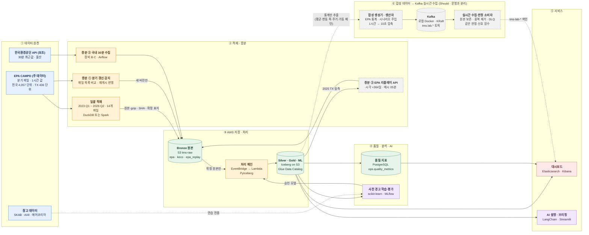

# 굴뚝 TMS 데이터 파이프라인 및 AI 사전 경고 시스템

## 프로젝트 계획서 — EPA 주 데이터 전환판 (2026-10-29)

| 항목 | 내용 |
|---|---|
| 기간 | 2026-10-28(수) ~ 2026-12-16(수), 6주 + 마감 주간(7주차) |
| 최종 발표 | 2026-12-17(목) |
| 팀 | 5명(A~E) |
| 기준 문서 | [20261028_계획서.md](20261028_계획서.md) — 이 문서에 없는 내용(일하는 방식·코드 리뷰·회의 리듬 등)은 기준 문서를 따릅니다 |
| 변경 요지 | **주 데이터를 미국 EPA 시간별 배출 자료로 바꾸고**, 한국환경공단 API는 국내 연계 가능성을 확인하는 **보조 원천**으로 둡니다. EPA는 **일괄 적재 후 API로 증분**합니다 |
| 변경 (10/29) | **합성 데이터를 생성해 Kafka로 실시간 수집하는 시나리오를 Should(P1)** 로 넣음 (11장) |

---

## 0. 무엇이 바뀌나 — 한눈에

| 구분 | 기존 계획 | 바뀐 계획 |
|---|---|---|
| 주 데이터 | 한국환경공단 굴뚝 TMS API (30분) | **EPA CAMPD 시간별 배출 자료** (Part 75, 1시간) |
| 한국환경공단 API | 모든 처리·평가의 기준 | **보조 원천**: 30분 수집은 그대로 유지. 국내 연계 시연·품질 분석용이며 평가 지표에는 넣지 않음 |
| 핵심 관제 지역 | 울산 (사업장 94개소, 배출구 약 490개) | **미국 텍사스(TX)** (시설 135곳, 배출 단위 436개). 울산은 국내 연계 화면으로 유지 |
| 이력 확보 | 10/30부터 6주 쌓기 | **2023-01 ~ 2026-06 (3년 6개월)을 1주차에 일괄 적재** |
| 증분 | 30분 API 하나 | ① EPA 분기 갱신 감지 ② 환경공단 30분 수집 ③ **EPA 리플레이 API** (시간 이동 재생) |
| 판정 기준 | 법정 허용기준 대비율 | **대리 기준 대비율** (단위별 기준 연도 NOx 배출률 상위 1% 값. 법적 기준 아님) |
| 사전 경고 | 60분 안 경고 진입 | **다음 1시간(1구간)** 안 경고 진입 (보조: 3시간 안) |
| 평가 분할 | 앞 4주 학습 / 뒤 2주 평가 | 2023~2024 학습 / 2025 검증 / **2026 상반기 평가** |
| 새 Must | — | **데이터 품질 리포트** (결측·비가동·대체값·연속성·중복·이상치·배치 신뢰성) |
| Kafka (Should) | 국내 Silver 통계 기반 합성 데이터 | **EPA Silver 통계로 합성 데이터를 생성 → Kafka로 실시간 수집 → 같은 판정 함수로 즉시 처리** (11장) |

> **한 문장으로:** 3년치 EPA 실측을 먼저 통째로 쌓아 분석·학습을 바로 시작하고, 증분은 API로 받습니다. 국내 데이터는 계속 모아 "같은 파이프라인이 국내 자료에도 붙는다"는 것을 보여 줍니다.

---

## 1. 왜 바꾸나

**문제:** 한국환경공단 API로 받은 데이터에 결측이 많습니다. 게다가 API는 최근 30분 값 하나만 주므로, 결측이 많으면 6주를 기다려도 학습·평가에 쓸 사건이 모자랄 수 있습니다. 프로젝트 전체가 데이터를 기다리며 멈출 위험이 큽니다.

**EPA로 바꾸면 얻는 것**

| 얻는 것 | 근거 (2-3절 실측 확인) |
|---|---|
| 첫 주부터 3년 이상의 이력 | 1995년부터 공개되어 있고, 분기·주(州)별 파일로 한 번에 받을 수 있음 |
| 결측이 거의 없음 | 가동 중인 시간의 값 빈칸 **0%**. 측정 실패 시간은 규정에 따라 **대체값으로 채우고 표시** |
| 측정 방식이 시간마다 표시됨 | 실측·대체·계산(LME) 표시가 행마다 붙어 있어 품질을 숫자로 분석할 수 있음 |
| 학습할 사건이 충분함 | 텍사스 436개 단위 × 3년 6개월 ≈ 1,340만 시간 |

**그래도 지키는 것**

- **국내 TMS라는 원래 주제:** 환경공단 30분 수집을 10/30부터 그대로 돌립니다. 같은 공통 형태·같은 판정 함수가 국내 자료에도 동작하는 것을 시연합니다.
- **원본 불변·멱등성·정직한 보고** 원칙은 그대로입니다.

> ⚠️ **환경공단 "결측"도 먼저 나눠 봐야 합니다.** 배출구마다 측정하는 항목이 다르므로, 빈칸 중 상당수는 "측정 대상이 아닌 항목"일 수 있습니다. 1주차에 결측을 ① 측정 대상 아님 ② 상태값(보수중·가동중지 등) ③ 진짜 미수신으로 나눠 수치로 남깁니다(EP09). 이 결과가 전환 결정의 근거 자료가 됩니다.

---

## 2. EPA 데이터 — 규모와 품질 (2026-10-29 실측 확인)

### 2-1. 무엇이 들어 있나

출처는 EPA Clean Air Markets Program Data(**CAMPD**)의 "Unit-level Hourly Part 75 emissions"입니다. 발전소 등 대형 연소 설비의 **배출 단위(unit)별 1시간 값**이 담겨 있습니다.

| 분류 | 컬럼 (원문 이름) | 비고 |
|---|---|---|
| 식별 | `State`, `Facility Name`, `Facility ID`, `Unit ID`, `unit_id`, `Associated Stacks` | `unit_id`가 단위의 고유 번호 |
| 시각 | `Date`, `Hour` (0~23) | **현지 표준시로 알려져 있음** → 1주차에 확인(EP04) |
| 가동 | `Operating Time` (0~1), `Gross Load (MW)`, `Steam Load` | 0 = 그 시간 가동 안 함, 0~1 사이 = 일부만 가동 |
| 배출 | `SO2 Mass/Rate`, `NOx Mass/Rate`, `CO2 Mass/Rate`, `Heat Input` | 단위: lbs, lbs/mmBtu, short tons |
| 측정 방식 | 항목별 `… Measure Indicator` | 실측·대체·계산 등 (2-3절) |
| 설비 정보 | `Primary/Secondary Fuel Type`, `Unit Type`, 방지시설(`SO2/NOx/PM/Hg Controls`), `Program Code` | |

### 2-2. 규모

EPA 공개 목록(`camd-services/bulk-files`)을 받아 집계했습니다.

| 범위 | 파일 | CSV 크기 | 행 수 (추정) |
|---|---|---|---|
| 전국 전체 이력 (1995 ~ 2026 Q2) | 분기 파일 126개 | **229 GB** | 약 10억 행 |
| 전국 1년 (2025) | 분기 파일 4개 (각 1.8~2.0 GB) | **7.5 GB** | 약 3,550만 행 (4,057 단위 × 8,760시간) |
| **일괄 적재 대상: 전국 2023-01 ~ 2026-06** | 분기 파일 14개 | 약 26 GB | 약 1.2억 행 |
| **핵심 관제: 텍사스 2023-01 ~ 2026-06** | 주(州)별 파일에서 추출 | 약 2.9 GB | 약 1,340만 행 |
| 표본 분석: 콜로라도 2025 | `emissions-hourly-2025-co.csv` | 140 MB | 626,448 행 (실측) |

| 2025 시설 현황 (`facility-2025.csv`) | 값 |
|---|---|
| 전국 시설 / 배출 단위 | **1,331곳 / 4,057개** |
| 단위가 많은 주 | TX 436 · CA 245 · NY 235 · FL 206 · IL 204 · PA 171 |
| 주 연료 (단위 수) | 천연가스 3,056 · 석탄 408 · 경유 266 |
| 시설 분류 | 발전(Electric Utility) 3,564 · 열병합 277 · 산업용 보일러 116 · 정유 38 |
| 좌표 빈칸 | 0건 (지도 화면에 바로 사용 가능) |

**압축하면 매우 작아집니다** (콜로라도 2025 표본 기준): CSV 140 MB → gzip 6.3 MB(약 22배) → Parquet(zstd) 4 MB(약 35배). 비가동 시간의 빈칸이 많아 압축이 잘 됩니다. 그래서 일괄 적재 대상 26 GB는 **Bronze gzip 약 1.2 GB, Silver Parquet 약 1 GB 안팎(추정)** 이 됩니다.

**게시 주기:** 사업자는 분기가 끝난 뒤 **30일 안에** 분기 보고서를 제출합니다(40 CFR 75.64). EPA는 이를 분기 파일로 게시합니다. 따라서 EPA 증분은 **분기 단위**입니다. 목록상 2024 Q3 ~ 2026 Q2 파일이 2026-10-27~28에 다시 게시되었습니다. 즉 **과거 분기도 다시 바뀔 수 있습니다**(재제출·정정).

### 2-3. 품질 분석 결과 — 콜로라도 2025 표본 (23개 시설, 76개 단위)

| 분석 항목 | 결과 | 해석 |
|---|---|---|
| 값 빈칸 비율 (전체 행) | 배출·부하 7개 컬럼 모두 **58.3%** | 빈칸이 절반을 넘지만… |
| 값 빈칸 비율 (가동 중인 행) | **0.0%** | 가동 중에는 빈칸이 하나도 없음 |
| 값 빈칸 비율 (비가동 행) | **100%** | **빈칸 = 그 시간 가동 안 함**. 결측이 아님 |
| 가동 시간 분포 | 가동 41.7% · 비가동 58.3% · 일부 가동 1.8% | 가스터빈(첨두부하용)은 대부분 꺼져 있음 |
| `Operating Time` 자체 빈칸 | 384행 | 격리 대상 |
| 시간 연속성 | 76개 단위 중 **끊긴 구간 0건**. 70개는 8,760시간 모두 있음 | 나머지 6개는 연중 신규 가동(최소 2,208시간) |
| 중복 (`unit_id` + 시각) | **0건** | |
| 측정 방식 (가동 중, NOx 배출률) | 실측 99.0% · 대체 0.85% · 계산 0.11% | 대체값은 적지만 **반드시 구분** |
| 측정 방식 표기 | 같은 뜻에 표기가 두 가지: `Measured`/`MEASURE`, `Substitute`/`SUB`, `Measured and Substitute`/`MEASSUB` | **정규화 필요** (6-1절) |
| 음수 | 0건 | |
| 가동 중인데 값이 0 | SO2 배출률 1,709건, 부하 3,178건 | 천연가스 단위는 SO2가 0일 수 있음 → 연료별 판단 |
| 직전 시간 대비 NOx 배출률 2배 이상 | 5,535건 / 260,963쌍 (2.1%) | 시동·정지 구간 영향으로 추정 → 신호 규칙에서 분리(EP07) |
| 한 해 동안 가동 0시간인 단위 | 1개 | 판정 대상에서 제외 |

> **핵심 발견:** EPA의 빈칸은 대부분 "결측"이 아니라 **"비가동"** 입니다. 빈칸을 결측으로 세면 결측률이 58%로 부풀고, 0으로 바꾸면 배출 통계가 왜곡됩니다. 품질 분석의 핵심은 빈칸 비율이 아니라 **가동 상태·측정 방식별 분포**입니다.

이 분석은 콜로라도 한 주의 1년치입니다. 전국·텍사스 수치는 1주차 품질 프로파일링(EP03)에서 같은 방법으로 다시 계산합니다.

### 2-4. 국내 TMS와 다른 점 — 설계에 미치는 영향

| 다른 점 | 국내 TMS (환경공단) | EPA CAMPD | 설계 대응 |
|---|---|---|---|
| 시간 간격 | 30분 | **1시간** | 공통 형태의 `interval_minutes`로 구분. 신호 규칙은 간격별 설정(`rules.yaml` 프로필) |
| 값의 종류 | 농도 (ppm, mg/m³) | **배출량·배출률** (lbs, lbs/mmBtu) | 단위를 `unit_of_measure`로 함께 저장. 국내 값과 숫자를 직접 비교하지 않음 |
| 허용기준 | 응답에 포함 | **없음** | **대리 기준**을 만들어 버전 관리 (7-1절) |
| 결측 처리 | 상태값 글자(`보수중`, `미수신`) | 규정 절차로 **대체값을 채우고 표시** | 상태 구분 체계를 하나로 통일 (6-1절) |
| 게시 주기 | 30분마다 최근값 | **분기마다** + 과거 정정 | 증분 ①은 분기 감지, 실시간 연습은 리플레이(증분 ③) |
| 시각 | KST | 현지 표준시(추정), TX는 대부분 중부 시간대 | 시간대 붙여 저장. 날짜 계산 규칙은 지역별 현지 시각 + UTC 보관 |
| 다시 받기 | **불가** (지난 값 안 줌) | **가능** (언제든 다시 내려받음) | 국내 수집은 계속 "놓치면 끝" 원칙. EPA는 재수집 가능하지만 Bronze 원본은 그대로 보존 |

---

## 3. 받은 제안(품질 분석안) 검토

"결측치와 데이터 품질을 어떻게 분석할까"의 제안을 실측 결과와 대조했습니다.

| 제안 | 판단 | 실측 근거 · 보완 |
|---|---|---|
| EPA를 써도 결측 문제는 자동 해결되지 않는다 | **부분 동의** | 가동 중 빈칸은 0%라 "결측"은 거의 없습니다. 대신 **대체값(약 1%)** 과 **비가동 빈칸(58%)** 을 올바르게 구분하는 것이 과제입니다 |
| 품질 코드로 실측·계산·대체를 구분 | **동의 + 보완** | 표기가 두 가지로 섞여 있어(`Measured`/`MEASURE` 등) **정규화 사전**이 먼저 필요합니다 |
| 결측률: 컬럼별 NULL 비율 | **보완** | 전체 NULL 비율만 보면 58%로 오해합니다. **가동 행 / 비가동 행으로 나눈 NULL 비율**을 지표로 씁니다 |
| 시간 연속성: 설비별 간격·누락 시간 | **동의** | EPA는 끊긴 구간이 거의 없으므로 **신규 가동·퇴역 경계**를 함께 봅니다. 국내 자료에서는 이 지표가 핵심입니다 |
| 중복: 설비 ID + 측정 시각 | **동의** | 표본에서는 0건입니다. 다만 **분기 재게시 때 같은 키가 다시 들어오므로** 증분 적재의 핵심 시험 항목입니다 |
| 이상치: 음수·급등·범위 초과 | **동의 + 보완** | 음수 0건. 급등 2.1% 중 상당수는 시동·정지로 추정 → **가동 시간 조건을 붙여** 판단합니다 |
| 설비 가동 상태: 가동 시간과 배출량 비교 | **동의** | 일부 가동(1.8%)·가동 중 0값은 연료별로 정상일 수 있어 규칙으로 정리합니다 |
| 배치 신뢰성: 수집 건수·재시도·중복 적재 | **동의** | 일괄 적재·분기 증분·리플레이·국내 수집 **네 경로 모두** 같은 실행 기록 표에 남깁니다 |
| 결측·설비 정지·측정 실패는 서로 다른 상태 | **강하게 동의** | 실측으로 확인했습니다. 6-1절의 **상태 구분 6종**으로 고정합니다 |
| NULL을 0으로 바꾸지 않는다 | **강하게 동의** | 12장 규칙 9로 추가합니다 |
| 시뮬레이션·실제 데이터 구분 비율 | **동의** | 모든 행에 `data_origin`을 붙이고 비율을 대시보드에 표시합니다 |
| 지표를 PostgreSQL에 저장하고 Kibana로 시각화 | **동의 + 보완** | PostgreSQL `ops.quality_metrics`에 저장하고 ES `tms-quality-*`로 색인합니다. **어느 Iceberg 스냅샷으로 계산했는지**도 함께 저장해 재현할 수 있게 합니다 |
| (근거 출처) data.catalyst.coop | **참고만** | Catalyst Cooperative(PUDL)가 정리한 EPA CEMS 사본입니다. 우리 Bronze는 **EPA 원본 파일**에서 받습니다. PUDL은 결과 대조용 대안으로만 둡니다 |

---

## 4. 데이터 구성 — 원천별 역할

| 구분 | 데이터 | `data_origin` | 용도 | 평가에 쓰나 |
|---|---|---|---|---|
| **① 주 데이터** | EPA CAMPD 시간별 배출 (TX 핵심, 전국 집계) | `epa_observed` | 모든 판정·학습·평가의 기준 | ✅ |
| | EPA 시설 정보(`facility-YYYY.csv`), 판정 규칙·데이터 사전 문서 | — | 보완 정보, AI 설명 근거 | ✅(보조) |
| **② 보조 원천** | 한국환경공단 굴뚝 TMS API (30분, 울산) | `keco_observed` | 국내 연계 시연, 품질 분석, 공통 형태 검증 | ❌ (화면·품질 보고만) |
| **③ 시뮬레이션** | **EPA 리플레이** (EPA 값을 시각만 옮겨 재생, Must) | `epa_replay` | 시간 단위 증분 수집·처리·대시보드 신선도 연습 | ❌ |
| | **합성 데이터** (EPA 통계로 새로 생성, **Kafka 실시간 수집용, Should**) | `synthetic` | 스트림 수집·실시간 처리 연습, 드문 경고 시나리오 재현 | ❌ |
| **④ 우리가 만드는 것** | 이상 주입 자료, 사전 경고 정답(자동 계산), 검수 표본 | `injected` | 규칙·모델 검증 | ✅(검증용) |
| **⑤ 참고** | SKAB, AI4I, 에어코리아, 기상(ASOS) | `reference` | 외부 검증 연습, 겹쳐 보기 | ❌ |

- 리플레이 값은 EPA 실측과 숫자가 같으므로 **평가에 두 번 들어가지 않게** 운영 평가 테이블에서 반드시 빼고, 별도 Bronze 경로(`tms-raw/epa_replay/`)와 별도 테이블에 둡니다.
- 합성 데이터는 Kafka 토픽과 연습 공간(MinIO `lab/`, S3 `sandbox/`, Glue `tms_lab`, ES `tms-lab-*`)에만 있습니다. **운영 Bronze·Silver·Gold에는 들어가지 않습니다.**
- 대시보드에는 원천별 비율(`epa_observed` · `epa_replay` · `keco_observed` · `synthetic`)을 항상 표시합니다.

---

## 5. 적재 설계 — 일괄 적재 + 증분 3종

### 5-1. 일괄 적재 (Backfill, 1~2주차, Must)

| 항목 | 내용 |
|---|---|
| 범위 | 전국 분기 파일 **2023 Q1 ~ 2026 Q2 (14개)**. 텍사스는 여기서 추출 |
| 받는 곳 | `https://api.epa.gov/easey/bulk-files/emissions/hourly/quarter/emissions-hourly-YYYY-qN.csv` (목록: `camd-services/bulk-files`) |
| Bronze | 원본 CSV를 **그대로 gzip**하여 `s3://tms-raw/epa/hourly/quarter/YYYY-qN/<lastUpdated>/`에 저장. 원본 SHA-256, 목록의 `bytes`·`lastUpdated`를 매니페스트에 기록 → 검증 통과 시 `_SUCCESS` |
| 처리 엔진 | 2 GB 파일을 Lambda로 처리하지 않습니다(시간·메모리 한계). **로컬 DuckDB 또는 Spark**(G1 결과에 따라 Glue Job)로 Silver 적재 |
| 행 수 보존 | 파일별로 `원본 행 수 = Silver 적재 행 수 + 격리 행 수`가 맞아야 확정 |
| 이력 범위를 이렇게 정한 이유 | 학습(2년)·검증(1년)·평가(반년)에 충분하고, 저장 비용이 월 $1 목표 안에 들어갑니다. 1995년부터의 전체(229 GB)는 받지 않습니다 |

### 5-2. 증분 ① — EPA 분기 갱신 감지 (Must)

```text
매일 06:00 KST  Airflow DAG `epa_bulk_watch`
  ① bulk-files 목록 받기 → 직전 목록과 비교 (filename · bytes · lastUpdated)
  ② 새 분기 파일 또는 재게시 파일만 내려받기
  ③ Bronze 새 버전 경로에 저장 (이전 버전은 지우지 않음) → SHA 검증 → _SUCCESS
  ④ Silver MERGE: 키 (unit_id, 시각), 값이 바뀐 행만 갱신하고 source_version 기록
  ⑤ 차이 보고서: 추가·변경·삭제 행 수, 바뀐 단위 목록 → 판정·경고는 바뀐 구간만 재계산
```

- **같은 파일이 두 번 들어와도 결과가 같아야 합니다**(멱등성). 바뀐 행이 0건이면 아무것도 커밋하지 않습니다.
- 분기 보고 기한(분기 종료 후 30일)을 보면, 2026 Q3 파일이 프로젝트 기간에 게시될 가능성이 있습니다. 게시되면 **"새 분기 증분 → 재평가"** 를 실제로 시연합니다. 게시되지 않으면 재게시 감지 시험으로 대신합니다.
- 특정 단위·기간만 다시 받아야 할 때는 Emissions API(`emissions-mgmt`, 시간당 1,000회·페이지당 500행)나 Streaming API를 씁니다. 이 경우 api.data.gov 키가 필요합니다.

### 5-3. 증분 ② — 한국환경공단 30분 수집 (Must, 보조 원천)

기존 계획의 수집 설계(장비 B·C 이중화, MinIO → S3, 확정 표지, Airflow 전환, 선택 Lambda T58)를 **그대로 유지**합니다. 이 데이터는 지난 값을 다시 받을 수 없으므로 **10/30 수집 시작**과 누락률 1% 이하 목표도 그대로입니다. 바뀌는 것은 용도뿐입니다.

- 평가 지표에 넣지 않고, **국내 연계 시연**(울산 화면)과 **품질 리포트**(결측 원인 3분류)에 씁니다.
- 공통 형태로 변환해 EPA와 **같은 판정 함수**가 돌아가는지 확인합니다(허용기준이 응답에 있으므로 국내는 법정 기준 대비율).

### 5-4. 증분 ③ — EPA 리플레이 API (Must, 시뮬레이션)

"EPA 데이터를 조금 변형해서 API로 증분"하는 부분입니다. EPA는 분기마다 게시되므로 실시간 증분이 없습니다. 그래서 과거 EPA 값을 **현재 시각으로 옮겨** 매시 내주는 연습용 API를 만듭니다.

| 항목 | 내용 |
|---|---|
| 구현 | 로컬 Docker의 작은 HTTP 서비스(FastAPI). `GET /hourly?state=TX&hour=2026-11-12T14:00` |
| 원본 | **평가 구간이 아닌** 2025년 TX 실측 (Silver에서 읽음) |
| 변형 | 시각만 **+364일**(52주) 이동해 요일 패턴 유지. 값은 바꾸지 않음. 응답에 `data_origin = "epa_replay"`, `source_ts`(원래 시각) 포함 |
| 수집 | Airflow DAG `epa_replay_collect`가 **매시 05분** 호출 → Bronze `tms-raw/epa_replay/` → 확정 표지 → 처리 체인 |
| 장애 연습 | API에 지연·오류·빈 응답·중복 응답을 일부러 섞는 옵션 → 재시도·누락 감시가 실제로 동작하는지 시험 |
| 쓰는 곳 | 대시보드 "마지막 갱신 시각"·신선도, 처리 체인 운영, Kafka 생산자(11장) |

> 리플레이는 **연습용**입니다. 화면에는 "리플레이 · 연습용" 표시를 붙이고, 평가·성능 수치에 넣지 않습니다.

### 5-5. "변형"의 범위 — 해도 되는 것과 안 되는 것

| 구분 | 해도 됨 | 하면 안 됨 |
|---|---|---|
| Bronze | 원본 그대로 gzip 압축 | 컬럼 이름 변경, 행 삭제, 값 수정 |
| Silver | 컬럼 이름을 공통 형태로 바꾸기, 단위·시간대 붙이기, 측정 방식 표기 정규화, 상태 구분 부여 | **NULL을 0으로 바꾸기**, 대체값을 실측으로 표시 |
| 리플레이 | 시각 이동, 장애 패턴 주입(표시 포함) | 값 바꾸기, 리플레이를 실측으로 표시 |
| 이상 주입 | Silver **복사본**에만 | 운영 테이블에 주입 |

### 5-6. 큰 그림 — 바뀐 흐름도

- **실선**: 운영 경로(Must) / **점선**: 선택·조건부 / **회색**: 시뮬레이션·Kafka(운영 평가와 분리)



### 5-7. 저장 용량·비용 (추정)

| 저장소 | 내용 | 크기 | 월 비용 (S3 Standard) |
|---|---|---|---|
| Bronze EPA | 분기 파일 14개 gzip (+ 재게시 버전) | 약 1.2 ~ 2 GB | 약 $0.03 ~ 0.05 |
| Silver·Gold EPA | Iceberg Parquet (전국) | 약 1 ~ 2 GB | 약 $0.03 ~ 0.05 |
| Bronze 국내 | 30분 응답 × 7주 (약 1.8 MB × 48 × 50일, gzip) | 1 GB 미만 | $0.02 미만 |
| 리플레이 | TX 시간별 응답 | 수백 MB | $0.01 미만 |

압축 배율은 콜로라도 표본 기준입니다. 전국 파일에서 1주차에 다시 확인합니다(EP02). 다운로드는 EPA → 팀 PC → S3로 올리므로 AWS 쪽 데이터 반입 비용은 없습니다.

---

## 6. 데이터 품질 분석 (Must)

### 6-1. 상태 구분 — 하나의 체계로 통일

| `record_state` | 뜻 | EPA에서 | 국내에서 | 판정 | 학습 |
|---|---|---|---|---|---|
| `measured` | 실측 | `Measured`, `MEASURE` | 정상 측정값 | ✅ | ✅ |
| `substituted` | 측정 실패 → 규정에 따라 대체 | `Substitute`, `SUB`, `Measured and Substitute`, `MEASSUB` | — | ✅ (표시) | ❌ (기본 제외, 보조 실험만) |
| `calculated` | 측정기 대신 계산식 | `Calculated`, `LME` | — | ✅ (표시) | 설정으로 결정 |
| `not_operating` | 설비 정지 | `Operating Time = 0` | `가동중지` | ⚪ 판정 제외 | ❌ |
| `maintenance` | 측정기 점검 | — | `보수중` | ⚪ 판정 제외 | ❌ |
| `missing` | 와야 할 값이 안 옴 | 가동 중 빈칸, 시간 행 누락 | `미수신`, 수집 실패 구간 | ⚪ 판정 제외 | ❌ |
| `not_applicable` | 그 항목을 측정하지 않음 | 연료상 해당 없음 | 측정 대상 아닌 항목 | 대상 아님 | — |

- 정규화 사전은 `config/record_state.yaml`에 두고 버전을 관리합니다. **처음 보는 표기는 격리**하고 보고합니다.
- **NULL은 절대 0으로 바꾸지 않습니다.** 비가동 시간의 배출량을 0으로 집계하는 것은 `not_operating` 상태를 확인한 뒤 집계 규칙에서만 합니다.

### 6-2. 품질 지표

| 분석 항목 | 계산 방법 | 결과물 | 원천 |
|---|---|---|---|
| 결측률 | 컬럼별 NULL 비율을 **가동 / 비가동 / 전체**로 나눠 계산 | 품질 리포트 | 전체 |
| 시간 연속성 | 단위별 기대 시간 수 대비 실제 행 수, 끊긴 구간, 신규 가동·퇴역 경계 | 누락 구간 목록 | 전체 |
| 중복 | (단위 ID, 시각) 기준 중복 행. 분기 재게시 때 다시 들어온 행 | 중복 레코드·처리 결과 | 전체 |
| 측정 상태 | `record_state`별 건수·비율, 단위별 대체값 비율 상위 목록 | 측정 상태 분포 | 전체 |
| 이상치 | 음수, 범위 초과(설비 최대 열 입력 대비), 가동 조건부 급등 | 이상치 목록 | 전체 |
| 설비 가동 상태 | 가동 시간 vs 부하·열 입력·배출량 일관성 (예: 비가동인데 값 있음) | 가동·정지 구간 분석 | EPA |
| 배치 신뢰성 | 경로별 실행 횟수·성공·재시도·중복 적재·처리 시간 | 배치 실행 이력 | 4개 경로 |
| 정제 전후 | 원본 행 수 → Silver 적재 + 격리 행 수, 품질 지표 변화 | 행 수 보존 표 | 전체 |
| 원천 구분 비율 | `data_origin`별 행 수·비율 | 원천 비율 | 전체 |
| 국내 결측 원인 | 빈칸을 측정 대상 아님 / 상태값 / 미수신으로 분류 | 국내 결측 분해표 | 국내 |

### 6-3. 저장과 화면

```text
처리 체인 · 일괄 적재 · 분기 증분
   └─► 품질 계산 (DuckDB/Spark, Iceberg 스냅샷 ID 기록)
         └─► PostgreSQL ops.quality_metrics (지표, 계산 시각, 스냅샷 ID, 규칙 버전)
               └─► Elasticsearch tms-quality-* ─► Kibana "데이터 품질" 화면
```

- 지표 한 행: `metric_name`, `data_origin`, `scope`(전국/TX/단위), `period`, `value`, `snapshot_id`, `rule_version`, `computed_at`
- 대시보드 10요소 중 **2개를 품질 화면에 배정**합니다: 측정 상태 분포, 경로별 배치 실행 이력

---

## 7. 판정 · 이상 신호 · 사전 경고 — 바뀌는 부분

### 7-1. 대리 기준 대비율

EPA 자료에는 시간별 허용기준이 없습니다. 그래서 **단위마다 대리 기준**을 만듭니다.

```text
대리 기준(단위 u, 항목 p) = 기준 연도(2023)의 가동 중 · 실측(measured) 시간 값의 상위 1% 값 (P99)
대리 기준 대비율(%)      = 현재 값 ÷ 대리 기준 × 100
```

| 결정 | 내용 | 이유 |
|---|---|---|
| 주 항목 | **NOx 배출률(lbs/mmBtu)** — 모든 단위에 있음 | 연료·부하가 달라도 비교 가능한 "배출률" |
| 보조 항목 | SO2 배출률 (석탄·중유 단위만) | 천연가스 단위는 SO2가 0에 가까워 의미 없음 |
| 기준 연도 | 2023년 (학습 구간 안) | 평가 구간 정보가 기준에 섞이지 않게(누수 방지) |
| 단계 | 정상 < 80% ≤ 주의 < 90% ≤ 경고 < 100% ≤ 초과 (기존과 같음) | 기존 판정 함수를 그대로 씀 |
| 표시 | 모든 화면·문서에 **"대리 기준 · 법적 기준 아님"** | 법적 위반 판단을 하지 않는다는 원칙 유지 |
| 제외 | 2023년 가동 시간이 500시간 미만인 단위 | 기준을 만들 표본이 부족 |
| 버린 대안 | 단위별 법정 배출 한도(NSPS 등) 적용 | 단위마다 규정·계산 방식이 달라 7주 안에 검증할 수 없음 |

`rules.yaml`에 `profile: epa_hourly`(대리 기준·1시간 간격)와 `profile: keco_30min`(법정 기준·30분 간격)을 따로 둡니다.

### 7-2. 이상 신호 4종

신호 4종(`MARGIN_ALERT`, `TREND_RISE`, `RATE_SPIKE`, `VOLATILITY_SURGE`)은 그대로 둡니다. 바뀌는 점은 다음과 같습니다.

- **시동·정지 구간 분리:** 직전 시간이 비가동이거나 일부 가동(`0 < Operating Time < 1`)이면 `RATE_SPIKE`를 내지 않고 `STARTUP_TRANSIENT`로 따로 기록합니다.
- **1시간 간격 기준으로 재조정:** "4회 연속 상승"은 4시간이 됩니다. 문턱값은 2023~2024 자료로 정하고 2025 자료로 확인합니다.
- **대체값 구간 표시:** 신호가 `substituted` 값에서 나왔으면 화면에 표시합니다.

### 7-3. AI 사전 경고

| 항목 | 기존 | 바뀐 계획 |
|---|---|---|
| 질문 | 60분 안에 경고(90%) 진입? | **다음 1시간 값이 경고(90%)에 새로 진입?** (보조: 3시간 안) |
| 대상 | 울산 배출구 | **TX 436개 단위** (전국은 보조 실험) |
| 분할 | 앞 4주 / 뒤 2주 | **학습 2023-01~2024-12 / 검증 2025 / 평가 2026-01~06**. 경계마다 3시간 엠바고 |
| 피처 | 최근 기준대비율·변화율·기울기·표준편차·시각·요일·가동 재개 후 경과 | 기존 + **부하(MW)·열 입력·연료·방지시설·월(계절)** |
| 제외 | 이미 경고 중, 정답 없음 | 기존 + 비가동·대체값 시점 |
| 모델 | 규칙(기울기 연장) vs 로지스틱 회귀, (여유 시) Random Forest | **같음** |
| 추가 평가 | — | 2026 Q3 파일이 게시되면 **증분 데이터로 재평가** (모델은 다시 학습하지 않음) |

- 사건이 부족할 위험이 크게 줄었습니다. 평가 구간만 해도 TX 436개 단위 × 약 4,300시간입니다.
- 기존의 "EPA는 5주차에 사용 종료" 규칙은 **없앱니다.** EPA가 주 데이터이기 때문입니다.

---

## 8. 최종 발표(12/17)에서 보여 줄 것

### 8-1. 시연 7장면 (1~6 Must · 7 Should)

| # | 장면 | 무엇을 보여 주나 | 주로 준비 |
|---|---|---|---|
| 1 | **관제 대시보드** | TX 단위별 대리 기준 대비율·단계, 리플레이 마지막 갱신 시각, **울산 국내 연계 화면**(같은 판정 함수) | D (B·E) |
| 2 | **데이터 품질 리포트** | 가동/비가동 결측률, 측정 상태 분포, 경로별 배치 이력, 원천 비율, 국내 결측 분해 | C·D |
| 3 | **사전 경고 목록** | 다음 1시간 안 경고 진입 예상 단위, 추세·신호·예측 | E (D) |
| 4 | **AI 브리핑(RAG)** | 수치와 출처(규칙 명세서, 데이터 기준 시각, 대리 기준 버전) | D |
| 5 | **계보·증분 추적** | 경고 1건 → Gold → Silver → Bronze → **EPA 분기 파일의 원문 행**. 재게시로 바뀐 행의 이전·이후 버전 비교 | C (A·B) |
| 6 | **정직한 평가표** | 규칙 vs 로지스틱 회귀: 재현율·정밀도·평균 선행 시간 (2026 상반기, 가능하면 Q3 재평가) | E |
| 7 | **합성 스트림 실시간 수집·판정** (Should) | 합성 생성기가 10초마다 보내는 값을 Kafka로 받아 "합성 · 연습용" 화면에 판정·신호가 바로 뜸. 소비자를 껐다 켜거나 같은 메시지를 다시 넣어도 결과가 같음 | B (C·E·D) |

### 8-2. 성공 기준

| 영역 | 성공 기준 |
|---|---|
| 일괄 적재 | 분기 파일 14개 **100% Bronze 확정**, 파일마다 원본 행 수 = 적재 + 격리 |
| 분기 증분 | 재게시 파일을 감지해 바뀐 행만 반영, **같은 파일을 두 번 넣어도 결과 같음** |
| 리플레이 증분 | 운영 시작 후 시간 단위 누락률 **1% 이하**, 장애 주입 시 재시도·누락 감시 동작 |
| 국내 수집 | 누락률 **1% 이하** 유지, 결측 원인 3분류 보고 |
| 표준화 | 측정 방식 표기 100% 정규화(처음 보는 표기는 격리·보고), NULL→0 변환 0건 |
| 판정 | 계산 오차 0, 같은 입력·같은 규칙 버전이면 항상 같은 판정 |
| 이상 신호 | 심어 둔 이상 4종을 **90% 이상** 찾아냄 (시동·정지 구간 제외 규칙 포함) |
| 사전 경고 | 2026 상반기 TX 기준 **규칙 vs ML 비교표**를 대시보드에 표시 |
| 품질 리포트 | 6-2절 지표 10종을 화면에 표시, 각 지표에 스냅샷 ID 기록 |
| 재현성 | 같은 스냅샷·같은 규칙 버전으로 다시 돌리면 같은 결과, 실험은 MLflow에 기록 |
| AI 설명 | 질문 10개 모두 근거 표시, 대리 기준임을 답변에 밝힘 |
| 개발 품질 | 핵심 로직 테스트 커버리지 80% 이상 |
| Kafka 실시간 수집 (Should) | ① 합성 시나리오 8종의 기대 결과를 소비자가 **모두** 맞힘 ② 같은 합성 시퀀스를 배치 함수로 돌린 결과와 스트림 결과가 **일치** ③ 소비자 재시작·중복 주입 뒤에도 결과 같음, 잘못된 메시지는 DLQ로 감 ④ 받은 메시지 = 보존 원본 + DLQ (수집 건수 보존) |

**하지 않는 것:** 법적 위반 판단, 특정 사업장을 오염 원인으로 단정하기, 실제 알림 발송, **미국 자료와 국내 자료의 수치 직접 비교**(단위·측정 방식이 다름), 1995년부터의 전체 이력 적재.

---

## 9. 팀원별 역할 (R&R) — 바뀐 부분

| 담당 | 역할 | 기존 업무에서 바뀌는 것 |
|---|---|---|
| **A** 플랫폼·AWS·통합 | 모두가 같은 환경에서 끊김 없이 돌게 | **+ EPA 리플레이 API**(EP06), 일괄 적재 실행 환경(DuckDB/Spark/Glue 결정), 버전별 Bronze 경로 정책 |
| **B** 수집·Bronze | 들어오는 모든 원본을 빠짐없이, 검증해서 | **+ EPA 일괄 다운로드·Bronze 확정**(EP01), **분기 갱신 감지 DAG**(EP05), 리플레이 수집 DAG. 국내 30분 수집은 그대로. Kafka 주담당 그대로 |
| **C** 계약·Silver·Iceberg | 모두가 같은 약속으로 읽고 쓰게 | **+ EPA 필드 사전·측정 방식 정규화**(EP04), Silver MERGE(재게시 반영), 행 수 보존 검증, **Kafka 합성용 통계 추출**(EPA Silver 2023~2024 TX, K2 지원). 장비 C 수집 운영 그대로 |
| **D** 분석·화면·RAG | 결과를 보이게, 설명되게 | **+ 품질 프로파일링**(EP03), **품질 리포트 화면**(EP08), TX 지도·단위 화면. RAG 근거에 EPA 문서·대리 기준 명세 추가 |
| **E** 판정·AI·MLOps | 규칙과 모델을 같은 조건에서 정직하게 | **+ 대리 기준 설계**(EP07), `epa_hourly` 규칙 프로필, 시동·정지 분리 규칙, 1시간 예측 피처·라벨 |

**새 Task 목록 (EP = EPA 전환)** — 기존 T 번호는 [실행일정표](TMS_Task별_사람별_실행일정표.md)를 따르고, 아래는 새로 추가합니다.

| ID | 할 일 | 담당 (지원) | 기한 | 등급 | 완료 증거 |
|---|---|---|---|---|---|
| EP01 | EPA 분기 파일 14개 다운로드 → Bronze gzip·SHA·매니페스트·확정 표지 | B (A) | 11/3 | Must | 객체 목록, 매니페스트, 행 수 |
| EP02 | 압축 배율·Parquet 크기·비용 재계산 | A (B) | 11/3 | Must | 비용표 |
| EP03 | 전국·TX 품질 프로파일링 (2-3절 항목 전부) | D (C) | 11/6 | Must | 품질 보고서 v0 |
| EP04 | EPA 필드 사전, 측정 방식 정규화 사전, 시간대 확인 | C (E) | 11/10 | Must | `record_state.yaml`, 데이터 사전 |
| EP05 | 분기 갱신 감지 DAG (`epa_bulk_watch`) + 재게시 반영 MERGE | B (C) | 11/17 | Must | 같은 파일 2회 투입 시험, 차이 보고서 |
| EP06 | EPA 리플레이 API + 수집 DAG + 장애 주입 옵션 | A (B) | 11/14 | Must | API 응답 샘플, 장애 주입 시험 로그 |
| EP07 | 대리 기준(P99) 설계, `epa_hourly` 프로필, 시동·정지 분리 규칙 | E (D) | 11/17 | Must | `rules.yaml`, 대리 기준 명세서 |
| EP08 | 품질 지표 저장(`ops.quality_metrics`) + Kibana 품질 화면 | D (C) | 12/1 | Must | 화면 캡처, 지표 10종 |
| EP09 | 국내 결측 원인 3분류 (측정 대상 아님 / 상태값 / 미수신) | C (B) | 11/6 | Must | 국내 결측 분해표 |
| EP10 | EPA·국내 공통 형태 v1 (기존 T79 확장) | C (전원) | 11/17 | Must | 공통 형태 명세, 양쪽 fixture 테스트 |
| EP11 | 전국 Silver 적재 (TX 외) | C (A) | 12/1 | Should | 행 수 보존 표 |
| EP12 | 2026 Q3 증분 재평가 (게시된 경우) | E (B) | 12/14 | Should | 재평가표, 또는 미게시 기록 |

---

## 10. 일정

### 10-1. 관문

```text
1주(10/28~11/3) ─► 2주(11/4~11/10) ─► 3주(11/11~11/17) ─► 4주(11/18~11/24) ─► 5주(11/25~12/1) ─► 6주(12/2~12/8) ─► 7주(12/9~12/16)
 EPA 일괄 적재       G1 기술 결정       G2 데이터 계약      G3 핵심 흐름        품질 화면·피처      MVP 시연(12/8)     최종 평가·동결
 국내 수집(10/30)    리플레이 PoC       리플레이 운영 시작   TX 3.5년 판정       Kafka K1·K2         Kafka K3           Kafka K4·K5 ─► 12/17
```

| 주차 | 이름 | 관문 / 마감 | 끝나면 손에 쥐는 것 |
|---|---|---|---|
| 1 | **쌓기 시작** | 10/30 국내 수집 ON, **11/3 EPA Bronze 확정** | EPA 3.5년 원본, 국내 수집 기록, 품질 첫 수치 |
| 2 | **검증·결정** | **G1** (11/6 중간, 11/10 최종) | 적재 엔진 결정, 리플레이 PoC, 품질 보고서 v0, 국내 결측 분해 |
| 3 | **약속 정하기** | **G2** (11/17) | 공통 형태 v1, 정규화 사전, 대리 기준·`rules.yaml`, 분기 감지 DAG, **리플레이 운영 시작** |
| 4 | **연결하기** | **G3** (11/24) | TX 3.5년 Bronze → Silver → Gold 판정, 리플레이가 처리 체인을 통과 |
| 5 | **완성하기** | 12/1 대시보드·품질 화면 중간본 | 피처·라벨, 신호 검증, 전국 Silver(Should), Kafka K1·K2 |
| 6 | **모델 학습** | **12/8 MVP** | 적재 → 판정 → 경고 → 대시보드 → 브리핑 일괄 시연, Kafka K3 |
| 7 | **평가·마무리** | 12/16 동결·리허설 | 평가표(2026 상반기 + 가능하면 Q3), 재현 시험, 런북, Kafka K4·K5 |

### 10-2. 주차 × 사람

| 주차 | A 플랫폼 | B 수집 | C 계약·Silver | D 분석·화면 | E 판정·AI |
|---|---|---|---|---|---|
| **1** | 저장소·로컬 서비스·AWS 확인, **용량·비용 재계산(EP02)** | **EPA 일괄 다운로드·Bronze(EP01)**, **10/30 국내 수집 시작** | 장비 C 수집, EPA 필드 확인 | **품질 프로파일링 착수(EP03)** | 판정 단계 후보, 대리 기준 후보 분석 |
| **2** | 처리 체인 PoC, 적재 엔진 PoC, **리플레이 API PoC**, **G1** | S3 업로드·확정 표지(국내), 첫 누락률 | **국내 결측 분해(EP09)**, 정규화 사전 초안 | 품질 보고서 v0, Athena, 화면 설계 | 규칙 명세서 초안(대리 기준 포함) |
| **3** | **리플레이 운영(EP06)**, AWS 초기화·`tms_lab` | Airflow 초안, **분기 감지 DAG(EP05)** | **공통 형태 v1(EP10)**, 계약 v1, Iceberg 설계, **G2** | 공통 형태 합의, 레이아웃 | **`rules.yaml`·대리 기준 확정(EP07)** |
| **4** | 처리 체인 운영 배포, **G3** | Airflow 전환(국내·리플레이) | **TX 3.5년 Silver 적재**, 재처리 | 경고 사건 수(TX), 학습 가능성 | 판정 구현, 신호 시험(시동·정지 분리) |
| **5** | 비용 점검, **Kafka K1** | 누락률 유지, **Kafka K2 합성 생성기·생산자** | 스냅샷 검증, **합성용 통계**, 전국 Silver(Should, EP11) | **품질 화면(EP08)**, Kibana 중간본, RAG 문서 | Gold 연결, 피처·라벨, 신호 4종 검증 |
| **6** | 1차 내보내기, **MVP 진행** | 수집 유지, **Kafka K3 수집·판정 소비자** | Iceberg 유지보수 | 대시보드 완성, RAG MVP, **K5 화면 틀** | 게이트 → 학습 → 배포, K3 리뷰 |
| **7** | 백업·재구성, **동결 진행** | 런북, Kafka K4·K5 | 재현 시험, **계보·증분 시연** | 비교 보고서, 발표 자료 | 최종 평가표, **Q3 재평가(EP12)** |

### 10-3. 주차별 체크리스트 — 바뀐 항목만

기존 계획서 9장의 체크리스트를 기본으로 하고 아래를 더하거나 바꿉니다.

**1주차 (10/28~11/3)**
- [ ] **B:** EP01 — 분기 파일 14개 내려받기 → gzip·SHA → Bronze 확정 표지. 국내 수집(T03·T04)은 **10/30 그대로 시작**
- [ ] **A:** EP02 — 전국 파일로 압축 배율·비용 재계산, api.data.gov 키 발급(전원 공용 1개 + 개인별)
- [ ] **D:** EP03 착수 — 2-3절 분석을 TX 2025 → 전국 2025 순서로 반복
- [ ] **E:** 대리 기준 후보(P95·P99·최대값) 비교, 2023년 가동 시간 500시간 미만 단위 수 확인
- [ ] **C:** EPA 필드·측정 방식 표기 목록 뽑기, 시간대 확인 방법 조사

**2주차 (11/4~11/10) — G1에서 결정할 것**
- [ ] 일괄 적재 엔진: 로컬 DuckDB vs 로컬 Spark vs Glue Job (2 GB 파일 1개 기준 시간·비용 비교)
- [ ] 리플레이 API 형태 확정, Bronze 경로 규칙(`epa` / `epa_replay` / `keco`)
- [ ] 품질 보고서 v0과 국내 결측 분해(EP09)를 보고 **전환 확정 기록**을 `docs/decision-log.md`에 남김

**3주차 (11/11~11/17) — G2에서 고정할 것**
- [ ] 공통 형태 v1에 `data_origin`, `record_state`, `unit_of_measure`, `interval_minutes`, `source_version`, `source_ts` 포함
- [ ] `rules.yaml` 두 프로필(`epa_hourly`, `keco_30min`) 확정, 대리 기준 명세서를 RAG 1순위 문서로 등록
- [ ] **리플레이 수집 운영 시작** (이때부터 리플레이 누락률 집계)

**4주차 (11/18~11/24)**
- [ ] TX 3.5년 Silver 적재, 행 수 보존 표, 분기 감지 DAG로 **같은 파일 2회 투입 시험**
- [ ] 🟣 Kafka 시작 확인(G3): 기본은 5주차 시작

**5~7주차:** 기존 체크리스트와 같습니다. 다만 "EPA 사용 종료"(5주차) 항목은 없애고, 7주차에 EP12(Q3 재평가)와 **계보·증분 시연**(재게시 전후 비교)을 더합니다.

**밀리면 지키는 순서:** 원본 보존(국내 수집·EPA Bronze) → 계약·Silver·판정(TX) → 품질 리포트 → 대시보드·모델 평가·재현성 → 🟣 Kafka 합성 실시간 수집 K1~K5(Should) → 전국 Silver·Q3 재평가(Should) → `(선택)` 과제.

**줄일 때는 반대 순서로 뺍니다:** `(선택)` 과제와 🟣 K6 → 전국 Silver·Q3 재평가 → 🟣 K5(화면 대신 소비자 로그로 시연) → 🟣 K4. **K1~K3은 Must가 밀릴 때만 뺍니다.** 줄이면 `docs/decision-log.md`에 이유를 남깁니다.

---

## 11. 🟣 합성 데이터 생성 → Kafka 실시간 수집 (Should · P1)

### 11-1. 왜 하나 · 왜 Should인가

- EPA는 **분기마다**, 리플레이는 **1시간마다** 들어옵니다. 둘 다 "실시간 스트림"은 아닙니다.
- 합성 데이터는 **원하는 속도·원하는 시나리오**로 만들 수 있습니다. 1시간 간격을 **10초로 압축**하면 하루치(24구간)를 4분에 흘려 볼 수 있습니다. 실측에서 드문 "경고 진입" 사건도 원하는 만큼 만들 수 있습니다.
- 이미 만든 판정·신호 함수를 **스트림에서 그대로 재사용**하며, 배치와 스트림의 차이(순서, 중복, 재시작)를 직접 다룹니다.
- **Should인 이유:** 팀이 Must를 지키면서 해낼 수 있다고 판단했습니다. 실무 수요가 큰 스트림 수집을 직접 해 보고, "배치와 스트림의 결과가 같다"를 보이면 판정 함수의 품질 근거가 하나 더 생깁니다. 그래서 일정에 고정하고 최종 발표의 7번 장면으로 넣습니다.

### 11-2. 리플레이(증분 ③)와 무엇이 다른가

| 구분 | EPA 리플레이 (증분 ③) | 합성 데이터 → Kafka (이 장) |
|---|---|---|
| 등급 | Must | **Should** |
| 값 | EPA 실측 그대로, 시각만 이동 | **통계로 새로 생성**한 값 |
| 간격 | 1시간 (실제 시간대로) | 1시간 값을 **10초로 압축** |
| 받는 방식 | Airflow가 매시 API를 부름 (pull) | 생산자가 Kafka로 보냄 (**push**) |
| 처리 | 운영 처리 체인 → Iceberg | Kafka 소비자 → 연습 공간 |
| 목적 | 운영 파이프라인·신선도 연습 | 스트림 수집·실시간 처리 연습 |
| `data_origin` | `epa_replay` | `synthetic` |

### 11-3. 구성

```text
 합성 생성기(Python)  ──►  Kafka (로컬 Docker, 브로커 1대)  ──►  수집·판정 소비자(Python)
  · EPA 통계 기반 시계열        토픽 tms.lab.measurements           · 스키마 검증, event_id 중복 제거
  · 가동/비가동 상태 전환        토픽 tms.lab.signals   ◄──────────  · 원본 보존: MinIO lab/synth/raw/
  · 시나리오 주입 + 정답 라벨    토픽 tms.lab.dlq (오류 메시지)       · ratio_pct(), detect_signals() 재사용
  · 재생 속도 조절                                                   · 판정·신호 결과 발행
                                                                    ├► ES tms-lab-* → Kibana "합성 · 연습용" 화면
                                                                    └► (K6 선택) 5분 묶음 Parquet → S3 sandbox/synth/
                                                                         → Glue Catalog tms_lab → Athena 조회
```

| 요소 | 선택 | 이유 |
|---|---|---|
| Kafka | `apache/kafka` 이미지, KRaft 단일 노드, `docker-compose`의 `kafka` 프로필 | ZooKeeper 불필요, 필요할 때만 기동. AWS MSK는 비용 때문에 쓰지 않음 |
| 클라이언트 | `confluent-kafka` (Python) | 가장 널리 쓰이는 Python 클라이언트 |
| 메시지 키 | `unit_id` | 같은 단위 메시지가 같은 파티션 → **순서 보장** |
| 메시지 형식 | JSON, 공통 형태 v1(EP10: `entity_key`, `measured_at`, `value`, `unit_of_measure`, `interval_minutes`, `record_state` …) + `event_id`, `scenario_id`, `expected`, `data_origin = "synthetic"` | 운영과 같은 형태라 판정 함수를 그대로 씀 |
| 수집 원칙 | 받은 메시지는 판정 전에 **원본 그대로 보존**, 받은 건수 = 보존 + DLQ | 운영 Bronze와 같은 원칙을 스트림에도 적용 |
| 판정 규칙 | `rules.yaml`의 `epa_hourly` 프로필 | 대리 기준·시동 정지 분리 규칙까지 같게 |
| Glue Streaming Job | **쓰지 않음** | 로컬 Kafka에 AWS가 접속할 수 없고, 상시 과금(최소 2 DPU)이라 비용 목표와 맞지 않음 |

### 11-4. 합성 데이터 만드는 법

1. **(C)** EPA Silver의 **TX 2023~2024(학습 구간)** 에서 단위별 **통계만** 뽑습니다. NOx 배출률 평균·변동 폭, 시간대·요일·월 주기, 가동 확률·가동 지속 시간 분포, 대체값 발생 비율입니다. 실측값 자체는 복사하지 않습니다. 결과는 `sandbox/synth/stats/`에 둡니다.
2. **(B)** 생성기가 단위마다 **가동/비가동 상태 전환**을 만들고, 가동 중에는 통계에 맞는 정상 시계열을 만든 뒤 아래 시나리오를 섞습니다.

| 시나리오 | 내용 | 기대 결과 (`expected`) |
|---|---|---|
| 정상 | 평소 범위에서 오르내림 | 신호 없음 |
| 서서히 상승 | 몇 시간에 걸쳐 대리 기준 90%에 접근 | `TREND_RISE` → 사전 경고 |
| 급변 | 가동 중 한 번에 +40% | `RATE_SPIKE` |
| 시동 직후 급등 | 비가동 → 가동 전환 직후 큰 값 | `STARTUP_TRANSIENT` (`RATE_SPIKE` 아님) |
| 비가동 | `Operating Time = 0`, 값 빈칸 | `not_operating`, 판정 제외 (0으로 바꾸지 않음) |
| 대체값 구간 | `record_state = substituted` | 판정하되 대체값 표시 |
| 지연·중복 | 늦게 도착하거나 두 번 오는 메시지 | 중복 제거, 시각 순서로 처리 |
| 잘못된 메시지 | 필수 필드 누락, 형식 오류 | DLQ로 보냄, 소비자는 멈추지 않음 |

3. 모든 메시지에 **시나리오와 기대 결과(정답)** 를 함께 넣어, 소비자가 제대로 잡았는지 바로 대조합니다.

### 11-5. 단계 · 담당 · 일정

| 단계 | 할 일 | 등급 | 주담당 (지원) | 언제 | 완료 증거 |
|---|---|---|---|---|---|
| 준비 | 메시지 필드를 공통 형태 v1(EP10)에 맞추기로 확인 | Should | B (C) | 3주차 (G2) | 합의 메모 |
| 시작 확인 | 기본은 5주차 시작. G3 미통과·수집 누락률 1% 초과일 때만 연기 | Should | A | 11/24 G3 리뷰 | 결정 기록 |
| **K1** | Kafka 컨테이너 기동, 토픽 3개 생성 | Should | A (B) | 5주차 초 (~11/27) | `kafka-topics --list` 캡처 |
| **K2** | 합성용 통계 추출 + 합성 생성기·생산자 (상태 전환, 시나리오 8종, 재생 속도 옵션) | Should | B (C: 통계) | 5주차 (~12/1) | 통계 파일, 메시지 샘플, 단위 테스트 |
| **K3** | 수집·판정 소비자: 원본 보존, 판정·신호 함수 재사용, 결과 토픽 발행, **같은 합성 시퀀스의 배치·스트림 결과 일치 시험** | Should | B (E: 리뷰) | 6주차 (~12/8, MVP 포함) | 시나리오별 기대 결과 대조표, 일치 시험 결과 |
| **K4** | 신뢰성: `event_id` 중복 제거, 재시작 후 이어 읽기(오프셋), 잘못된 메시지 → DLQ, 수집 건수 보존 | Should | B (A) | 7주차 초 (~12/11) | 재시작·중복 주입 시험 로그 |
| **K5** | ES `tms-lab-*` + Kibana "합성 · 연습용" 화면 (D의 화면 틀 재사용), 배치 결과와 비교 | Should | B (D: 화면 틀·검토) | 7주차 (~12/12) | 화면 캡처, 7번 장면 리허설 |
| **K6** | 5분 마이크로배치 → S3 `sandbox/synth/` Parquet → Glue `tms_lab` → Athena. 여유가 있으면 1분 간격 생성 + 1시간 창 집계, 파티션 3개·소비자 2개 리밸런싱 관찰 | 선택 | B (A: 권한) | 7주차 (~12/12) | S3 객체 목록, Athena 조회 캡처 |

- **목표선:** K1~K5는 **Should**로 일정에 고정합니다. K6만 선택입니다.
- **작업량 배분:** 5~6주차에 B의 본업은 "수집 유지"라 여유가 있고, A·C도 5주차가 비교적 가볍습니다. E(6주차 학습)와 D(5~7주차 화면·발표)는 바쁘므로 E는 리뷰만, D는 화면 틀만 넘기고 검토합니다.
- **중단 조건:** 누락률이 1%를 넘거나 그 주 Must가 밀리면 Kafka 작업을 멈추고 Must부터 복구합니다. Should이므로 그냥 빼지 않고, 미루거나 줄이면 이유와 새 일정을 `docs/decision-log.md`에 남깁니다(축소 순서는 10-3절).

### 11-6. 꼭 지킬 선

1. **운영과 완전 분리:** 합성 데이터는 운영 Bronze·Silver·Gold, 운영 PostgreSQL·ES 인덱스에 넣지 않습니다(Kafka `tms.lab.*`, MinIO `lab/`, S3 `sandbox/`, Glue `tms_lab`, ES `tms-lab-*`만).
2. **통계만 씁니다:** 생성기는 EPA 통계 파일만 읽고, 실측 행을 복사하지 않습니다.
3. **성능 지표에 넣지 않습니다:** 합성 스트림의 수치는 평가표에 넣지 않습니다. 남는 성과는 코드·시험 결과·배운 점입니다.
4. **표시:** 화면·문서에 항상 **"합성 · 연습용"** 을 붙입니다.
5. 결정과 결과는 `docs/decision-log.md`와 일일 기술 노트에 남깁니다.

---

## 12. 꼭 지킬 규칙 — 기존 8가지 + 추가 3가지

기존 규칙 1~8(원본 불변, 멱등성, 시간대, 비밀값, 테스트 먼저, 운영 테이블 쓰기 한 곳, 참고·합성 분리, 정직한 보고)은 그대로입니다.

9. **NULL은 0이 아닙니다.** 빈칸은 `record_state`로 이유를 붙이고, 0으로 바꾸지 않습니다.
10. **원천을 섞지 않습니다.** 모든 행에 `data_origin`을 붙이고, 평가에는 `epa_observed`만 씁니다. 리플레이·합성 데이터는 평가에 넣지 않고, 미국·국내 수치를 직접 비교하지 않습니다.
11. **대리 기준은 대리 기준입니다.** 화면·답변·발표에 "법적 기준 아님"을 밝히고, 대리 기준 버전을 결과와 함께 기록합니다.

---

## 13. 위험과 대응

| 위험 | 가능성 | 영향 | 대응 |
|---|---|---|---|
| "국내 TMS" 주제가 약해 보임 | 중 | 중 | 국내 30분 수집·품질 리포트·울산 화면을 Must로 유지. 발표 1장면에 "같은 파이프라인, 두 나라 자료" 명시 |
| 대리 기준의 의미가 약함 | 중 | 중 | 기준 연도·방법·버전을 명세서로 공개. 결과는 "평소 대비 이상 접근" 신호로 설명 |
| EPA 시각 해석 오류(표준시·시간대) | 중 | 높음 | 1주차 EP04에서 공식 문서로 확인, 시간대 테스트 고정 |
| 분기 재게시로 과거 값 변경 | 높음 | 중 | 버전별 Bronze + MERGE + 차이 보고서. 평가 데이터는 **Iceberg 스냅샷 태그로 고정** |
| 2 GB 파일 처리로 팀 PC 부담 | 중 | 낮음 | 파일 단위 스트리밍 처리(DuckDB), 처리는 A·B 장비에서만. 필요 시 TX만 먼저 |
| EPA 사이트·API 변경, 키 제한 | 낮음 | 중 | 1주차에 원본을 모두 Bronze로 확보. 이후 API 장애는 증분에만 영향 |
| 리플레이·합성 데이터가 평가에 섞임 | 낮음 | 높음 | 별도 경로·테이블·토픽, `data_origin` 필터 테스트, 평가 쿼리에 원천 검사 추가 |
| 일정 증가 (EP 과제 12개 + Kafka Should) | 중 | 중 | 6주 이력 대기 시간이 없어진 만큼 3~4주차 여유를 EP 과제에 사용. Kafka는 B가 여유 있는 5~7주차에 배치하고, 밀리면 10-3절 축소 순서를 따름 |

---

## 14. 오늘 정할 것

| # | 결정 | 제안 |
|---|---|---|
| 1 | 핵심 관제 지역 | **텍사스** (시설 135곳·단위 436개로 울산 규모와 비슷) |
| 2 | 일괄 적재 범위 | **2023 Q1 ~ 2026 Q2** 전국 원본 보관, Silver는 TX 먼저(Must) → 전국(Should) |
| 3 | 대리 기준 방법 | **단위별 2023년 NOx 배출률 P99** |
| 4 | 예측 지평 | **다음 1시간**(주력), 3시간(보조) |
| 5 | 리플레이 원본 연도 | **2025년** (평가 구간 2026과 겹치지 않음) |
| 6 | 국내 수집 | **그대로 유지**(10/30 시작, 누락률 1% 이하), 평가에서는 제외 |
| 7 | Kafka 합성 실시간 수집 | **Should**: K1~K5 일정 고정, K6 선택. 합성용 통계는 TX 2023~2024에서만 추출 |

---

## 부록 A. 이번 분석을 다시 해 보는 방법

```bash
# 1) 공개 파일 목록 (약 87 MB JSON)
curl -o bulk.json "https://api.epa.gov/easey/camd-services/bulk-files?API_KEY=DEMO_KEY"

# 2) 표본 파일 (콜로라도 2025, 140 MB) · 시설 정보 (1.5 MB)
curl -O "https://api.epa.gov/easey/bulk-files/emissions/hourly/state/emissions-hourly-2025-co.csv"
curl -O "https://api.epa.gov/easey/bulk-files/facility/facility-2025.csv"
```

```sql
-- DuckDB: 가동 / 비가동으로 나눈 빈칸 비율
SELECT
  round(avg(("NOx Rate (lbs/mmBtu)" IS NULL)::int) * 100, 1)                                        AS null_all,
  round(avg(("NOx Rate (lbs/mmBtu)" IS NULL)::int) FILTER (WHERE "Operating Time" > 0) * 100, 1)   AS null_operating,
  round(avg(("NOx Rate (lbs/mmBtu)" IS NULL)::int) FILTER (WHERE "Operating Time" = 0) * 100, 1)   AS null_not_operating
FROM read_csv_auto('emissions-hourly-2025-co.csv', sample_size = -1);

-- 측정 방식 표기 분포 (가동 중)
SELECT coalesce("NOx Rate Measure Indicator", '<NULL>') AS indicator, count(*) AS n
FROM read_csv_auto('emissions-hourly-2025-co.csv', sample_size = -1)
WHERE "Operating Time" > 0
GROUP BY 1 ORDER BY 2 DESC;
```

## 부록 B. 새 용어

| 용어 | 뜻 |
|---|---|
| CAMPD | EPA Clean Air Markets Program Data. 미국 대형 연소 설비의 배출 자료 공개 서비스 |
| Part 75 | 미국 연방 규정(40 CFR Part 75). 연속 배출 측정과 보고 방법을 정함 |
| 배출 단위(unit) | 보일러·터빈 같은 연소 설비 하나. 국내의 "배출구"와 비슷한 분석 단위 |
| 배출률 (lbs/mmBtu) | 연료 열량 100만 Btu당 배출된 오염물질 무게(파운드) |
| 대체값(Substitute) | 측정기가 고장 났을 때 규정된 절차로 채운 값. 실측이 아님 |
| LME | Low Mass Emissions. 배출이 적은 설비가 측정기 대신 계산식으로 보고하는 방식 |
| 리플레이 | 과거 실측을 시각만 옮겨 지금 들어오는 것처럼 다시 내보내는 연습 방식 |
| 합성 데이터 | 실측 통계(평균·변동 폭·주기)만 보고 새로 만든 값. 실측을 복사하지 않음 |
| Kafka 토픽·파티션·오프셋 | 메시지 채널 / 채널을 나눈 칸(칸 안에서 순서 보장) / 어디까지 읽었는지 표시 |
| 생산자 / 소비자 | Kafka에 메시지를 넣는 프로그램 / 꺼내 처리하는 프로그램 |
| DLQ | 처리에 실패한 메시지를 따로 모아 두는 토픽 |
| 대리 기준 | 법정 기준이 없을 때 단위의 과거 분포로 만든 비교 기준 |
| 재게시 | EPA가 정정·재제출을 반영해 같은 분기 파일을 다시 올리는 것 |
| MERGE (upsert) | 키가 같은 행은 바꾸고 없는 행은 넣는 쓰기 방식 |
