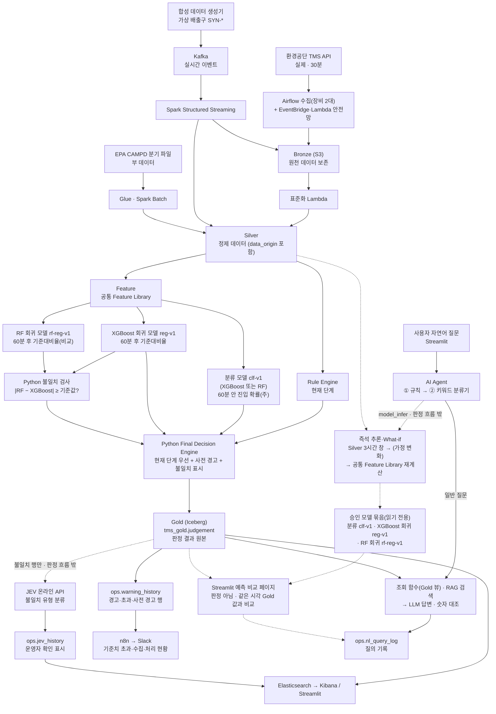
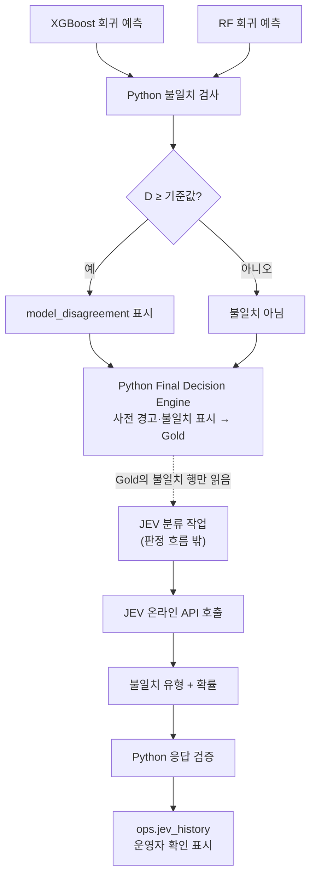

# 굴뚝 TMS 데이터 파이프라인 및 Hybrid AI 사전 경고 시스템
## 전체 프로세스 및 구현 가이드

---

## 주차별 할 일 한눈에 (11/2 ~ 12/17)

> 주차마다 해야 할 주요 Task를 한 문장씩 정리했습니다. 자세한 내용은 주차별 작업 계획서를 따릅니다. 이 표와 작업 계획서가 다르면 정본에 맞춰 고칩니다. "3.6"처럼 번호만 적은 곳은 이 문서의 절입니다.
>
> **우선순위 표시:** 표시가 없는 Task는 필수입니다. **(Should)** 는 필수를 끝낸 뒤 이번 주 안에 하는 것으로, 못 끝내면 이유와 남은 일을 적습니다. **(Could)** 는 여유가 있을 때 하는 것입니다. 필수와 시간이 겹치면 필수를 먼저 합니다.

### 주차별 주요 Task 요약

| 주 | 주요 Task |
|---|---|
| 11/2 주 | - 환경공단·EPA Bronze 적재<br>- 환경공단·EPA Silver 표준화<br>- 합성 생성기·Kafka → Bronze<br>- Silver 변환 점검 테스트<br>- **Silver 완성** |
| 11/9 주 | - 데이터 구간 확정·라벨 생성(`label-v1`, 11/12 고정)<br>- 공통 Feature Library·Feature 데이터셋<br>- EPA 점수 모델(`epa-surge-v1`)<br>- Kafka → Spark 스트리밍<br>- Rule Engine 현재 판정<br>- 학습 리허설 |
| 11/16 주 | - 분류 본 실험(B → B+E → +S × XGBoost·RF 두 사슬, B+EP는 Could)·최종 비교·채택<br>- 회귀 모델 학습(XGBoost 주, RF 비교)·불일치 기준값<br>- 승인 모델 판정 흐름 연결<br>- Final Decision·사전 경고·불일치 표시<br>- **Gold(`tms_gold.judgement`) 완성·고정(11/20)** |
| 11/23 주 | - Test 운영 시작(Test 11/23~12/4)<br>- **Test-1 중간 평가(11/27)**<br>- 모델 오류 분석(1차)<br>- 평가 세 축 보고서(중간판) |
| 11/30 주 | - Test 운영 계속(모델·임계값·Feature·규칙·판정 코드 고정)<br>- 규칙 계층·키워드 분류기<br>- 조회 함수 12개<br>- **JEV 불일치 분류(판정 흐름 밖)**<br>- RAG 벡터 DB<br>- LLM 경고 설명<br>- (Should) 경고 대응·법령 절차 근거 문서 수집<br>- (Could) EPA 지식 카드 색인<br>- (Should) 즉석 추론·What-if 설계<br>- Agent·대시보드·n8n 설계 |
| 12/7 주 | - **Test 전체 최종 평가(12/7)**·평가 세 축 보고서 확정<br>- **분류·회귀 모델 평가 완성**<br>- JEV 효과 평가(A안 vs B안)<br>- AI Agent 하이브리드 질의<br>- (Should) LLM+RAG 경고 대응 안내·법령 절차 설명<br>- (Could) 현황+규정 혼합 질문·EPA 지식 카드 연결<br>- (Should) 모델 즉석 추론<br>- (Could) 입력값 변화 예측 비교·자연어 What-if<br>- n8n Slack 알림 2개(기준치 초과, 수집·처리 현황)<br>- Kibana·Streamlit 대시보드 구현<br>- 통합 시연<br>- **기능 동결(12/11)** |
| 12/14~12/17 | - 버그 수정<br>- 발표 자료·시연 준비<br>- 리허설 2회<br>- **최종 발표(12/17)** |

### 11/2 주 (11/2~11/6) — Bronze·Silver

**목표:** 원본을 모으고 믿을 수 있는 Silver를 만듭니다.

| # | Task | 한 문장 요약 |
|---|---|---|
| 1 | 데이터 활용 원칙·Bronze 재고 조사 | 원천별 활용 범위를 정하고, 지금 쌓인 Bronze 원본의 양·기간·상태를 조사합니다. |
| 2 | 환경공단 수집·S3 적재 | 수집자 `b`·`c`·`aws`의 원본을 S3 Bronze에 모으고 Lambda 안전망과 확정 표지를 둡니다(부록 A). |
| 3 | EPA 수집·Bronze 적재 | EPA 분기·시설 파일을 받아 원본 그대로 S3 Bronze에 보관합니다. |
| 4 | 공통 필드·표준화 설계 | 필드 사전(뜻·단위·시간대)과 원천별 매핑을 정의합니다. |
| 5 | 환경공단 Silver 표준화 | 국내 실측을 `tms_silver.measurements`로 표준화하고, 같은 키·다른 값은 격리합니다. |
| 6 | EPA Silver 표준화 | EPA 분기 1개 이상을 `epa_silver.*`로 표준화하고 대리 기준 `proxy-v0`를 정합니다. |
| 7 | AI-Ready Data 점검 | Bronze·Silver 점검표로 품질·추적성을 확인하고 `usable`·`conditional`·`unusable`로 판정합니다. |
| 8 | 합성 데이터 생성 | 시나리오 기반 합성 생성기 1차를 만들고 생성 결과를 검수합니다. |
| 9 | Kafka → Bronze | 합성 이벤트를 Kafka 토픽으로 발행하고, Spark Structured Streaming이 받아 **원본 그대로** Bronze에 적재합니다(처리는 11/9 주). |
| 10 | PostgreSQL 설계 | 운영 이력·메타데이터 테이블 DDL을 만듭니다. |
| 11 | 실행 주체·처리 방식 정리 | Airflow·EventBridge·Kafka·Spark가 각각 무엇을 맡는지 정합니다. |
| 12 | 버전·데이터 계보 관리 | 처리 이력과 버전 규칙을 정해 Silver 한 행에서 Bronze 원본까지 거슬러 갈 수 있게 합니다. |
| 13 | Silver 변환 점검 테스트 | 고정 사례로 표준화 결과를 CI에서 자동 확인합니다. |

### 11/9 주 (11/9~11/13) — Feature·스트리밍·현재 판정

**목표:** 학습 재료를 만들고 판정 흐름을 잇습니다. 모델 성능은 아직 확정하지 않습니다.

| # | Task | 한 문장 요약 |
|---|---|---|
| 1 | 국내 EDA | 전국 실측의 분포·품질·사건 수를 분석해 ML 대상 항목을 예비로 정합니다. |
| 2 | 데이터 구간 확정 | Train 10/30~11/12, Validation 11/13~11/17, 연결·고정 11/18~11/22, Test 11/23~12/4로 나누고 경계 60분은 뺍니다(4.5). |
| 3 | 라벨 생성 | 분류 `label_entry_60m`과 회귀 `label_ratio_60m`을 `label-v1` 규칙(4.4, 부록 B)으로 만들고 11/12까지 고정합니다. |
| 4 | 공통 Feature Library | 국내·EPA·스트리밍이 같은 함수로 Lag·Rolling·상태 특성과 추가 후보 3개(`ratio_diff_60m`·`ratio_diff_120m`·`ratio_slope_3h`)를 계산하게 합니다. |
| 5 | Feature 데이터셋·준비도 게이트 | `tms_feature.keco_features`를 만들고 AI 준비도 게이트로 학습 적합성을 점검합니다. |
| 6 | EPA Silver 확장 | EPA 텍사스 14개 분기를 모두 표준화합니다. |
| 7 | EPA 현상 분석 | 가동 재개·변동성 증가·동시 상승 현상이 실제로 있는지 EPA에서 확인합니다. |
| 8 | 공통 특성 `common-v1` | 두 원천에서 같은 식·같은 시간 창으로 계산하는 상대 특성 5개(부록 C)를 정의하고 30분·60분 고정 사례 테스트를 만듭니다. |
| 9 | EPA 점수 모델 | EPA만으로 `epa-surge-v1`을 학습해 국내 NOx·SOx에 `epa_surge_score`를 계산할 준비를 합니다. |
| 10 | 비교 실험 준비 | B·B+E·+S를 XGBoost·RF 두 알고리즘으로 같은 조건에서 돌릴 코드를 만듭니다. (Could) B+EP용 데이터 구조. |
| 11 | 합성 생성기 v1 | Train 통계로 합성 데이터를 만들고, 합성 배출구마다 참조 실측 배출구(`ref_stack_code`)를 기록해 Kafka로 보냅니다. |
| 12 | Kafka → Spark 스트리밍 | 11/2 주의 같은 Spark 작업에 Silver·Feature·현재 판정 단계를 덧붙여, 합성 행이 실측과 같은 공통 코드로 처리되게 합니다. |
| 13 | 현재 단계 판정 | 공통 Rule Engine으로 정상·주의·경고·초과를 판정해 배치·스트리밍 모두 Gold에 기록합니다. |
| 14 | 경고 이력 | 경고·초과를 `ops.warning_history`에 남깁니다(Slack 송신은 12/7 주 n8n). |
| 15 | 테스트 확장 | Silver·Feature·Label·Rule 고정 사례 테스트를 CI에 겁니다. |
| 16 | 학습 리허설 | 분류·회귀 학습부터 MLflow 기록까지 한 번 끝까지 돌려 막히는 곳을 찾습니다. |

### 11/16 주 (11/16~11/20) — 모델 학습·채택과 Gold 완성

**목표:** 분류·회귀 모델을 고르고 판정 흐름에 연결해 Gold를 완성·고정합니다.

| # | Task | 한 문장 요약 |
|---|---|---|
| 1 | Feature 데이터셋 확정 | Train·Validation 특성·라벨을 계산하고 실험용 스냅샷을 고정합니다. |
| 2 | 국내 P99·EPA 점수 계산 | Train 구간만으로 국내 P99를 구하고 국내 NOx·SOx에 `common-v1`과 `epa_surge_score`를 만듭니다(그 밖 항목은 빈 값, 합성 행은 참조 실측 배출구의 P99). |
| 3 | (Could) B+EP 합동 데이터셋 | 11/17까지 실행 여부를 정하고, 실행하면 국내 Train과 EPA 행을 합친 학습 데이터를 만듭니다. |
| 4 | 본 실험 전 게이트 | 구간 분리·누수·출처 분리를 다시 점검해 통과해야 본 실험을 시작합니다. |
| 5 | 분류 본 실험 | 11/18에 B Feature 세트를 XGBoost로 확정한 뒤, XGBoost·RF 사슬마다 B → B+E → +S를 비교하고 두 결승 후보를 배출구 단위 부트스트랩으로 최종 비교합니다(5.2). 확실한 차이가 없으면 XGBoost를 채택합니다. |
| 6 | 채택·임계값·승인 모델 등록 | 재현율 0.6 이상 중 F1이 가장 높은 임계값을 정하고 분류(`clf-v1`)·회귀(`reg-v1`)·RF 회귀(`rf-reg-v1`)와 불일치 기준값을 한 묶음으로 등록합니다. |
| 7 | 회귀 모델 학습 | 국내 실측 Train만으로 XGBoost·RF 회귀(B판·B+E판)를 학습하고, 두 예측 차이로 불일치 기준값(10%p에서 출발)을 Validation에서 정합니다. |
| 8 | 판정 흐름에 모델 연결 | 승인 모델을 호출해 `tms_gold.judgement`에 3.6의 열대로 키 MERGE로 기록하고, 추론 Feature를 `online_features`에 남기며, 실패하면 `hold_reason`을 남깁니다. |
| 9 | Final Decision·사전 경고 | 현재 판정을 우선하고 확률·예측값으로 사전 경고와 불일치 표시(RF만 90% 이상이어도 유지)를 정해, 경고 행을 `ops.warning_history`로 옮기고 뷰·Elasticsearch 색인을 만듭니다. |
| 10 | Gold 통합 확인·고정 | 배치·스트리밍 전체 흐름을 확인하고 11/20에 모델·규칙·임계값·불일치 기준값·코드 버전을 고정합니다. |
| 11 | 합성 시나리오 1차 평가 | 합성 평가용 시나리오를 같은 경로로 흘려 기대 결과대로 반응하는지 봅니다. |
| 12 | Test 계획·평가 코드 | Test 운영 규칙과 Test 적정성 기준값(4.5, 부록 B.2의 사건 세는 법)을 11/22까지 정하고, 평가 스크립트를 Validation으로 미리 검증합니다. |

### 11/23 주 (11/23~11/27) — Test 운영·중간 평가

**목표:** 고정한 모델로 Test를 운영하고 11/27에 Test-1(11/23~11/26) 중간 평가를 합니다. 최종 성능 수치는 Test 전체(11/23~12/4)로 12/7 주에 냅니다.

| # | Task | 한 문장 요약 |
|---|---|---|
| 1 | Test 운영 | 고정 모델로 Test 데이터를 처리하고 매일 운영 상태와 장애만 기록합니다. 운영은 12/4까지 이어집니다. |
| 2 | 운영 안정화·장애 대응 절차서 | Bronze부터 Gold까지 장애별 확인·복구 방법을 Runbook으로 정리합니다. |
| 3 | 합성 시나리오 반응 평가 | 평가용 시나리오를 운영 경로로 흘려 기대 결과 일치율을 잽니다. |
| 4 | Test-1 중간 평가 | 11/27 01:00 이후 승인 분류·회귀 모델을 Test-1로 평가합니다. 결과를 보고 모델·임계값·Feature·규칙을 바꾸지 않습니다. |
| 5 | 모델 오류 분석(1차) | Test-1의 미탐지·오경보·회귀 큰 오차 사례의 원인을 찾아 기록합니다. |
| 6 | EPA·합성 효과 정리 | B·B+E·+S × XGBoost·RF Validation 비교, (실행했으면) B+EP 참고 결과, 시나리오 결과를 구분해 정리합니다. |
| 7 | 평가 세 축 보고서(중간판) | Silver 변환·모델 성능(Test-1)·시나리오 반응을 섞지 않고 한 보고서에 정리합니다. |
| 8 | Gold·데이터 흐름 완료 점검 | 데이터 흐름과 Test-1 평가가 끝났는지 PASS·FAIL로 점검합니다. |
| 9 | 외부 API 사전 확인 | 에어코리아·ASOS의 과거 자료 조회와 JEV 키 발급·불일치 분류 호출을 미리 확인합니다. |

### 11/30 주 (11/30~12/4) — Agent 부품과 설계

**목표:** Agent 부품과 JEV 불일치 분류를 만들고 Agent·대시보드·n8n을 설계합니다.

**Test 운영 중(~12/4):** 승인 모델·운영 임계값·Feature 정의·Rule Engine·판정 코드를 바꾸지 않습니다. Agent·RAG·LLM 설명·JEV 분류는 판정 흐름 밖에서 만듭니다.

| # | Task | 한 문장 요약 |
|---|---|---|
| 1 | 규칙 계층·키워드 분류기 | 확실한 질문을 먼저 처리하는 규칙과 질문 유형을 고르는 키워드 분류기를 만듭니다. |
| 2 | LLM 경고 설명 | Gold의 검증된 값으로만 경고 사유를 설명하고 숫자를 자동 대조합니다. |
| 3 | 질문 유형·조회 함수 | 키워드 분류기로 질문 유형 13종 중 하나를 고르고 조회 함수 12개를 만듭니다. |
| 4 | 새 상태 문구 PR 절차 | 처음 보는 상태 문구를 담당자가 PR로 올리고 두 명이 검토하는 절차를 정해 시험 PR 1건을 냅니다. |
| 5 | 질문 유형 평가 세트 | 질문 65개(13유형 × 5)와 정답 유형을 만듭니다. |
| 6 | RAG 문서 수집·정제 | 판정 규칙·클린시스 안내·환경 법령 핵심 조문을 받아 조각으로 나눕니다. |
| 7 | 벡터 DB 구축 | 임베딩 모델을 고정해 벡터 DB에 색인하고 검색 품질을 확인합니다. |
| 8 | AI Agent 설계 | ① 규칙 → ② 키워드 분류기 → ③ ML 예측 결과 조회 → 도구 → LLM 흐름과 평가 방법을 정합니다. |
| 9 | 대시보드 설계 | Kibana·Streamlit 화면마다 목적·데이터·필터·문구를 정하고 배치도를 그립니다. |
| 10 | n8n 설계 | 기준치 초과·수집·처리 현황 알림 2개의 Slack 송신 흐름을 정합니다. |
| 11 | (Should) 주변 대기질·기상 적재 | 에어코리아·ASOS 자료를 참고용 테이블에 둡니다. |
| 12 | 설계 리뷰 | Agent·대시보드·n8n 설계를 멘토와 검토하고 다음 주 구현 순서를 정합니다. |
| 13 | JEV 불일치 분류 | Gold의 불일치 행만 A안 규칙과 JEV로 분류해 `ops.jev_history`에 운영자 확인 표시를 남깁니다(7~8장). |
| 14 | (Should) 경고 대응·법령 절차 근거 문서 | 경고 대응 안내와 법령 절차 설명에 쓸 공식 문서를 모아 `response_guide_v1` 컬렉션을 만들고 질문 유형 `response_guide`를 정합니다. |
| 15 | (Could) EPA 지식 카드 색인 | 11/9 주 EPA 현상 분석 결과로 만든 EPA 지식 카드를 `epa_cards_v1` 컬렉션에 따로 색인합니다. |
| 16 | (Should) 즉석 추론·What-if 설계 | 질문 유형 `model_infer`, 입력을 만드는 순서, 변화율 해석 규칙·허용 범위, 화면 문구, 평가 질의와 0% 검증 사례를 정합니다. |

### 12/7 주 (12/7~12/11) — 구현 완료·기능 동결

**목표:** Agent·n8n·대시보드를 완성하고 12/11에 기능을 동결합니다.

| # | Task | 한 문장 요약 |
|---|---|---|
| 1 | Agent 하이브리드 질의 조립 | 규칙 → 키워드 분류기 → ML 예측 결과 → 조회 함수 → LLM 흐름을 잇습니다. |
| 2 | RAG 답변 연결 | 법령·규칙 질문을 벡터 DB로 답하고 법령명·조문·시행일을 인용합니다. |
| 3 | 브리핑 | 같은 Agent로 현황·기간별·사업장별 브리핑을 씁니다. |
| 4 | Agent·RAG 평가 | 숫자 일치·근거 표기와 질문 65개로 키워드 분류기 정확도를 잽니다. |
| 5 | n8n ① 기준치 초과 알림 | 기준대비율 100% 이상(초과)이 생기면 Slack으로 보냅니다. |
| 6 | n8n ② 수집·처리 현황 알림 | 수집·처리 결과 요약과 장애·격리 건수를 Slack으로 보냅니다. |
| 7 | n8n 알림 시험·정리 | 중복 방지·실패 재시도를 시험하고 실행 이력을 화면에 잇습니다. |
| 8 | Kibana 화면 구현 | 설계서대로 필수 화면을 모두 만듭니다. |
| 9 | Streamlit 구현 | Agent 질의·경고 상세·통합 조회·예측 비교·브리핑 페이지를 만듭니다. |
| 10 | (Should) 겹쳐 보기 화면 | 사업장 기준대비율과 주변 농도·풍향을 같은 시간축에 그립니다. |
| 11 | 통합 시연 | 데이터 유입부터 경고·설명·Agent 답변·화면까지 끝까지 돌려 봅니다. |
| 12 | 최종 산출물 점검 | 필수 검증 항목과 최종 결과물을 모두 점검합니다. |
| 13 | Test 전체 최종 평가 | 12/7에 승인 분류·회귀 모델을 Test 전체(11/23~12/4)로 한 번 평가하고 Test 적정성 기준 충족 여부를 적습니다. |
| 14 | 모델 오류 분석·평가 보고서 확정 | Test 전체로 오류 분석을 보완하고 평가 세 축 보고서를 최종 수치로 바꾼 뒤 모델 완료를 점검합니다. |
| 15 | JEV 효과 평가 | Test 구간의 불일치 행으로 A안(Python 규칙)과 B안(JEV)의 분류를 정답과 비교합니다(12.2). |
| 16 | (Should) 경고 대응 안내 | 경고가 난 행의 항목·사유·상태에 맞는 확인 항목을 대응 근거 문서에서 찾아 LLM이 3~5줄로 정리합니다. |
| 17 | (Should) 법령 절차 설명 | 흩어진 조문 2~4개를 절차 순서로 엮어 쉬운 말로 설명하고 문장마다 법령명·조문·시행일을 붙입니다. |
| 18 | (Could) 현황+규정 혼합 질문 | 조회 함수 결과와 RAG 조문을 한 답변으로 엮되 [현황]·[규정] 근거를 따로 표시합니다. |
| 19 | (Could) EPA 지식 카드 연결 | 국내 경고의 특성과 비슷한 EPA 카드를 찾아 `[EPA · 참고]` 문단으로 따로 붙입니다. |
| 20 | (Should) 모델 즉석 추론 | 질문한 배출구·항목의 최신 입력으로 승인 모델을 바로 불러 같은 기준시각의 Gold 값과 나란히 보여 줍니다. |
| 21 | (Could) 입력값 변화 예측 비교 | 슬라이더로 기준시각 측정값을 바꿔 다시 추론하고 변화 전후를 비교합니다. |
| 22 | (Could) 자연어 What-if | "20% 오르면"처럼 질문에서 변화율을 뽑아 Task 21과 같은 경로로 답합니다. |

#### LLM+RAG 활용 사례 (2026-11-01 추가)

숫자는 조회 함수와 템플릿이 맡고, **여러 문서를 엮어 상황에 맞게 풀어 써야 하는 곳**에만 LLM+RAG를 씁니다.

| 사례 | 우선순위 | 질문 예 | 근거 | 지키는 것 |
|---|---|---|---|---|
| 경고 대응 안내 | Should | "3번 NOx 사전 경고인데 뭘 확인해야 해?" | Gold 행 + `response_guide_v1` | 확인 항목만 안내하고 조치를 지시하지 않습니다. 실제 조치는 사업장 환경기술인과 운영 절차를 따른다고 표시합니다 |
| 법령 절차 설명 | Should | "허용기준을 넘으면 어떤 절차가 진행돼?" | `law_rules_v1`·`response_guide_v1` | 위반 여부·처분 수위는 판단하지 않습니다. 기준 점수 미만이면 "찾지 못함" |
| 현황+규정 혼합 질문 | Could | "지금 기준 근처인데 넘으면 어떻게 돼?" | 조회 함수 + RAG | 정해진 유형 조합만 허용하고, 그 밖의 다중 유형은 계속 되묻습니다 |
| EPA 지식 카드 연결 | Could | "이런 급상승 패턴이 다른 데서도 있었어?" | `epa_cards_v1` | EPA는 참고로만 씁니다. 국내 수치와 같은 문장에 섞지 않습니다 |

모든 사례는 숫자·인용을 자동 대조하고, 실패하면 템플릿 답변(근거 원문과 출처)으로 바꿉니다. 근거 문서 목록과 처리 규칙은 11/30 주 작업 계획서 Task 14를 따릅니다.

**LLM 모델 (2026-11-01 결정):** OpenAI **GPT-6.1 Terra(`gpt-6.1-terra`)** 를 씁니다. LLM은 Gold 숫자와 검색된 조각을 받아 짧은 한국어 문장으로 정리하는 일만 하므로, 최상위 모델이 아닌 중간 모델로 충분합니다(입력 $1 / 출력 $5, 1M 토큰당, 2026-11-01 공식 모델 페이지 기준).

- 경고 설명·RAG 답변·브리핑·LLM+RAG 사례 모두 같은 모델을 씁니다. 추론 수준(reasoning)은 낮게 시작합니다.
- 모델 ID와 사용 시작일을 `ops.nl_query_log`와 팀 결정 기록에 남깁니다. 공식 페이지에 날짜가 붙은 버전 ID가 없으므로, 모델을 바꾸면 기록으로 구분합니다.
- API 키는 환경변수(`OPENAI_API_KEY`)로만 다룹니다.
- 대안은 GPT-6 Luna(`gpt-6-luna`, $0.10 / $0.50)입니다. 12/7 주 Agent 평가에서 같은 질문 세트로 비교해 숫자 대조 통과율·문장 품질 차이가 없으면 멘토와 협의해 바꿀 수 있습니다.

#### 모델 즉석 추론·What-if (2026-11-01 추가)

"3번 배출구 NOx가 20% 오르면 경고 들어가?"처럼 **Gold에 답이 없는 가정 질문**에 답하고, 같은 경로로 변화 없이 추론해 **모델이 판정 흐름과 같은 값을 내는지** 확인합니다. Agent가 모델을 부르는 유일한 경로이고, 결과는 판정이 아닙니다.

| 단계 | 우선순위 | 질문 예 | 화면 |
|---|---|---|---|
| ① 모델 즉석 추론 | Should | "3번 배출구 NOx 지금 예측해 줘" | 즉석 추론 값과 같은 기준시각 Gold 값, 일치 여부 |
| ② 입력값 변화 예측 비교 | Could | ① + 슬라이더(측정값 변화율) | 변화 전후 진입 확률·예측 대비율 |
| ③ 자연어 What-if | Could | "3번 배출구 NOx가 20% 오르면 경고 들어가?" | ②와 같음 |

```text
질문 → ① 규칙 → ② 질문 유형 model_infer(배출구·항목·변화율 추출)
     → Silver에서 기준시각까지 3시간 창 읽기(판정 흐름과 같은 ingested_at 조건) → 복사본의 기준시각 measure_value만 ×(1+변화율)
     → 공통 Feature Library로 Feature 다시 계산(판정 흐름과 같은 Feature 정의·버전, B+E면 epa_surge_score도 다시 계산)
     → 승인 모델(읽기 전용): 분류 clf-v1 · XGBoost 회귀 reg-v1 · RF 회귀 rf-reg-v1
     → Streamlit 예측 비교 페이지 [가정 시뮬레이션 · 판정 아님] + 같은 시각 Gold 값
     → ops.nl_query_log 기록
```

3.8 예시(78.0%)에 +20%를 적용하면 다음과 같이 바뀝니다.

| Feature | 현재 | +20% 후 | 이유 |
|---|---|---|---|
| `ratio_pct` | 78.0 | 93.6 | 기준시각 값 |
| `ratio_lag_30m`·`ratio_lag_60m` | 72.0·66.0 | 그대로 | 과거 값 |
| `ratio_diff_30m` | 6.0 | 21.6 | 93.6 − 72.0 |
| `ratio_pct_change_30m` | 8.3 | 30.0 | 21.6 / 72.0 |
| `ratio_rolling_mean_3h` | 68.5 | 71.1 | 6개 중 하나만 바뀜 |
| `hour`·`dayofweek` | — | 그대로 | 시간 정보 |

- **판정 흐름과 같은 값만 읽습니다.** Silver 창은 판정 흐름처럼 `ingested_at` 조건(4.1)으로 거릅니다. 판정 뒤에 늦게 들어온 값이 섞이면 같은 기준시각이라도 Feature가 달라져 0% 검증이 깨집니다.
- **Feature를 직접 고치지 않습니다.** `ratio_pct`만 바꾸면 변화량·Rolling 평균이 옛 값으로 남아 있을 수 없는 입력이 됩니다. 측정값을 바꾸고 같은 함수로 다시 계산합니다.
- **"20% 오르면"은 상대 증가(×1.2)이고, 기준시각 값 하나만 바꿉니다.** 허용 범위(예: −30%~+50%) 밖이면 "모델이 학습하지 않은 범위"로 안내하고 추론하지 않습니다.
- **판정이 아닙니다.** Gold·`ops.warning_history`·Slack에 쓰지 않고, Kibana에 넣지 않습니다. 카드에 모델 버전과 "실제 판정은 Gold 값을 따릅니다"를 표시합니다.
- **0% 검증:** 변화율 0%로 다시 계산한 Feature는 `online_features`의 같은 키 행과, 예측은 Gold의 `entry_probability`·`predicted_ratio_pct`·`rf_predicted_ratio_pct`와 같아야 합니다. 고정 사례 테스트로 겁니다.
- 승인 모델·임계값·Feature 정의를 바꾸지 않으므로 Test 고정 원칙과 부딪치지 않습니다. 설계는 11/30 주 Task 16, 구현은 12/7 주 Task 20~22입니다.

### 12/14~12/17 — 발표 준비

**목표:** 새 기능 없이 마무리하고 12/17에 발표합니다.

| # | Task | 한 문장 요약 |
|---|---|---|
| 1 | 버그 수정 | 통합 시연에서 끊긴 곳과 점검표의 오류만 고칩니다. |
| 2 | 미완료 항목 마무리 | 빠진 산출물을 채우고, 못 채우면 이유를 적습니다. |
| 3 | 결과 문서 정리 | 성능·품질·장애 대응 검증 문서를 한 묶음으로 정리합니다. |
| 4 | 발표 자료 | 문제 → 구조 → 데이터 → 모델 → 판정·Agent → 평가 → 한계 순서로 만듭니다. |
| 5 | 시연 준비 | 시연 시나리오와 데이터를 고정하고 예비 영상을 녹화합니다. |
| 6 | 리허설 2회 | 실제 발표 시간으로 두 번 해 보고 지적 사항을 고칩니다. |
| 7 | 저장소 정리 | README·실행 방법을 정리하고 비밀값이 없는지 확인한 뒤 최종 태그를 붙입니다. |
| 8 | 최종 발표 | 12/17에 발표하고 질의응답을 합니다. |

---

## 1. 프로젝트 개요

### 1.1 프로젝트 목적

굴뚝 TMS 측정 데이터를 수집하고, 데이터 파이프라인으로 정제·분석한 뒤 AI 모델로 **60분 안에 경고 단계(기준대비율 90%)에 들어갈 가능성**을 예측해 사전에 알려 주는 시스템을 구축합니다.

단순히 현재 배출량이 기준을 넘었는지 확인하는 것이 아니라, 현재 측정값과 과거 배출 패턴을 분석하여 **미래 위험을 미리 알고 대응할 수 있게 하는 것**이 핵심입니다.

모델은 세 개를 함께 씁니다. 주 모델은 **분류 모델**(`clf-v1`, 60분 안 진입 확률)이고, **XGBoost 회귀 모델**(`reg-v1`)과 비교용 **RF 회귀 모델**(`rf-reg-v1`)이 60분 후 기준대비율을 예측합니다(5.1). 두 회귀 모델의 **예측 차이가 클 때만** JEV를 호출하여 불일치 유형을 분류하도록 합니다.

**Hybrid AI**는 수치 규칙(Rule Engine)의 현재 단계 판정과 ML 모델(분류·회귀)의 60분 예측을 함께 쓰고, Python Final Decision Engine이 규칙을 우선해 최종 결과를 정하는 구조입니다. JEV(예측 불일치 분류)와 LLM(설명·질의)은 판정 흐름 밖에서 보조하며, 없어도 판정은 그대로 동작합니다.

### 1.2 핵심 구현 목표

1. 환경공단 API(30분)와 합성 데이터(Kafka)를 함께 받는 데이터 수집 파이프라인 구축
2. Airflow·EventBridge·Lambda(배치)와 Kafka·Spark(스트리밍)를 활용한 데이터 처리
3. S3·Iceberg 기반 Bronze·Silver·Gold 데이터 레이크하우스 구성
4. PostgreSQL을 활용한 수집·판정·경고 이력 관리
5. 분류 모델(XGBoost·RF를 같은 조건으로 비교해 채택)로 60분 안 경고 진입 예측(주 모델), 회귀 모델로 60분 후 기준대비율 예측(보조)
6. EPA 데이터를 부 데이터로 활용한 비교 실험(B · B+E · +S)
7. Rule Engine을 통한 현재 위험 단계 판정
8. RF·XGBoost 예측 차이가 클 때만 JEV 온라인 API 호출
9. Python Final Decision Engine을 통한 최종 판정
10. Kibana·Streamlit 대시보드와 n8n → Slack 알림
11. 모델 및 시스템 성능 평가
12. 자연어 질의(AI Agent·RAG)와 모델 즉석 추론·What-if

### 1.3 전체 기술 구성

| 영역 | 주요 기술 | 역할 |
|---|---|---|
| 실제 데이터 수집 | Python, Airflow, EventBridge, Lambda | 환경공단 API 30분 수집(안전망 포함) |
| 합성 데이터 | Python 생성기, Kafka | 실시간 이벤트 및 다양한 상황 시험 |
| 데이터 처리 | Lambda·PyIceberg(실제), Spark Structured Streaming(합성), Glue·Spark Batch(EPA) | 정제, 변환, 집계 |
| 데이터 저장 | MinIO(로컬 버퍼), S3, Iceberg, Glue Catalog | 데이터 레이크하우스 |
| 데이터 관리 | PostgreSQL | 수집·판정·경고 이력 |
| 데이터 분석 | DuckDB, Python | EDA 및 분석 |
| AI 예측 | XGBoost·Random Forest(분류 후보, 회귀 주·비교 모델), MLflow | 60분 안 경고 진입·60분 후 기준대비율 예측 |
| 기준 판정 | Python Rule Engine | 현재 위험 단계 판정 |
| 추가 AI 판단 | JEV API | RF·XGBoost 예측 불일치 유형 분류 |
| 최종 제어 | Python Final Decision Engine | 최종 결과 검증 및 조치 결정 |
| 시각화 | Elasticsearch, Kibana, Streamlit | 데이터 및 위험 상황 모니터링 |
| 알림 | n8n → Slack | 기준치 초과·수집·처리 현황 알림 |
| 자연어 질의·설명 | 키워드 규칙, 조회 함수, RAG(벡터 DB), LLM(OpenAI `gpt-6.1-terra`) | 질문 처리·판정 결과 설명·법령 근거 인용(2.1, 12/7 주) |
| 즉석 추론·What-if | 공통 Feature Library, 승인 모델(읽기 전용) | 질문한 배출구·항목의 예측과 가정 변화 비교(판정 아님) |

---

## 2. 전체 시스템 아키텍처

전체 시스템은 크게 7단계로 구성합니다.

1. 데이터 수집
2. 데이터 저장 및 전처리
3. AI 모델 학습 및 예측
4. Rule Engine 및 JEV 판단
5. 최종 판정 및 알림
6. 모니터링 및 성능 평가
7. 사용자 질의(AI Agent 답변, 모델 즉석 추론·What-if)

### 2.1 전체 처리 흐름



**중요한 설계 원칙**

- Airflow·EventBridge는 배치 작업의 실행 시각과 순서를 관리합니다.
- Kafka는 합성 이벤트를 전달합니다.
- Lambda는 실제 데이터를, Spark는 합성 데이터와 EPA 대량 데이터를 정제·변환합니다.
- 실제·합성 데이터는 같은 Silver 구조, 같은 Feature 코드, 같은 모델, 같은 판정 규칙을 씁니다.
- **분류 모델이 주 모델**입니다. 알고리즘은 XGBoost와 RF를 같은 조건으로 비교해 Validation으로 고릅니다. 사전 경고는 승인된 분류 모델과 XGBoost 회귀 모델로 정합니다.
- RF 회귀 모델은 **비교 모델**입니다. XGBoost 회귀와 예측 차이를 재는 데만 씁니다.
- Rule Engine은 수치 기준으로 현재 위험 단계를 판정합니다. 모델 결과에 의존하지 않습니다.
- JEV는 두 모델의 예측 차이가 클 때만 추가 판단을 수행합니다.
- Python Final Decision Engine이 최종 결과를 통제합니다.
- AI Agent는 일반 질문에 Gold 뷰와 RAG 검색 결과로만 답합니다. 모델을 부르는 것은 `model_infer`(즉석 추론·What-if) 하나뿐이고, 판정 흐름과 같은 Feature Library·승인 모델을 읽기 전용으로 씁니다. 그 결과는 판정이 아니므로 Gold·경고 이력·Slack에 쓰지 않고 `ops.nl_query_log`에만 남깁니다(12/7 주 "모델 즉석 추론·What-if").

JEV가 없어도 전체 시스템은 정상적으로 작동할 수 있어야 합니다.

---

## 3. 데이터 수집 및 저장

### 3.1 데이터 수집 방식

이번 프로젝트에서는 세 가지 데이터를 함께 활용합니다.

| 구분 | 수집 방식 | 주요 목적 |
|---|---|---|
| 국내 TMS(주 데이터) | 환경공단 API → Airflow·Lambda → S3 Bronze | 실제 배출 분석, 모델 학습·검증·평가 |
| 합성 데이터 | Python 생성 → Kafka → Spark | 실시간 이벤트, 다양한 상황 시험, 학습 보강(+S) |
| EPA CAMPD(부 데이터) | 분기 파일 → Glue·Spark Batch | 급등 패턴 학습(EPA 점수 모델), 국내 특성 설계의 근거 |
| 보완 데이터 | 클린시스 파일 | 사업장 코드·좌표 보완 |

**국내 TMS API의 특징**

- 최근 30분 측정값만 주고 **과거 조회가 안 됩니다.** 놓친 구간은 다시 받을 수 없으므로 수집 누락을 최소화해야 합니다.
- 매시 05분·35분에 전국(약 3,340개 배출구) 응답을 받습니다.
- 응답 한 행은 배출구 하나이고, 항목(NOx·SOx·먼지·HCl·CO·NH3·HF)별 **측정값과 허용기준**이 함께 옵니다.
- 측정값 대신 상태 문구(가동중지·보수중 등)가 올 수 있습니다.

실제 데이터와 합성 데이터는 수집 경로가 다르지만, 이후에는 동일한 데이터 구조와 공통 처리 경로를 사용합니다.

합성 데이터도 별도의 장난감 데이터로 취급하지 않습니다. 실제 환경에서 발생할 수 있는 측정값과 시간 흐름을 반영하여 생성하고, 동일한 Rule Engine과 ML 모델 및 최종 판정 로직을 통과시킵니다. 다만 **모델 성능 평가(Validation·Test)에는 실제 데이터만** 씁니다.

### 3.2 Airflow · EventBridge 역할

실제 데이터는 수집을 놓치지 않도록 세 수집자가 같은 시각에 받습니다.

| 수집자 | 실행 | 저장 |
|---|---|---|
| 장비 B Airflow | 매시 05·35분 | MinIO(로컬 버퍼) → S3 Bronze |
| 장비 C Airflow | 매시 05·35분 | MinIO(로컬 버퍼) → S3 Bronze |
| EventBridge + 수집 Lambda(안전망) | 매시 05·35분 | S3 Bronze 직접 |

이후 매시 15·45분에 EventBridge가 **표준화 Lambda**를 깨워 세 수집자의 원본을 합쳐 Silver를 만듭니다. 같은 측정은 한 번만 세고, 값이 서로 다르면 격리합니다.

Airflow가 하는 일의 예:

1. 환경공단 API 호출
2. 응답 형식 확인
3. MinIO에 임시 저장
4. S3 업로드 및 재검증
5. 확정 표지 기록
6. 수집 결과 기록
7. 실패 시 재시도

Airflow와 EventBridge는 데이터를 직접 분석하는 도구가 아니라 여러 작업을 정해진 시각에 연결하고 실행하는 도구입니다.

### 3.3 Kafka 역할

Kafka는 이벤트 형태로 유입되는 데이터를 전달합니다.

이번 프로젝트에서는 Python으로 생성한 합성 측정 이벤트를 Kafka에 보냅니다. 합성 이벤트는 **실제 API 응답과 같은 항목**(측정값과 허용기준)을 담고, 기준대비율은 Silver·Feature 단계에서 실제 데이터와 같은 코드로 계산합니다.

예시:

```json
{
  "event_id": "EVT-000001",
  "scenario_id": "S-02",
  "generator_version": "gen-v1",
  "data_origin": "synthetic",
  "fact_manage_nm": "합성사업장-01",
  "stack_code": "SYN-ULS-001-03",
  "ref_stack_code": "실측 참조 배출구 번호",
  "item_code": "NOX",
  "measure_value": 78.5,
  "exhst_perm_stdr_value": 100.0,
  "measured_at": "2026-11-20T09:00:00+09:00",
  "ingested_at": "2026-11-20T09:00:03+09:00"
}
```

- 합성 배출구는 `SYN-` 접두어의 가상 식별자를 씁니다. 실제 사업장에 가짜 경고가 나가지 않게 하기 위해서입니다.
- `ref_stack_code`는 크기 통계를 가져온 실측 배출구입니다. 합성 행의 P99도 이 배출구 값을 씁니다(부록 C.4).
- Kafka는 이벤트를 Topic에 저장하고 Spark Structured Streaming이 받아 처리합니다.

**합성 스트리밍 운영 규칙 (2026-11-01 결정)**

| 항목 | 규칙 | 이유 |
|---|---|---|
| 측정 시각 | `measured_at`은 실측과 같은 **30분 격자**(…14:00, 14:30…)로 만듭니다 | Feature(30분 전 값, 3시간 창)와 라벨(t+30·t+60)을 실측과 같은 규칙으로 쓰기 위해서입니다 |
| 발행 간격 | 생성기는 이벤트(배출구 × 항목의 한 측정)를 **20분마다** 보냅니다. 측정 30분을 실제 20분에 보내므로 **1.5배속**입니다 | 시나리오 반응을 실측보다 빨리 볼 수 있습니다 |
| 시나리오 시작 시각 | 시나리오의 첫 `measured_at`을 "발행 시작 시각 − 시나리오 길이 ÷ 3"으로 둡니다. 그러면 마지막 이벤트의 `measured_at`이 발행이 끝나는 시각과 비슷해져 미래 시각이 생기지 않습니다 | 1.5배속이라 그대로 두면 `measured_at`이 현재보다 점점 앞서 갑니다 |
| 신선도 | 합성 행의 신선도(60분 초과 시 예측 보류)는 `measured_at`이 아니라 **처리 시각 − `ingested_at`**으로 봅니다 | 1.5배속에서는 `measured_at`과 현재 시각의 차이가 신선도를 뜻하지 않습니다 |
| 토픽·메시지 키 | 토픽 `tms.synthetic.v1` 하나로 시작하고, 메시지 키는 `stack_code|item_code`입니다. 형식을 바꾸면 토픽 버전을 올립니다 | 같은 배출구 × 항목의 이벤트가 한 파티션에 순서대로 들어갑니다 |
| 워터마크 | `measured_at` 기준 **60분**. 넘은 이벤트는 Bronze에는 남기고 Silver에서 `late_beyond_watermark`로 격리합니다 | 판정 신선도 기준(60분)과 맞춥니다 |
| Feature 계산 | `foreachBatch`로 마이크로배치마다 Silver에 먼저 쓰고, 그 배치에 들어온 배출구 × 항목만 Silver에서 3시간 창을 읽어 공통 Feature Library로 계산합니다 | 배치(판정 Lambda)와 같은 코드·같은 입력이라 결과가 같고, 상태 관리가 단순합니다 |
| 실행 간격·체크포인트 | trigger **1분**, 체크포인트는 S3(또는 MinIO)의 정해진 경로에 둡니다(로컬 디스크 금지) | 컨테이너를 다시 띄워도 이어서 처리합니다 |

### 3.4 Airflow와 Kafka의 차이

| 구분 | Airflow · EventBridge | Kafka |
|---|---|---|
| 주요 역할 | 작업 실행 및 관리 | 이벤트 전달 |
| 처리 방식 | 스케줄 기반 배치 | 이벤트 스트리밍 |
| 주요 기능 | 작업 순서, 재시도, 스케줄 | Topic, Producer, Consumer |
| 이번 프로젝트 | 환경공단 API 수집, Silver 표준화 실행 | 합성 측정 이벤트 전달 |

두 기술은 경쟁 관계가 아닙니다. 서로 다른 역할을 담당하며 하나의 데이터 파이프라인에서 함께 사용합니다.

### 3.5 Bronze / Silver / Gold Layer

데이터는 목적에 따라 단계별로 구분하여 저장합니다.

| Layer | 주요 내용 | 처리 방식 |
|---|---|---|
| Bronze | API 원본, Kafka 이벤트, EPA 분기 파일 | 원본 보존(S3) |
| Silver | 정제 및 표준화 데이터 | 결측, 중복, 타입, 시간, 상태 문구 검증 |
| Feature | ML 모델 입력 데이터 | 학습 및 예측용 특성 생성 |
| Gold | 판정·예측 결과 | 현재 단계, 예측, 최종 판정, 사전 경고 |

#### Bronze

원천 데이터의 최초 유입 상태를 보존합니다.

- 원본 데이터 보존(수정·삭제하지 않음)
- 수집 시각 기록
- 데이터 출처와 수집자 기록
- 중복 이벤트 확인을 위한 식별자 보존

#### Silver

데이터 품질을 확인하고 정제합니다.

- 컬럼명 및 데이터 타입 표준화
- 날짜 및 시간 형식 통일(KST)
- 배출구 × 항목 단위로 펼치기
- 결측·상태 문구 표시
- 중복 데이터 제거, 서로 다른 값은 격리
- 실제 데이터와 합성 데이터의 출처(`data_origin`) 구분

#### Feature / Gold

- 기준대비율(측정값 ÷ 허용기준 × 100) 계산
- 과거 시계열 특성 생성
- 모델 입력 Feature 생성
- 현재 판정, 모델 예측, 최종 판정 기록

**주의:** 원천 데이터의 결측값을 임의로 0이나 직전 값으로 바꾸지 않습니다. 미래 측정값이 없을 때 라벨을 어떻게 처리하는지는 4.4에서 설명합니다.

### 3.6 Gold 테이블 — 판정 결과를 한 곳에

#### Gold는 집계표가 아니라 판정 결과표입니다

Gold Layer의 테이블은 **`tms_gold.judgement`** 하나입니다(Iceberg). 30분마다 **배출구 × 항목 × 기준 시각**마다 한 행이 쌓이고, 정상인 행도 모두 남깁니다.

`ops.warning_history`(PostgreSQL)는 Gold Layer가 아니라, Gold에서 **경고·초과·사전 경고가 난 행만 골라 담은 운영 테이블**입니다. n8n 알림, 발송 기록처럼 자주 읽고 갱신하는 일은 운영 DB에서 합니다. **숫자의 원본은 언제나 Gold**이고, 운영 테이블과 화면은 Gold의 값을 복사해 씁니다.

#### 어떻게 만들어지나요?

```text
14:00 측정 → 14:05 수집 → 14:15 표준화 Lambda → Silver
                                   │ 표준화가 끝나면
                                   ▼
                판정 Lambda(실측) / Spark Structured Streaming(합성) — 같은 공통 라이브러리
                ① 품질·신선도 확인 ── 실패 → 예측 보류 + hold_reason
                ② Rule Engine: 현재 단계
                ③ Silver 창으로 Feature 계산(ingested_at ≤ 기준 시각)
                ④ 승인 모델 추론: 분류 확률, XGBoost·RF 회귀 예측
                ⑤ Final Decision: 현재 단계 우선 + 사전 경고 + 불일치 표시
                                   │
          ┌────────────────────────┼─────────────────────────┐
          ▼                        ▼                         ▼
 tms_gold.judgement       tms_feature.online_features   ops.warning_history
 (Gold, 모든 행)           (추론에 쓴 Feature)            (경고·초과·사전 경고 행만)
          │
          ├─▶ Elasticsearch 색인 → Kibana
          ├─▶ 뷰(실측 전용, 일간 집계, JEV 조인) → Streamlit·Agent
          └─▶ (판정 흐름 밖) JEV 불일치 분류 → ops.jev_history
```

판정을 표준화와 다른 Lambda로 두는 이유는, 한쪽이 실패해도 다른 쪽에 번지지 않고 판정만 다시 돌릴 수 있기 때문입니다.

#### `tms_gold.judgement` 열

| 묶음 | 열 | 설명 |
|---|---|---|
| **키** | `data_origin`, `stack_code`, `item_code`, `measured_at`, `rules_version`, `model_version` | 이 여섯 개가 같으면 같은 판정입니다 |
| 위치 | `region_std`, `fact_manage_nm`, `processing_mode`, `scenario_id` | `scenario_id`는 합성일 때만 채웁니다 |
| 현재 | `measure_value`, `standard_value`, `current_ratio_pct`, `current_level`, `record_state` | Rule Engine 결과 |
| 예측 | `entry_probability`, `predicted_ratio_pct`, `rf_predicted_ratio_pct`, `prediction_gap_pct` | 분류 확률, XGBoost 회귀, RF 회귀, 두 회귀의 차이 |
| 판정 | `final_level`, `early_warning`, `early_warning_reason`, `model_disagreement` | 사유: `prob_gte_threshold` / `xgb_ratio_gte_90` / `rf_only_disagreement` |
| 보류 | `hold_reason` | 상태 문구, 신선도 초과, Feature 부족, 모델 호출 실패 등(보류일 때만) |
| 추적 | `feature_schema_version`, `common_version`, `epa_score_version`, `processed_at` | 어떤 정의·버전으로 판정했는지 |

`model_version`에는 분류·회귀·RF 회귀 버전을 함께 적습니다(예: `clf-v1 / reg-v1 / rf-reg-v1`).

**사전 경고 사유 우선순위:** 여러 조건이 동시에 맞으면 `early_warning_reason`에는 아래 순서에서 **가장 앞의 하나**만 기록합니다. 주 모델인 분류의 사유를 앞에 둡니다. 함께 충족한 나머지 조건은 화면에서 확률·예측값으로 같이 보여 줍니다.

1. `prob_gte_threshold` — 분류 진입 확률 ≥ 운영 임계값
2. `xgb_ratio_gte_90` — XGBoost 회귀 예측 ≥ 90%
3. `rf_only_disagreement` — 불일치 상태에서 RF 회귀만 ≥ 90%

#### 쓰는 규칙

- **같은 키는 한 번만 씁니다.** 키 여섯 개로 MERGE하고, 이미 있으면 쓰지 않습니다. 판정 Lambda를 재시도해도 행이 두 번 생기지 않습니다(멱등).
- **고쳐 쓰지 않습니다.** 규칙이나 모델 버전이 바뀌어 다시 판정하면 키가 달라지므로 새 행이 생기고, 원래 행은 그대로 남습니다. Test 기간의 판정 기록이 보존됩니다.
- **늦게 도착한 값으로 다시 판정하지 않습니다.** 14:15에 없던 값이 14:45에 Silver로 들어와도 14:00 판정은 그대로입니다. Gold는 **"그 시각에 알 수 있던 값으로 내린 판정"**입니다. 늦은 값은 라벨(스냅샷)과 다음 구간 Feature에만 반영됩니다.
- **라벨은 Gold에 넣지 않습니다.** 평가할 때 Gold의 예측과 나중에 만든 라벨(`label-v1` 스냅샷)을 키로 조인해 계산합니다.

#### 함께 쓰는 테이블과 뷰

| 이름 | 저장소 | 층 | 내용 |
|---|---|---|---|
| `tms_gold.judgement` | Iceberg | **Gold** | 모든 판정 행(원본) |
| `tms_feature.online_features` | Iceberg | Feature | 추론에 실제로 쓴 Feature 값(Gold와 같은 키). 오류 분석, 학습·운영 Feature 일치 확인에 씁니다 |
| `gold.v_judgement_observed` | Iceberg 뷰 | Gold 뷰 | 실측만 보는 유일한 뷰. 운영 지표(실측 경고 건수 등은 경고 행만 골라 셈)와 Test 평가에 씁니다 |
| `gold.v_daily_summary` | Iceberg 뷰 | Gold 뷰 | 일간 최대 대비율, 경고 건수 등. 별도 집계 테이블을 만들지 않아 숫자가 어긋나지 않습니다 |
| `ops.warning_history` | PostgreSQL | 운영 | 경고·초과·사전 경고 이벤트. 이미 낸 경고는 고치지 않고, 바뀌면 새 버전 행을 추가합니다 |
| `ops.jev_history` | PostgreSQL | 운영 | 불일치 행의 A안·JEV 분류와 운영자 확인 표시. Gold를 고치지 않고 화면용 뷰에서 조인합니다 |
| Elasticsearch 색인 | Elasticsearch | 화면 | 판정 흐름 다음 단계가 새 Gold 행을 키 기준으로 색인합니다(같은 키는 덮어씀) |

### 3.7 레이어별 테이블 흐름 한눈에

Silver부터 운영 화면까지 데이터가 어떤 테이블을 거치는지 정리하면 다음과 같습니다.

```text
Silver Layer
  tms_silver.measurements            정제된 측정값(배출구 × 항목 × 30분)
        │
        ├──────────────────────────────────────────────┐
        ▼                                              │ (학습할 때만)
Feature 계산(공통 Feature Library)                        ▼
  학습: tms_feature.keco_features          Label 생성: label-v1 스냅샷
  운영: tms_feature.online_features        (Gold에 넣지 않음, 평가 때 조인)
        │
        ▼
모델 추론(승인 묶음)
  분류 모델 clf-v1(XGBoost 또는 RF): 60분 안 진입 확률      ← 주 모델
  XGBoost 회귀 모델 reg-v1: 60분 후 기준대비율              ← 보조
  RF 회귀 모델 rf-reg-v1: 60분 후 기준대비율                ← 비교·불일치 검사
        │
Rule Engine(현재 단계) ──┐
        ▼                ▼
Python Final Decision(현재 단계 우선 + 사전 경고 + 불일치 표시)
        │
        ▼
Gold Layer
  tms_gold.judgement                 판정 결과 원본(한 행에 현재·예측·최종)
  gold.v_judgement_observed          실측 전용 뷰
  gold.v_daily_summary               일간 집계 뷰(화면·질의용)
        │
        ├──▶ ops.warning_history      경고·초과·사전 경고 행만(운영)
        ├──▶ Elasticsearch → Kibana / Streamlit
        └──▶ (판정 흐름 밖) JEV 불일치 분류 → ops.jev_history
                                        ▼
                                 n8n → Slack(기준치 초과·수집·처리 현황만)

사용자 질의(판정 흐름 밖)
  자연어 질문 → AI Agent(규칙 → 키워드 분류기)
        ├──▶ 일반 질문: 조회 함수(Gold 뷰)·RAG 검색 → LLM 답변 → ops.nl_query_log
        └──▶ model_infer: Silver 3시간 창 → (가정 변화) → 공통 Feature Library 재계산
                          → 승인 모델(분류 clf-v1 · XGBoost 회귀 reg-v1 · RF 회귀 rf-reg-v1, 읽기 전용)
                          → Streamlit 예측 비교 페이지 → ops.nl_query_log
                          (Gold·ops.warning_history·Slack에 쓰지 않음)
```

이 흐름에서 헷갈리기 쉬운 것들을 짚어 둡니다.

| 헷갈리기 쉬운 생각 | 이 프로젝트의 원칙 |
|---|---|
| Gold 집계(사업장·시간별)를 만든 뒤 그걸로 Feature를 만든다 | Feature는 **Silver(배출구 × 항목 × 30분)**에서 바로 만듭니다. 1시간이나 사업장 단위로 묶으면 30분 정보가 사라지고, 서로 다른 배출구·항목 값이 섞입니다. 집계는 화면·질의용 **뷰**입니다 |
| 모델은 60분 후 배출 비율만 예측한다 | **주 모델은 분류**(60분 안 90% 진입 확률)입니다. 회귀는 보조이자 RF·XGBoost 불일치 검사용입니다 |
| JEV 결과를 받은 뒤 최종 판정을 한다 | Final Decision이 먼저 Gold에 판정을 씁니다. JEV는 **판정 흐름 밖**에서 불일치 행만 읽어 운영자 확인 표시를 남깁니다. JEV가 느리거나 멈춰도 사전 경고는 늦어지지 않습니다 |
| 예측 결과, 판정 결과, 최종 판정을 테이블 세 개에 나눠 담는다 | **`tms_gold.judgement` 한 행**에 현재 단계·예측·최종 판정을 모두 담습니다. 운영 테이블과 화면은 이 행을 복사해 씁니다 |
| 사용자가 질문하면 모델이 다시 판정한다 | 일반 질문은 Gold에 이미 있는 판정·예측을 읽어 답합니다. `model_infer`만 승인 모델을 즉석 추론하며, 결과는 **판정이 아닌 참고값**이라 Gold에 쓰지 않습니다. 변화율 0%면 Gold 값과 같아야 합니다 |
| Feature Dataset도 Gold Layer다 | **아닙니다.** Feature는 Silver와 Gold 사이의 **따로 된 층**(`tms_feature.*`)입니다. Gold는 모델과 규칙이 내린 **판정 결과**만 담습니다. 입력과 결과를 섞으면 "Gold = 그 시각의 판정"이라는 원칙이 흐려집니다 |

### 3.8 한 행 따라가기 예시

배출구 A의 NOx, 기준 시각 14:00(실측) 한 행이 Silver에서 Gold까지 가는 모습입니다. 두 회귀 모델의 예측이 비슷한 **일치 예시**입니다. 예측이 크게 갈리는 **불일치 예시**는 5.3·7.1·9.3에서 따로 봅니다.

```text
① Silver Layer — tms_silver.measurements
   정제된 30분 단위 측정 데이터(배출구 × 항목 × 측정 시각)
   - 측정값, 허용기준, 기준대비율, 상태(record_state)
   - measured_at, ingested_at, data_origin, 사업장·배출구·항목

        │ 30분마다(배치: 판정 Lambda / 합성: Spark 마이크로배치)
        ▼

② Feature Layer — tms_feature.online_features (학습용은 keco_features)
   공통 Feature Library로 계산(일부만 표시, 전체는 4.1)
   - ratio_pct 78.0, ratio_lag_30m 72.0, ratio_lag_60m 66.0
   - ratio_rolling_mean_3h 68.5, ratio_diff_30m 6.0, ratio_pct_change_30m 8.3
   - (B+E 계열이 채택됐다면) epa_surge_score

        │ 같은 Feature를 세 모델에 입력
        ▼
   분류 모델 clf-v1(XGBoost 또는 RF) → 60분 안 진입 확률  0.52   ← 주 모델
   XGBoost 회귀 모델 reg-v1          → 60분 후        97.5%
   RF 회귀 모델 rf-reg-v1            → 60분 후        94.2%   ← 비교 모델
        │
   Rule Engine(현재 단계: 78% → NORMAL) + Python Final Decision
        ▼

③ Gold Layer — tms_gold.judgement (한 행)
   - 키: data_origin, stack_code, item_code, measured_at, rules_version, model_version
   - 현재: current_ratio_pct 78.0, current_level NORMAL
   - 예측: entry_probability 0.52
           predicted_ratio_pct 97.5 (XGBoost)
           rf_predicted_ratio_pct 94.2
           prediction_gap_pct 3.3
   - 판정: early_warning true, early_warning_reason prob_gte_threshold,
           model_disagreement false
   - 추적: model_version(clf-v1 / reg-v1 / rf-reg-v1), processed_at
```

- **불일치가 아닙니다.** 두 회귀 예측의 차이 3.3%p가 기준값(10%p에서 출발)보다 작으므로 `model_disagreement = false`이고, JEV도 부르지 않습니다.
- **사전 경고입니다.** 진입 확률 0.52가 운영 임계값 이상이라고 가정하면 사유는 `prob_gte_threshold`입니다. XGBoost 회귀도 90% 이상이므로 `xgb_ratio_gte_90` 조건도 함께 충족합니다. 사유는 3.6의 우선순위에 따라 앞에 오는 `prob_gte_threshold` 하나만 기록하고, 나머지는 화면에서 함께 보여 줍니다.
- **현재 단계는 그대로입니다.** 지금은 78%라서 NORMAL이고, 예측이 높다고 현재 단계를 바꾸지 않습니다.
- **같은 키의 Feature 행이 남습니다.** 14:00에 쓴 Feature 값은 `online_features`에 같은 키로 남아, 나중에 "왜 사전 경고가 났나"를 확인할 때 씁니다.
- **경고 행은 운영 테이블에 복사됩니다.** 사전 경고 행이므로 `ops.warning_history`에도 같은 숫자로 옮겨집니다.

---

## 4. 데이터 분석 및 Feature / Label 생성

### 4.1 Feature란?

Feature는 AI 모델이 미래 위험을 예측하기 위해 사용하는 입력 변수입니다.

현재 기준대비율뿐 아니라 직전 측정값, 최근 평균, 변화량 등의 정보를 함께 사용합니다. 아래는 국내 Feature 14개 중 일부입니다. 추가 후보 3개(`ratio_diff_60m`·`ratio_diff_120m`·`ratio_slope_3h`)는 11/9 주 Task 4에서 함께 만들고, 넣을지는 11/18에 정합니다(5.2).

| Feature | 설명 |
|---|---|
| `ratio_pct` | 현재 기준대비율 |
| `ratio_lag_30m` | 30분 전 기준대비율 |
| `ratio_lag_60m` | 60분 전 기준대비율 |
| `ratio_rolling_mean_1h` | 최근 1시간 평균 |
| `ratio_rolling_mean_3h` | 최근 3시간 평균 |
| `ratio_diff_30m` | 직전 구간 대비 변화량 |
| `ratio_pct_change_30m` | 직전 구간 대비 변화율(직전 값이 0이면 빈 값) |
| `hour` | 측정 시간 |
| `dayofweek` | 요일 |

Feature를 만들 때 지킬 것:

- **시간으로 찾습니다.** 30분 전·60분 전 값과 Rolling 창은 행 순서가 아니라 `measured_at` 기준 **시간 창**(1시간·3시간)으로 찾습니다. 중간에 빠진 구간이 있으면 행 순서로는 90분 전 값을 가져올 수 있습니다.
- **창 안의 값이 충분할 때만 계산합니다.** 3시간 창은 6개 중 4개 이상, 1시간 창은 2개 모두 있어야 하고, 미달이면 빈 값입니다.
- **0으로 나누지 않습니다.** HCl처럼 0이 많은 항목에서는 변화율이 계산되지 않으므로 빈 값으로 두고, 변화량(`ratio_diff_30m`)을 함께 씁니다.
- **요일은 조심해서 봅니다.** Train이 2주라 같은 요일이 두 번씩만 들어 있어 `dayofweek`에 과적합되기 쉽습니다. 특성 중요도가 이 변수에 몰리면 멘토와 상의합니다.
- **시계열은 `data_origin` × 배출구 × 항목별로 따로** 만듭니다. 합성 값이 실제 배출구의 Lag에 섞이면 안 됩니다.
- **예측 시점에 확보할 수 있는 정보만** 씁니다(`ingested_at ≤ 기준 시각`).

실험 B+E에서는 여기에 EPA 점수 모델이 계산한 `epa_surge_score` 하나를 더합니다(5.2).

### 4.2 Label이란?

Label은 AI 모델이 학습할 때 정답으로 사용하는 값입니다.

이번 프로젝트의 주 라벨은 **"현재 90% 미만일 때, 다음 60분 안에 한 번이라도 90% 이상에 들어가는가"** 입니다.

국내 데이터는 30분 간격이므로 다음 60분은 **t+30, t+60 두 시점**입니다.

| 측정 시점 | 기준대비율 | 구분 |
|---|---:|---|
| 09:00 | 78% | 기준 시각(현재 Feature) |
| 09:30 | 93% | 다음 60분 안 |
| 10:00 | 88% | 다음 60분 안 |

이 경우 10:00에는 90% 아래로 내려왔지만, 09:30에 90%를 넘었으므로 09:00 행의 분류 라벨은 **1**입니다. 60분 후 한 시점만 보면 이 진입을 놓칩니다.

90%는 프로젝트 내부 조기 경고 기준이며 법적 배출허용기준 위반을 뜻하지 않습니다.

### 4.3 Classifier와 Regressor의 차이

이번 프로젝트에서는 두 가지 예측을 함께 만듭니다.

| 구분 | Classifier(주 모델) | Regressor(보조 모델) |
|---|---|---|
| 목적 | 60분 안 경고 진입 여부 | 60분 후 기준대비율 |
| 라벨 | `label_entry_60m` | `label_ratio_60m` |
| 출력 | 진입 확률(0~1) | 기준대비율 수치(%) |
| 예시 | 진입 확률 0.41 | 60분 후 94.2% |
| 평가 | PR-AUC, Recall, Precision, F1 | MAE, RMSE, Persistence 대비 개선 |
| 모델 | XGBoost 또는 RF(5.2에서 채택) | XGBoost(주), RF(비교 모델) |

Classifier의 진입 확률 0.85와 Regressor의 기준대비율 85%는 전혀 다른 의미입니다.

### 4.4 Label 생성 예시

라벨 규칙의 이름은 `label-v1`이고 11/12까지 고정합니다(자세한 규칙은 부록 B).

**분류 라벨 `label_entry_60m`**

| t+30 | t+60 | 라벨 |
|---|---|---|
| 유효 < 90% | 유효 < 90% | 0 |
| 유효 ≥ 90% | 무엇이든 | 1 |
| 무엇이든 | 유효 ≥ 90% | 1 |
| 유효 < 90% | 결측·상태 문구 | 제외(알 수 없음) |
| 결측·상태 문구 | 유효 < 90% 또는 결측·상태 문구 | 제외(알 수 없음) |

- 기준 시각이 이미 90% 이상이면 예측 대상이 아니므로 제외합니다.
- 기준 시각 값이 상태 문구이거나 유효하지 않으면 제외합니다.
- 미래의 상태 문구(점검·가동중지)는 **음성이 아니라 "알 수 없음"** 입니다.

**회귀 라벨 `label_ratio_60m`**: t+60의 기준대비율입니다. t+60이 없으면 제외하고, t+30으로 대신하지 않습니다. 학습 라벨의 상한은 200%로 둡니다(평가는 원래 값).

```python
import pandas as pd

KEYS = ["data_origin", "stack_code", "item_code"]

def label_at(df, minutes):
    """기준 시각 + minutes 의 기준대비율을 시간으로 찾아 붙인다."""
    future = df[KEYS + ["measured_at", "ratio_pct", "is_valid"]].copy()
    future["measured_at"] = future["measured_at"] - pd.Timedelta(minutes=minutes)
    return df.merge(
        future, on=KEYS + ["measured_at"], how="left",
        suffixes=("", f"_{minutes}m"),
    )

df = label_at(df, 30)
df = label_at(df, 60)

def valid(col):
    return df[f"is_valid_{col}"].eq(True)

hit_30 = valid("30m") & (df["ratio_pct_30m"] >= 90)
hit_60 = valid("60m") & (df["ratio_pct_60m"] >= 90)
both_low = valid("30m") & valid("60m") & ~hit_30 & ~hit_60

# 분류 라벨: 확인된 진입은 1, 두 값이 모두 유효하고 낮으면 0, 나머지는 제외(NaN)
df["label_entry_60m"] = pd.NA
df.loc[hit_30 | hit_60, "label_entry_60m"] = 1
df.loc[both_low, "label_entry_60m"] = 0

# 예측 대상이 아닌 기준 시각은 제외
not_target = ~df["is_valid"].eq(True) | (df["ratio_pct"] >= 90)
df.loc[not_target, "label_entry_60m"] = pd.NA

# 회귀 라벨: t+60이 유효할 때만, 학습용 상한 200%
df["label_ratio_60m"] = df["ratio_pct_60m"].where(valid("60m")).clip(upper=200)
df.loc[~df["is_valid"].eq(True), "label_ratio_60m"] = pd.NA
```

- `shift(-2)`처럼 "두 행 뒤"를 쓰지 않습니다. 중간에 빠진 구간이 있으면 두 행 뒤가 60분 뒤가 아닙니다.
- 묶는 단위는 사업장이 아니라 **`data_origin` × 배출구 × 항목**입니다. 한 사업장에 배출구와 항목이 여러 개 있기 때문입니다.
- 기준대비율은 반올림하지 않은 값으로 비교합니다.
- 제외한 행 수를 이유별(결측 / 상태 문구 / 허용기준 없음)로 기록합니다.

### 4.5 데이터 누수 방지와 데이터 분할

AI 모델 학습에서 중요한 것은 미래 정보를 Feature로 사용하지 않는 것입니다.

예를 들어 09:00 시점의 예측에 10:00 실제 배출량을 입력하면 안 됩니다.

데이터 분할은 시간 순서에 따라 수행합니다.

| 구간 | 기간 | 쓰임 |
|---|---|---|
| Train | 10/30~11/12 | 모델 학습 |
| Validation | 11/13~11/17 | Feature·하이퍼파라미터·임계값·실험 채택 |
| 연결·고정 | 11/18~11/22 | 승인 모델을 판정 흐름에 연결(학습·평가에 쓰지 않음) |
| Test | 11/23~12/4 | 최종 평가(Test-1 11/23~11/26 중간 결과) |

- 무작위 분할을 하지 않습니다.
- 각 구간 끝의 60분은 라벨이 다음 구간을 보지 않도록 뺍니다.
- **Validation·Test는 실제 데이터만** 씁니다. 합성 데이터와 EPA 행은 Train에만 더할 수 있습니다.
- Test 결과를 보고 모델·임계값·라벨 규칙을 바꾸지 않습니다.

---

## 5. AI 모델 학습 및 예측

### 5.1 주 모델과 비교 모델

| 모델 | 특징 | 역할 |
|---|---|---|
| 분류 모델(XGBoost 또는 RF) | 두 알고리즘을 같은 조건으로 비교해 하나를 채택(5.2) | **주 모델.** 60분 안 경고 진입 확률 |
| XGBoost 회귀 | 이전 트리의 오차를 보완하는 방식으로 학습 | 60분 후 기준대비율. 사전 경고와 불일치 검사에 사용 |
| Random Forest 회귀 | 여러 결정 트리의 결과를 평균 | **비교 모델.** XGBoost 회귀와 예측 차이를 재는 데만 사용 |

- 모든 모델은 같은 Feature 세트와 같은 학습 데이터 규칙을 씁니다.
- RF는 **scikit-learn 1.4 이상**으로 고정합니다. 그래야 빈 값을 채우지 않고 그대로 받을 수 있습니다(결측을 채우지 않는다는 규칙).
- 회귀 모델(XGBoost·RF)은 **국내 실측 Train만**으로 학습합니다. 합성 행과 EPA 행은 넣지 않습니다.
- 가장 단순한 예측인 **Persistence**(60분 뒤에도 지금 값과 같다고 보는 예측)를 기준선으로 함께 평가합니다. 30분 데이터에서는 Persistence가 꽤 강하므로, 모델이 이것보다 나아야 의미가 있습니다.

### 5.2 비교 실험 — B · B+E · +S × XGBoost · RF

분류 모델은 **XGBoost와 RF 두 알고리즘을 같은 조건으로** 비교합니다. 알고리즘마다 B → B+E → +S 순서를 따로 돌리고(사슬), 마지막에 두 사슬의 결승 후보만 겨뤄 하나를 채택합니다.

| 실험 | 학습 데이터 | 특성 | 확인하는 질문 |
|---|---|---|---|
| **B** | 국내 실측 Train | 국내 Feature | 국내 데이터만으로 얼마나 되나(기준 모델) |
| **B+E** | 국내 실측 Train | B + `epa_surge_score` | EPA에서 배운 급등 점수가 도움이 되나 |
| **+S** | 그 사슬에서 채택된 쪽 + 합성(학습용) | 채택된 쪽과 같음 | 합성을 더하면 나아지나 |

```text
0단계  B Feature 세트 확정 (XGBoost로)
          │
   ┌──────┴───────┐
XGBoost 사슬    RF 사슬
B → B+E → +S    B → B+E → +S     ← 사슬 안에서 나아질 때만 채택
   │               │
XGB 결승 후보   RF 결승 후보
   └──────┬───────┘
     최종 비교 1회 → 승인 분류 모델
```

- **0단계:** B의 Feature 세트(추가 후보 3개를 넣을지)는 XGBoost로 한 번만 정하고, 두 사슬이 같은 세트를 씁니다. 알고리즘마다 따로 정하면 두 사슬의 입력이 달라져 같은 조건 비교가 깨집니다.
- **사슬 안 채택:** Validation에서 재현율 0.6 이상인 후보 중 F1이 높은 쪽을 고르고, 오경보가 크게 늘면 고르지 않습니다. 차이가 0.01 미만이면 단순한 쪽을 고릅니다.
- **최종 비교:** 두 결승 후보의 Validation F1 차이를 **배출구 단위 부트스트랩**으로 구간을 내서 봅니다. 구간이 0을 포함하면(확실히 낫다고 말할 수 없으면) **XGBoost를 채택**합니다. EPA 점수 모델과 회귀 주 모델이 XGBoost라 코드·설정이 하나로 유지되기 때문입니다.
- **같은 조건:** 같은 Feature 세트·데이터 스냅샷·클래스 가중치 방식(RF는 `class_weight="balanced"`)을 쓰고, 탐색 범위는 둘 다 작게(각 6조합 정도) 잡습니다.
- **미리 고정:** 이 구조와 동점 규칙은 11/17까지 문서로 고정하고, 결과를 본 뒤 바꾸지 않습니다. Test로는 고르지 않습니다.
- **결과표:** 분류 6개(B·B+E·+S × 2)를 모두 싣고 Test 점수도 비교 행으로 적습니다.
- **B+E의 점수:** EPA 데이터로만 학습한 점수 모델(`epa-surge-v1`, XGBoost)에 국내 NOx·SOx 행의 공통 특성(`common-v1`)을 넣어 "자기 평소 대비 60분 안 급등 가능성"(0~1)을 계산합니다. 두 사슬 모두 이 점수를 국내 Feature 하나로 붙입니다.
- **+S:** 합성은 Train 행의 30% 이내, 가중치 0.5로 고정합니다.
- **회귀:** 이 비교와 별개로 XGBoost(주)·RF(비교) 회귀를 B판과 B+E판으로 미리 학습하고, 채택된 분류 모델이 B+E 계열이면 B+E판을 씁니다.

### 5.3 모델 예측 예시

배출구 B의 NOx, 현재 기준대비율 78%인 경우입니다. 두 회귀 모델의 예측이 크게 갈리는 **불일치 예시**로, 7.1·9.3·10.2도 같은 숫자를 씁니다(3.8은 일치 예시).

| 모델 | 출력 |
|---|---:|
| 분류 모델 `clf-v1` | 진입 확률 0.52 |
| XGBoost 회귀 모델 `reg-v1` | 60분 후 98% |
| RF 회귀 모델 `rf-reg-v1` | 60분 후 82% |

각 모델은 독립적으로 예측 결과를 반환합니다.

두 회귀 모델의 결과를 평균 내지 않습니다. 사전 경고는 승인된 분류 모델과 XGBoost 회귀로 정하고, 두 회귀 모델의 예측 차이는 **추가 확인이 필요한지 알려 주는 신호**로 씁니다.

### 5.4 모델 성능 평가

| 평가 지표 | 설명 | 쓰임 |
|---|---|---|
| F1·재현율(행 단위) | 분류 성능 | Validation에서 **실험 채택** |
| 오경보 건수 | 하루당, 배출구·일당 잘못 울린 경고 수 | 채택(크게 늘면 탈락)·보고 |
| PR-AUC | 임계값과 무관한 분류 성능 | 보고 |
| Recall·Precision·F1(사건 단위) | 90% 진입 사건을 몇 건 미리 잡았나 | 보고 |
| Lead Time | 진입 전 첫 경고 시점. 30분 간격이라 **60분 전 / 30분 전 / 놓침** 비율로 적음 | 보고 |
| MAE·RMSE | 회귀 오차 | 회귀 설정 선택(Validation MAE)·보고 |
| Persistence 대비 개선율 | 기준선보다 얼마나 나은가 | 보고 |

- 사건 단위 지표는 연속된 90% 이상 구간을 한 건으로 셉니다. 끝난 뒤 60분 안에 다시 들어가도 같은 사건입니다.
- 오경보율(FPR)은 정상 행이 압도적으로 많아 작게 나오므로 보조로만 씁니다.
- R²는 배출구마다 수준 차이가 커서 높게 나와도 예측이 좋다는 뜻이 아닐 수 있으므로 참고로만 적습니다.
- 항목별 사건 수와 신뢰 구간(배출구 단위 부트스트랩)을 함께 적습니다.

---

## 6. Rule Engine: 기준에 따른 위험 판정

### 6.1 Rule Engine의 역할

Rule Engine은 기준대비율을 사전에 정의한 기준과 비교하여 위험 단계를 판정합니다.

AI 모델처럼 학습하는 것이 아니라 사람이 정한 조건에 따라 항상 같은 결과를 반환하는 결정론적 로직입니다.

| 기준대비율 | 판정 |
|---|---|
| 80% 미만 | NORMAL(정상) |
| 80% 이상 ~ 90% 미만 | CAUTION(주의) |
| 90% 이상 ~ 100% 미만 | WARNING(경고) |
| 100% 이상 | EXCEEDANCE(초과) |

이 기준은 프로젝트 내부 기준이며 실제 법적 배출허용기준 위반 여부를 판단하지 않습니다.

### 6.2 현재 상태와 미래 상태 구분

Rule Engine은 **현재 측정값**으로 현재 단계를 정합니다. 미래 위험은 모델이 따로 예측하고, 두 결과는 Final Decision에서 만납니다.

| 항목 | 값 | 결과 |
|---|---:|---|
| 현재 측정값 | 85% | 현재 단계 CAUTION |
| 분류 모델 | 진입 확률 0.41 | 사전 경고 조건 확인 |
| XGBoost 회귀 | 60분 후 94% | 사전 경고 조건 확인 |

현재 상태는 CAUTION이고 미래 위험은 "사전 경고"입니다.

두 상태를 하나로 합쳐 표현하면 안 됩니다.

### 6.3 Rule Engine 예시 코드

```python
def evaluate_ratio(measure_value, standard):

    if measure_value is None or standard in (None, 0):
        return "DATA_CHECK"

    if isinstance(measure_value, str):
        return "DATA_CHECK"      # 상태 문구(가동중지·보수중 등)는 정상으로 보지 않는다

    ratio = measure_value / standard * 100

    if ratio < 80:
        return "NORMAL"

    elif ratio < 90:
        return "CAUTION"

    elif ratio < 100:
        return "WARNING"

    else:
        return "EXCEEDANCE"
```

- 상태 문구는 Silver에서 매핑 표로 구분해 둡니다. 처음 보는 상태 문구는 격리하고, 담당자가 PR로 매핑을 올려 두 명이 검토한 뒤 반영합니다.
- 결측값뿐 아니라 오래된 측정값(신선도 60분 초과), 측정 시간 오류도 DATA_CHECK로 처리합니다.

현재 상태가 WARNING 또는 EXCEEDANCE인 경우 ML 모델의 낮은 예측값 때문에 현재 위험 단계를 낮추지 않습니다.

---

## 7. RF와 XGBoost 예측 불일치 검사

### 7.1 왜 모델 예측 결과를 비교하는가?

RF와 XGBoost는 서로 다른 학습 알고리즘을 사용하므로 같은 입력에서도 예측 결과가 다를 수 있습니다.

| 항목 | 값 |
|---|---:|
| 현재 기준대비율 | 78% |
| XGBoost 회귀 예측 | 98% |
| RF 회귀 예측 | 82% |
| 예측 차이 | 16%p |

두 모델의 예측 차이가 크다면 어느 한 모델의 결과를 무조건 믿기보다 추가 확인이 필요할 수 있습니다.

다만 모델 간 차이가 크다는 사실만으로 실제 위험이 발생한다고 판단해서는 안 됩니다.

### 7.2 불일치 계산

```python
def calculate_prediction_gap(rf_prediction, xgb_prediction):
    return abs(rf_prediction - xgb_prediction)
```

수식:

D = |RF 예측값 − XGBoost 예측값|

예시:

D = |82 − 98| = 16%p

### 7.3 JEV 호출 조건

JEV는 매번 호출하지 않습니다. **예측 차이가 기준값 이상일 때만** 호출합니다.

| 조건 | 처리 |
|---|---|
| D < 기준값 | JEV 호출 생략 |
| D < 기준값이지만 두 예측의 단계가 다름(예: 89%와 91%) | JEV 호출 생략. Python이 "단계 불일치"로 기록만 함 |
| D ≥ 기준값 | JEV 호출 |

- 기준값은 **10%p에서 출발**합니다. Validation 데이터에서 D의 분포를 보고, JEV 호출이 전체 예측의 약 5% 안팎이 되도록 조정합니다.
- 조정한 기준값은 Test가 시작되기 전에 고정하고, Test 결과를 본 뒤에 바꾸지 않습니다.
- 90% 근처에서는 작은 차이로도 단계가 갈리므로, 단계 차이만으로는 호출하지 않습니다.

**JEV 호출 여부는 Python이 결정합니다. JEV가 스스로 호출 여부를 결정하는 구조가 아닙니다.**

---

## 8. JEV: 모델 예측 불일치 상황의 추가 판단

### 8.1 JEV를 사용하는 이유

JEV(TypeSafe AI Jev)는 문장을 만들지 않고 **정해진 선택지 중 하나와 그 확률**을 돌려주는 결정 모델입니다.

이번 프로젝트에서 JEV는 **RF와 XGBoost의 예측 차이가 기준값 이상일 때만** 온라인 API로 호출합니다. 역할은 불일치 상황이 어떤 유형인지 분류하고, 추가 확인이 필요한지 판단하는 것입니다.

JEV는 다음 역할을 담당하지 않습니다.

- 배출량을 새로 예측하지 않음
- Rule Engine을 대체하지 않음
- 현재 배출 상태를 최종 판정하지 않음
- 사전 경고를 내리거나 없애지 않음
- Python Final Decision Engine을 대체하지 않음
- 자연어 질문 해석(키워드 규칙이 담당)이나 처음 보는 상태 문구 매핑(사람이 PR로 검토)을 하지 않음

### 8.2 JEV 처리 흐름



Final Decision은 JEV를 기다리지 않고 먼저 Gold에 판정을 씁니다. JEV 분류 작업은 그 뒤 Gold에서 불일치 표시가 붙은 행만 읽어 호출하고, 결과는 `ops.jev_history`에 따로 남깁니다. 그래서 JEV가 느리거나 멈춰도 현재 판정과 사전 경고는 늦어지지 않습니다.

### 8.3 JEV 분류 유형

이번 프로젝트에서는 분류 유형을 세 가지로 제한합니다.

| 분류 | 의미 | 후속 처리 |
|---|---|---|
| RISK_LIKELY | 높게 예측한 쪽이 맞을 가능성이 큼(실제 위험 가능성 높음) | 대시보드에 운영자 확인 표시 |
| MODEL_ERROR_LIKELY | 한 모델의 오차일 가능성이 큼 | 기록만 하고 일반 처리 |
| UNDETERMINED | 주어진 정보로 판단하기 어려움 | 대시보드에 추가 검토 표시 |

- 데이터 품질(결측·시간 오류·상태 문구)은 **Python이 먼저 검증**합니다. 품질 검증을 통과한 행만 JEV에 가므로 품질 유형은 두지 않습니다.
- 예측 차이가 작은 경우는 JEV를 부르지 않으므로 "차이 작음" 유형도 두지 않습니다.
- 두 모델 값만 보면 Python 규칙으로도 유형을 나눌 수 있습니다. JEV가 규칙과 다른 판단을 할 수 있도록 **최근 추이, 각 모델의 최근 오차, 과거 불일치 이력**을 함께 넣습니다.

### 8.4 JEV 입력 데이터 예시

Python에서 계산한 결과를 구조화하여 JEV에 전달합니다. 아래는 담을 정보의 예이고, **실제 요청 형식(필드 이름, 선택지와 평가 기준을 넣는 방법)은 JEV API 문서를 따릅니다.** JEV는 생성형 모델이 아니므로 LLM 프롬프트처럼 지시문을 쓰는 방식이 아닙니다.

```json
{
  "task": "MODEL_DISAGREEMENT_CLASSIFICATION",
  "measurement": {
    "data_origin": "keco_observed",
    "item_code": "NOX",
    "current_ratio": 78.0,
    "horizon": "60m"
  },
  "model_predictions": {
    "xgboost": 98.0,
    "random_forest": 82.0,
    "absolute_gap": 16.0,
    "higher_model": "xgboost"
  },
  "context": {
    "ratio_diff_60m": 12.0,
    "ratio_slope_3h": 6.5,
    "xgb_recent_mae_24h": 4.1,
    "rf_recent_mae_24h": 6.8,
    "disagreements_last_7d": 3
  },
  "classification_options": [
    "RISK_LIKELY",
    "MODEL_ERROR_LIKELY",
    "UNDETERMINED"
  ]
}
```

- 각 모델의 최근 오차(`*_recent_mae_24h`)는 같은 배출구 × 항목에서 정답이 이미 확정된 최근 24시간 예측으로 계산합니다. 정답이 없는 미래 값은 넣지 않습니다.

### 8.5 JEV 응답 데이터 예시

```json
{
  "decision_label": "RISK_LIKELY",
  "probability": 0.91
}
```

- `probability`는 JEV가 그 선택지를 고른 확신 정도입니다. 실제 위험 발생 확률이나 분류 모델의 진입 확률과 같은 의미로 쓰면 안 됩니다.
- 대시보드에 보여 줄 설명 문장은 Python이 유형과 입력값으로 만듭니다.
- 실제 응답 필드와 자료형은 API 문서를 확인하여 구현합니다.

### 8.6 JEV 온라인 연결 방식

JEV는 로컬에 내려받거나 추가 학습하는 방식이 아니라 온라인 API 연결을 전제로 합니다.

- Python에서 JEV API 호출
- 분류 선택지를 요청에 포함
- 입력 데이터를 JSON으로 전달
- JEV 응답 수신
- 응답 스키마와 허용된 분류값인지 검증
- JEV 결과와 A안 결과를 `ops.jev_history`에 기록(Gold는 고치지 않음)

선택지와 호출 기준값은 Python 설정 파일에서 관리하고 버전을 붙입니다.

별도 Fine-tuning은 이번 프로젝트의 구현 범위에 포함하지 않습니다.

JEV API의 실제 호출 방식, 인증, 입력 및 응답 규격은 제공되는 서비스 문서에 맞춰 구현합니다. 인증 키는 환경변수나 비밀값 저장소로만 다룹니다.

---

## 9. Python Final Decision Engine: 최종 판정 및 제어

### 9.1 Final Decision Engine의 역할

Final Decision Engine은 시스템의 최종 통제 역할을 담당합니다.

Rule Engine 결과, 분류 모델 예측, XGBoost·RF 회귀 예측을 확인하여 최종 결과를 결정하고 Gold에 씁니다. **JEV는 기다리지 않습니다.** 운영자 확인 여부는 그 뒤 판정 흐름 밖의 JEV 분류 작업이 정합니다.

JEV가 판단을 잘못하거나 API 호출에 실패하더라도 시스템 전체가 잘못된 결과를 내지 않도록 해야 합니다.

### 9.2 최종 판정 원칙

1. 현재 측정값에 대한 Rule Engine 결과를 그대로 유지합니다.
2. 현재 WARNING 또는 EXCEEDANCE를 ML 예측값으로 낮추지 않습니다.
3. **사전 경고는 승인된 분류 모델과 XGBoost 회귀 모델로 정합니다.** 분류 진입 확률 ≥ 운영 임계값이거나 XGBoost 회귀 예측 ≥ 90%이면 사전 경고입니다(운영 임계값은 Validation에서 정함).
4. 두 모델이 일치하면(D < 기준값) 미래 예측값으로 **XGBoost 회귀 값**을 표시합니다.
5. **불일치일 때 경고를 낮추지 않습니다.** XGBoost나 RF 중 한 모델이라도 60분 후 90% 이상을 예측하면 사전 경고를 유지하고 "모델 불일치" 표시를 덧붙입니다. RF만 90% 이상을 예측해 생긴 사전 경고는 사유를 따로 기록합니다(`rf_only_disagreement`).
6. RF와 XGBoost 예측값을 각각 보존합니다.
7. JEV 분류 작업은 Final Decision 뒤에, 판정 흐름 밖에서 돕니다. 응답이 정해진 JSON 형식과 허용된 분류값인지 검증합니다.
8. JEV(또는 A안)가 RISK_LIKELY나 UNDETERMINED를 반환하면 `ops.jev_history`에 운영자 확인을 표시하고, 대시보드는 Gold와 조인해 보여 줍니다.
9. JEV API 실패 시에는 Python 규칙(12.2의 A안)으로 유형을 정합니다. Gold의 판정은 이미 끝나 있으므로 영향이 없습니다.
10. 데이터 품질이 불량하면 정상으로 판정하지 않고 DATA_CHECK(예측 보류)로 처리합니다.

### 9.3 최종 판정 예시

다음 상황을 가정합니다.

| 항목 | 결과 |
|---|---:|
| 현재 기준대비율 | 78% |
| 분류 진입 확률 | 0.52 |
| XGBoost 회귀 예측 | 98% |
| RF 회귀 예측 | 82% |
| 예측 차이 | 16%p |
| 현재 Rule Engine | NORMAL |
| JEV 분류 | RISK_LIKELY (0.91) |

최종 결과(두 곳에 나뉘어 기록되고, 화면에서 조인해 보여 줍니다):

```jsonc
// ① Final Decision → tms_gold.judgement (먼저 기록)
{
  "current_level": "NORMAL",
  "early_warning": true,
  "early_warning_reason": "prob_gte_threshold",
  "predicted_ratio_pct": 98.0,
  "rf_predicted_ratio_pct": 82.0,
  "model_disagreement": true
}

// ② JEV 분류 작업 → ops.jev_history (나중에 기록)
{
  "rule_a_label": "RISK_LIKELY",
  "jev_label": "RISK_LIKELY",
  "jev_probability": 0.91,
  "operator_review": true
}
```

이 결과는 **현재는 정상이지만 60분 안에 경고에 들어갈 가능성이 있고, 두 모델의 의견이 달라 운영자 확인이 필요하다**는 뜻을 함께 전달합니다.

- 현재 상태를 WARNING으로 바꾸지 않습니다.
- 모델 의견이 다르다고 사전 경고를 "불확실"로 바꿔 없애지 않습니다.

### 9.4 JEV 장애 시 처리

JEV는 외부 온라인 API이므로 네트워크 오류나 응답 지연이 발생할 수 있습니다.

| 장애 상황 | 처리 |
|---|---|
| API 호출 실패 | Python 규칙(A안)으로 유형을 정함. Gold 판정은 이미 끝나 있어 영향 없음 |
| 응답 지연 | Timeout 적용 후 위와 같이 처리 |
| JSON 형식 오류 | 응답 무효 처리 |
| 허용되지 않은 분류값 | 응답 무효 처리 |
| API 장애 반복 | 장애 로그, 수집·처리 현황 알림에 포함 |

JEV가 응답하지 않는다고 해서 Rule Engine의 현재 판정이나 사전 경고까지 멈춰서는 안 됩니다.

---

## 10. Dashboard 및 Alert

### 10.1 Dashboard 구성

Dashboard(Kibana·Streamlit)에서는 현재 배출량뿐 아니라 데이터 수집부터 최종 판정까지의 결과를 확인할 수 있어야 합니다. 기본 화면은 실측이고, 합성은 출처 필터로 따로 봅니다.

| 화면 영역 | 주요 표시 내용 |
|---|---|
| 배출구 현황 | 배출구 × 항목별 현재 단계 |
| 배출 추이 | 시간별 기준대비율 |
| AI 예측 | 진입 확률, XGBoost·RF 60분 후 예측 |
| 모델 비교 | 두 모델의 예측 차이, 불일치 여부 |
| JEV | 호출 여부 및 분류 결과 |
| 최종 판정 | 현재 단계, 사전 경고, 운영자 확인 표시 |
| 이력 관리 | 경고 발생 및 처리 내역 |
| 수집·처리 현황 | 수집 건수·누락률, 변환 성공·실패, 격리 건수 |
| AI Agent 질의(Streamlit) | 자연어 질문과 답변, 거친 단계, 근거(조회 함수 결과·인용 조문) |
| 예측 비교(Streamlit) | 즉석 추론·What-if 결과와 같은 시각 Gold 값. "판정 아님" 표시 |

### 10.2 Dashboard 표시 예시

| 항목 | 결과 |
|---|---|
| 배출구 | 울산 ○○사업장 3번 배출구 NOx |
| 데이터 출처 | 한국환경공단 실측(`keco_observed`) |
| 현재 기준대비율 | 78% |
| 현재 단계 | NORMAL |
| 60분 안 진입 확률 | 0.52 |
| XGBoost 예측 | 98% |
| RF 예측 | 82% |
| 모델 차이 | 16%p (불일치) |
| 사전 경고 | 예 |
| JEV 분류 | RISK_LIKELY |
| 운영자 확인 | 필요 |

### 10.3 알림 방식

Slack 알림은 **n8n**이 보냅니다. Python은 판정과 경고 이력 저장까지만 하고 Slack으로 직접 보내지 않습니다.

Slack으로 보내는 것은 두 가지뿐입니다.

| 알림 | 시작 | 내용 |
|---|---|---|
| ① 기준치 초과 | 경고 이력의 새 EXCEEDANCE 행 | 배출구·항목, 측정값·허용기준·기준대비율, 측정 시각, 출처 |
| ② 수집·처리 현황 | 정기(예: 08:00·18:00) + 장애 즉시 | 수집 건수·누락률, 변환 성공·실패, 격리 건수, Spark·JEV 장애 |

사전 경고, 주의, 모델 불일치 운영자 확인은 Slack으로 보내지 않고 **경고 이력과 대시보드**에서 봅니다. Slack에 피드백 버튼은 두지 않습니다.

기준치 초과 알림 예시:

```text
[기준치 초과] 울산 ○○사업장 3번 배출구 NOx

측정값: 105 ppm / 허용기준: 100 ppm
기준대비율: 105%
측정 시각: 2026-11-20 14:30 KST
데이터 출처: 한국환경공단 실측(keco_observed)

단계 경계는 프로젝트 내부 기준이며 위반 여부를 판단하지 않습니다.
```

합성 데이터의 알림은 제목에 `[기준치 초과·합성]`처럼 출처를 표시합니다.

---

## 11. 데이터 저장 및 이력 관리

시스템에서 발생하는 주요 데이터를 저장해야 향후 분석과 성능 평가가 가능합니다.

### 11.1 주요 저장 항목

| 데이터 | 주요 저장 내용 |
|---|---|
| 원천 데이터 | 측정값, 허용기준, 측정 시각, 데이터 출처, 수집자 |
| Feature 데이터 | 모델 입력 변수, Feature 스냅샷 ID |
| Label 데이터 | 60분 안 진입 여부, 60분 후 기준대비율, `label_version` |
| 모델 예측 이력 | 진입 확률, XGBoost·RF 회귀 예측값, 모델 버전 |
| Rule Engine 이력 | 현재 단계, 규칙 버전 |
| JEV 이력 | 호출 여부, 입력, 응답, 응답 시간 |
| 최종 판정 이력 | 현재 단계, 사전 경고와 사유, 운영자 확인 여부, 판정 시각 |
| 알림 이력 | 알림 종류, 발송 결과 |
| 질의 기록(`ops.nl_query_log`) | 질문, 질문 유형, 거친 단계, 근거, 즉석 추론의 모델 버전·변화율·결과 |

경고 이력의 업무 키는 (`data_origin`, 배출구, 항목, 측정 시각, 규칙 버전)입니다. 실제와 합성은 같은 키가 될 수 없습니다.

### 11.2 JEV 호출 이력

JEV는 일부 상황에서만 호출되므로 호출 이력을 별도로 관리합니다.

- 호출 시각
- 배출구·항목
- XGBoost·RF 예측값
- 모델 예측 차이
- JEV 분류 결과와 확률
- Python 규칙(A안)의 분류 결과
- API 응답 시간
- API 성공 및 실패 여부

이를 통해 JEV가 어떤 상황에서 호출되었고 규칙과 다르게 판단한 경우가 얼마나 되는지 분석할 수 있습니다.

---

## 12. 시스템 성능 및 AI 모델 평가

이번 프로젝트는 데이터 파이프라인과 AI 모델뿐 아니라 최종 경고 시스템의 성능까지 평가합니다.

### 12.1 평가의 세 축

| 평가 축 | 무엇을 확인하나 | 데이터 |
|---|---|---|
| ① Silver 변환 점검 | 원본이 정한 규칙대로 Silver로 바뀌는가 | 고정 사례(100% 일치) |
| ② 모델 성능 | 미래 위험을 맞히는가 | **실제 데이터 Test만** |
| ③ 시나리오 반응 | 설계한 상황에 시스템이 설계대로 반응하는가 | 합성 평가·시연용 시나리오 |

**② 모델 성능 지표**

| 구분 | 평가 지표 |
|---|---|
| 분류 모델(주) | PR-AUC, 사건 단위 Recall·Precision·F1, 오경보 건수 |
| 조기 경고 | Lead Time(60분 전 / 30분 전 / 놓침 비율) |
| 회귀 모델 | MAE, RMSE(전체 행과 현재 90% 미만 행을 따로) |
| 기준선 | Persistence 대비 개선율, Rule Engine만 쓴 경우와 비교 |
| 모델 비교 | RF·XGBoost 예측 차이와 실제 오차의 관계 |

### 12.2 JEV 효과 평가

JEV는 예측 차이가 큰 상황에서만 쓰므로 같은 호출 대상 행에서 두 방식을 비교합니다.

| 구분 | A안 | B안 |
|---|---|---|
| 구성 | Rule Engine + Python 규칙 | Rule Engine + JEV + Python |
| 불일치 감지 | Python | Python |
| 유형 분류 | Python 규칙 | JEV |
| 운영자 확인 판단 | Python 규칙 | JEV 결과로 Python이 결정 |
| 최종 판정 | Python | Python |

**A안의 Python 규칙 예시**: 높게 예측한 모델의 최근 오차가 더 작고 최근 60분 동안 상승 중이면 RISK_LIKELY, 높게 예측한 모델의 최근 오차가 더 크면 MODEL_ERROR_LIKELY, 그 밖은 UNDETERMINED.

**정답 정의(평가 전에 고정)**

| 항목 | 정답 |
|---|---|
| 운영자 확인이 필요했는가 | 그 행의 `label_entry_60m` = 1(60분 안 실제 90% 진입) |
| RISK_LIKELY가 맞았는가 | 실제 t+60 값이 높게 예측한 모델에 더 가까웠음 |
| MODEL_ERROR_LIKELY가 맞았는가 | 실제 t+60 값이 낮게 예측한 모델에 더 가까웠음 |
| UNDETERMINED | 정답과 비교하지 않고 비율만 적음 |

평가 항목:

- 유형 분류 정확도(A안 vs B안)
- 운영자 확인이 필요한 상황의 Recall 및 Precision
- 불필요한 운영자 확인 표시 비율
- JEV 호출 비율, API 응답 시간, 사용 비용
- A안과 B안의 판단이 달랐던 행 수와 그중 B안이 맞은 비율

JEV가 반환한 결과를 정답으로 사용해서는 안 됩니다. 위에서 정의한 정답과 비교합니다.

### 12.3 실제 데이터와 합성 데이터 평가

실제 데이터와 합성 데이터는 동일한 데이터 처리 및 예측 경로를 사용합니다. 다만 무엇을 증명하느냐에 따라 평가 데이터가 다릅니다.

| 평가 구분 | 목적 |
|---|---|
| 실제 데이터 Train | 모델 학습 |
| 실제 데이터 Validation | 실험 채택, 임계값·JEV 기준값 조정 |
| 실제 데이터 Test | 최종 모델 성능 검증(성능 수치는 여기서만) |
| 합성 학습용 시나리오 | 학습 보강(+S 실험) |
| 합성 평가·시연용 시나리오 | 시나리오 반응 검증(③) |

합성 시나리오의 기대 결과는 모델 입력이나 라벨에 쓰지 않습니다. 학습용과 평가·시연용 시나리오가 겹치지 않도록 `scenario_id`로 관리합니다.

---

## 13. 구현 순서 및 주요 산출물

프로젝트는 다음 순서로 구현하는 것을 권장합니다.

| 단계 | 구현 내용 | 주요 산출물 |
|---|---|---|
| 1 | 환경공단 API 응답 구조와 국내 EDA | 데이터 명세서, EDA |
| 2 | Airflow·Lambda 수집 | DAG, 수집 로그 |
| 3 | Bronze → Silver 표준화 | 표준화 코드, 고정 사례 테스트 |
| 4 | Kafka 합성 이벤트·Spark 스트리밍 | 생성기, Topic, Streaming 작업 |
| 5 | EPA 적재·분석 | EPA Silver, EPA 현상 분석 |
| 6 | Feature / Label 생성 | 학습 데이터셋, `label-v1` |
| 7 | EPA 점수 모델 | `epa-surge-v1`, `epa_surge_score` |
| 8 | 분류 실험 B · B+E · +S × XGBoost · RF | 실험 비교표(6개), 승인 분류 모델 |
| 9 | 회귀 모델(XGBoost·RF) 학습 | 모델 파일, 평가 결과 |
| 10 | Rule Engine 구현 | 현재 단계 판정 |
| 11 | 모델 불일치 검사 | 예측 차이 계산 모듈, 기준값 |
| 12 | JEV 온라인 API 연동 | JEV Client, A안 규칙 |
| 13 | Final Decision Engine | 최종 판정 로직, 경고 이력 |
| 14 | AI Agent·RAG·LLM 설명 | 규칙 계층·키워드 분류기, 조회 함수, 벡터 DB, 경고 설명, (Should) 즉석 추론 |
| 15 | Dashboard, n8n Slack 알림 | 모니터링 화면, 알림 워크플로 |
| 16 | 통합 테스트 및 평가 | 최종 성능 보고서 |

### 13.1 구현 시 주의사항

- 데이터 수집과 데이터 처리의 책임을 구분합니다.
- Bronze 데이터는 원본 보존을 원칙으로 합니다.
- 실제·합성·EPA 데이터의 출처를 기록합니다.
- Feature와 라벨은 행 순서가 아니라 시간으로 찾습니다.
- Feature에 미래 데이터가 포함되지 않도록 합니다.
- Train, Validation, Test는 시간 순서에 따라 분리하고, Validation·Test는 실제 데이터만 씁니다.
- 실험은 Validation으로 고르고 Test로 보고합니다.
- 현재 위험 상태와 미래 예측 상태를 구분합니다.
- JEV는 예측 차이가 기준값 이상일 때만 호출합니다.
- JEV 응답은 Python에서 검증합니다.
- JEV 장애가 전체 시스템 장애로 이어지지 않도록 합니다.
- 최종 판정은 Python이, Slack 송신은 n8n이 합니다.

---

## 14. 최종 시스템의 핵심 이해

이번 프로젝트에서 각 기술의 역할을 정확하게 이해하는 것이 중요합니다.

| 구성요소 | 핵심 역할 |
|---|---|
| Airflow · EventBridge · Lambda | 실제 데이터 수집·표준화 실행 |
| Kafka | 합성 이벤트 전달 |
| Spark | 합성 스트리밍 처리, EPA 대량 처리 |
| S3 / Iceberg | 데이터 저장 및 관리 |
| PostgreSQL | 수집·판정·경고 이력 관리 |
| DuckDB | 데이터 분석 |
| 분류 모델(XGBoost 또는 RF) | 60분 안 경고 진입 확률(주 모델) |
| XGBoost 회귀 | 60분 후 기준대비율 |
| Random Forest 회귀 | 비교 모델(불일치 검사용) |
| EPA 점수 모델 | 국내 모델에 넣을 급등 점수 |
| Rule Engine | 기준에 따른 현재 위험 단계 판정 |
| JEV | 모델 예측 불일치 상황의 유형 분류 |
| Python Final Decision Engine | 최종 결과 통제 |
| AI Agent(규칙·키워드 분류기·조회 함수) | 자연어 질문을 정해진 조회로 바꿔 Gold 값으로 답함 |
| RAG(벡터 DB)·LLM | 법령·규칙 근거 검색과 설명 문장 작성(숫자는 자동 대조) |
| Elasticsearch / Kibana / Streamlit | 모니터링 및 시각화 |
| n8n → Slack | 기준치 초과·수집·처리 현황 알림 |

### 최종 처리 흐름 요약

1. 환경공단 API(30분)와 합성 이벤트(Kafka)를 수집합니다.
2. Bronze에 원본을 보존하고, Lambda·Spark로 같은 구조의 Silver를 만듭니다.
3. Rule Engine이 현재 측정값으로 현재 단계를 판정합니다.
4. 공통 Feature Library가 Feature를 만들고, 학습 때는 `label-v1`로 라벨을 만듭니다.
5. 승인된 분류 모델이 60분 안 경고 진입 확률을, XGBoost·RF 회귀 모델이 60분 후 기준대비율을 예측합니다.
6. Python이 두 회귀 모델의 예측 차이를 계산합니다.
7. Python Final Decision Engine이 현재 단계, 사전 경고, 불일치 표시를 결정합니다.
8. 결과를 Gold(`tms_gold.judgement`)에 저장하고, 경고 행은 경고 이력에 옮깁니다.
9. 판정 흐름 밖의 작업이 Gold의 불일치 행만 JEV(또는 A안)로 분류해 운영자 확인 표시를 남깁니다.
10. 대시보드는 Gold와 JEV 이력을 함께 보여 줍니다.
11. 사용자의 자연어 질문은 AI Agent가 Gold 값과 RAG 근거로 답하고, `model_infer` 질문만 승인 모델로 즉석 추론합니다(판정 아님).
12. 기준치 초과와 수집·처리 현황은 n8n이 Slack으로 보냅니다.
13. 예측, 판정, JEV 호출 이력으로 성능을 평가합니다.

**이번 프로젝트의 핵심 설계 원칙**

> 데이터 파이프라인은 데이터를 안정적으로 수집하고 처리합니다.
>
> 분류 모델(XGBoost·RF 중 채택)은 미래 위험을 예측하고, 두 회귀 모델(XGBoost·RF)은 서로의 예측을 비교해 봅니다.
>
> Rule Engine은 정해진 기준으로 현재 위험 단계를 판정합니다.
>
> JEV는 두 모델의 예측이 크게 다를 때만 불일치 유형을 분류합니다.
>
> Python Final Decision Engine은 모든 결과를 검증하고 최종 판단을 통제합니다.
>
> Dashboard와 Alert는 최종 결과를 운영자가 확인하고 대응할 수 있도록 제공합니다.
>
> AI Agent는 Gold에 기록된 숫자와 근거 문서로만 답하고, 판정을 새로 내리지 않습니다.

AI가 예측하고 추가 판단을 수행하더라도, 최종 결과는 검증 가능한 Python 로직으로 통제하는 구조를 목표로 합니다.

---

## 부록 A. 수집 이중화 — 놓친 30분은 다시 받을 수 없습니다

### A.1 왜 필요한가요?

환경공단 API는 **최근 30분 값만 주고 과거 조회가 안 됩니다.** 14:05에 호출을 놓치면 14:00 측정값은 다시 받을 수 없습니다.

수집기 한 대가 꺼지거나, 네트워크가 끊기거나, Airflow가 멈추면 그만큼 학습 데이터와 Test 사건이 줄어듭니다. 그래서 **같은 시각에 세 곳에서 따로 받습니다.**

### A.2 세 수집자

| 수집자 | 어디서 | 저장 경로 | 역할 |
|---|---|---|---|
| `b` | 장비 B의 Airflow | MinIO(B) → S3 Bronze | 주 수집 |
| `c` | 장비 C의 Airflow | MinIO(C) → S3 Bronze | 보조 수집(다른 장비·다른 네트워크) |
| `aws` | EventBridge → 수집 Lambda | S3 Bronze 직접 | 안전망. 로컬 장비가 모두 꺼져도 받습니다. **항상 수집**합니다 |

세 수집자 모두 **매시 05분·35분(KST)**에 호출합니다.

### A.3 한 번 수집할 때의 순서

세 수집자 모두 같은 순서를 지킵니다.

```text
API 호출 → 원본 저장(MinIO 또는 S3) → 매니페스트(건수·크기·해시) → S3 재검증 → 확정 표지
```

- **확정 표지**는 "이 원본은 S3에 온전히 올라갔다"는 표시입니다. Silver는 **확정 표지가 있는 원본만** 읽습니다. 올리다 끊긴 반쪽짜리 파일을 처리하지 않기 위해서입니다.
- 원본 경로에 수집자가 들어갑니다(`collector=b`·`c`·`aws`). 세 원본이 서로 덮어쓰지 않습니다.
- **Bronze에서는 합치지 않습니다.** 세 원본을 받은 그대로 모두 보관합니다.

### A.4 세 원본을 하나로 — Silver 표준화(매시 15·45분)

수집 10분 뒤 EventBridge가 표준화 Lambda를 깨웁니다. 이 Lambda가 세 수집자의 원본을 읽어 **업무 키**로 합칩니다.

> 업무 키 = (`data_origin`, `source`, 지역, 사업장, 배출구, 항목, `measured_at`)

| 경우 | 처리 |
|---|---|
| 세 수집자의 값이 같음 | **1행**으로 남기고 `dup_count = 3`, `seen_collectors = [b, c, aws]`를 기록 |
| `b`만 실패, `c`·`aws`는 같음 | 1행(`seen_collectors = [c, aws]`). 데이터 손실 없음 |
| 같은 키인데 값이 다름(예: `b` 42 ppm, `c` 45 ppm) | **어느 쪽도 고르지 않고 격리**하고 사유를 기록 |
| 세 수집자 모두 정상 응답 없음 | **수집 누락**으로 셈 |

- 늦게 올라온 원본은 다음 실행이 같은 날짜를 다시 만들면서 따라잡습니다.
- 다음 구간 응답에 같은 측정이 또 들어오는 것은 정상이며, 업무 키로 한 번만 셉니다.

### A.5 예시

```text
14:05  b: 성공     c: 네트워크 오류   aws: 성공
14:15  표준화 → 배출구 A NOx 14:00 = 42 ppm (seen_collectors = [b, aws]) → Silver 1행
14:35  b: 장비 꺼짐  c: 성공           aws: 성공
14:45  표준화 → 14:30 값은 c·aws 두 원본으로 1행
```

수집기 두 대에 동시에 문제가 생겨도 안전망 하나만 살아 있으면 데이터가 남습니다.

### A.6 지킬 것

- 수집 누락률은 **원천 미수신**(공단이 값을 안 줌)과 **수집 실패**(우리가 못 받음)를 나눠 n8n 수집·처리 현황 알림으로 보냅니다.
- 수집 주체는 Bronze 쓰기·읽기만 하고 **삭제 권한이 없습니다.** 표준화 Lambda는 Bronze 읽기와 Silver 쓰기만 합니다.
- 표준화 Lambda는 **동시에 하나만** 실행합니다. 두 번 겹쳐 돌면 같은 행을 두 번 쓸 수 있습니다.

---

## 부록 B. 라벨 `label-v1` — 모델에게 줄 정답을 만드는 규칙

### B.1 왜 이름과 버전을 붙이나요?

라벨을 만드는 방법이 조금만 달라도 사건 수, 재현율, F1이 바뀝니다. 규칙에 이름(`label-v1`)을 붙여 **11/12까지 고정**하면 모든 실험(B·B+E·+S)과 Test가 **같은 정답**으로 비교됩니다.

Validation이나 Test 결과를 보고 라벨 규칙을 바꾸면 결과를 믿을 수 없게 됩니다.

### B.2 분류 라벨 `label_entry_60m`(주 라벨)

> 기준 시각 t의 기준대비율이 **90% 미만**이고, **t+30 또는 t+60 중 하나라도 ≥ 90%**이면 1

**① "다음 60분"은 두 시점입니다.** 데이터가 30분 간격이므로 t+30과 t+60을 봅니다. t+60 한 시점만 보면 다음 경우를 놓칩니다.

| 시각 | 기준대비율 | |
|---|---|---|
| 09:00 | 78% | 기준 시각 |
| 09:30 | **93%** | 진입 |
| 10:00 | 88% | 다시 내려옴 |

→ 09:00 행의 라벨은 **1**입니다. t+60(88%)만 봤다면 0이 되어 실제 진입을 놓칩니다.

**② 이미 90% 이상인 시각은 뺍니다.** 이미 경고인 것을 "곧 경고가 된다"고 맞히는 것은 쉬운 문제라 성능이 부풀려집니다. 현재 경고는 Rule Engine이 맡습니다.

**③ 비교와 계산 규칙**

- 기준대비율은 **반올림하지 않은 값**으로 ≥ 0.90을 비교합니다. Rule Engine과 같은 계산식을 씁니다.
- 허용기준은 **그 측정 시각에 유효한 값**을 씁니다. 허용기준이 없거나 0이면 계산하지 않습니다.
- 미래 값은 행 순서(`shift(-2)`)가 아니라 **`measured_at` + 30분, + 60분을 시간으로** 찾습니다. 중간이 빠지면 "두 행 뒤"는 90분 뒤일 수 있습니다.

**④ 미래 값이 빠졌을 때 — 가장 중요한 규칙**

| t+30 | t+60 | 라벨 | 이유 |
|---|---|---|---|
| 88% | 85% | 0 | 둘 다 확인됐고 진입 없음 |
| **93%** | 결측 | **1** | 진입이 확인됨. 버리면 양성만 줄어 재현율이 왜곡됨 |
| 결측 | **95%** | **1** | 위와 같음 |
| 88% | 결측 | 제외 | t+60에 진입했을 수도 있음(알 수 없음) |
| 상태 문구(보수중) | 85% | 제외 | 점검 중에 올랐을 수도 있음 |

핵심은 **"확인된 진입은 남기고, 음성은 두 값이 모두 유효할 때만"**입니다. 미래의 상태 문구는 "정상"이 아니라 "알 수 없음"으로 봅니다.

**⑤ 재진입과 사건 묶기**

```text
13:00 92%   13:30 88%   14:00 91%
```

- 13:30 행의 라벨은 규칙대로 **1**이고, 행에 `is_reentry = true`를 표시합니다. 재진입은 맞히기 쉬워 성능을 부풀리기 쉬우므로 새 진입과 나눠 봅니다.
- **사건을 셀 때는** 90% 이상 구간이 끝난 뒤 60분 안에 다시 들어가면 **같은 사건 1건**으로 묶습니다. 90% 근처에서 오르내릴 때 사건 수가 부풀지 않게 하기 위해서입니다. Test 적정성 기준(사건 30건)도 이 방식으로 셉니다.

### B.3 회귀 라벨 `label_ratio_60m`(보조 라벨)

| 항목 | 규칙 |
|---|---|
| 값 | t+60의 기준대비율 |
| 대상 | 기준 시각이 유효한 **모든 행**(90% 이상 포함) |
| t+60이 없으면 | 제외. t+30으로 대신하지 않음 |
| 상한 | 학습 라벨은 **200%**로 자름(극단값이 학습을 휘두르지 않게). 평가는 원래 값 |
| 평가 | 전체 행과 **현재 90% 미만 행**을 따로 보고 |

### B.4 언제 확정하나요? — 스냅샷과 버전

- 늦게 들어오는 값이 있으므로, 라벨은 **구간이 닫힌 뒤 정한 시각의 Silver 스냅샷**으로 만듭니다(Test-1: 11/27 01:00 이후, Test 전체: 12/5 01:00 이후). 그 뒤에 들어온 값은 반영하지 않고 건수만 남깁니다.
- `label_version = label-v1`을 Feature 스냅샷 ID와 함께 MLflow에 기록합니다.
- 제외한 행 수를 **이유별(결측·상태 문구·허용기준 없음)·항목별**로 남깁니다.
- **합성 행**도 같은 규칙을 씁니다. 미래 값은 Silver에 **실제로 들어온** 합성 값을, 허용기준은 합성 행 자신의 값을 씁니다. 생성기가 계획한 궤적이나 기대 결과는 쓰지 않습니다.

### B.5 만들어야 할 고정 사례 테스트

아래 7가지 경우가 위 표대로 나오는지 확인합니다.

1. t+30만 진입
2. t+60만 진입
3. 한쪽 결측
4. 미래가 상태 문구
5. 재진입
6. 현재 이미 90% 이상
7. 허용기준 0

---

## 부록 C. 공통 특성 `common-v1` — EPA와 국내를 같은 말로 바꾸기

### C.1 왜 필요한가요?

B+E 실험은 **EPA로 학습한 점수 모델을 국내 행에 적용**합니다. 그러려면 두 데이터에서 **같은 식으로 계산되는 입력**이 있어야 합니다. 그런데 두 원천은 그대로 비교할 수 없습니다.

| 차이 | EPA | 국내 | 그대로 쓰면 |
|---|---|---|---|
| 값 | 배출률(lbs/mmBtu) | 농도(ppm) | 숫자 크기가 달라 모델이 "어느 나라 데이터인가"만 배움 |
| 간격 | 60분 | 30분 | "3개 전 값"이 EPA는 3시간 전, 국내는 1.5시간 전 |
| 기준 | 법적 기준 없음 | 법적 허용기준 | 같은 "90%"라도 뜻이 다름 |

### C.2 세 가지 원칙

1. **단위 없는 값:** 원래 값 대신 **자기 계열의 P99(평소 높은 값) 대비 %**만 씁니다. 배출률이든 농도든 "평소 높은 값의 몇 %인가"가 됩니다.
2. **시간 기준 창:** 창과 시차를 **분 단위**로 정합니다. 60분 전은 EPA에서 1행 전, 국내에서 2구간 전입니다.
3. **같은 뜻의 라벨:** EPA 점수 모델의 라벨도 "자기 P99 대비 90%에 60분 안 진입"입니다.

### C.3 특성 5개

| 특성 | 뜻 | 계산 | 최소 조건 |
|---|---|---|---|
| `rel_p99` | 평소 대비 지금 수준 | 현재 값 ÷ 자기 P99 × 100 | P99가 있고 0이 아님 |
| `rel_diff_60m` | 1시간 동안 얼마나 올랐나 | `rel_p99(t)` − `rel_p99(t−60분)` | 두 값 모두 있음 |
| `rel_roll_mean_3h` | 최근 3시간 평균 수준 | 창 (t−3시간, t]의 평균 | EPA 3개 모두, 국내 6개 중 4개 이상 |
| `rel_roll_std_3h` | 최근 3시간 흔들림 | 같은 창의 표본 표준편차(ddof = 1) | 위와 같음 |
| `hour` | 운전 시간대 | 측정 시각의 시 | EPA는 현지 표준시, 국내는 KST |

### C.4 분모 P99는 어떻게 정하나요?

| 원천 | P99 |
|---|---|
| EPA | 단위 × 항목별 **2023년** 가동·실측 행의 P99(`proxy-v0`) |
| 국내 실측 | 배출구 × 항목별 **Train 구간(10/30~11/12) 유효 값**의 P99. 유효 값 200개 미만이면 빈 값 |
| 합성 | 크기 통계를 가져온 **참조 실측 배출구(`ref_stack_code`)**의 Train P99 |

- **Validation·Test 값을 P99에 넣으면 누수입니다.** 한 번 계산해 버전과 함께 저장하고, Test와 운영에서도 그 값을 그대로 씁니다.
- P99가 0이면 빈 값입니다(HCl처럼 0이 많은 항목).

### C.5 국내 계산 예시

배출구 A의 NOx, Train P99 = 40 ppm, 기준 시각 14:00인 경우입니다.

| 시각 | 측정값(ppm) | `rel_p99` |
|---|---|---|
| 11:30 | 18 | 45.0 |
| 12:00 | (빈 값) | — |
| 12:30 | 20 | 50.0 |
| 13:00 | 22 | 55.0 |
| 13:30 | 26 | 65.0 |
| 14:00 | 30 | **75.0** |

- `rel_diff_60m` = 75.0 − 55.0 = **20.0**
- `rel_roll_mean_3h`: 6칸 중 5개가 유효(≥ 4) → (45 + 50 + 55 + 65 + 75) ÷ 5 = **58.0**
- `rel_roll_std_3h` = √(580 ÷ 4) ≈ **12.0**
- `hour` = **14**

EPA라면 같은 3시간 창에 12:00·13:00·14:00 세 행이 들어가고, 셋 다 있어야 계산합니다.

### C.6 이 특성으로 무엇을 하나요? — `epa_surge_score`

```text
[1단계] EPA 행의 common-v1 + EPA 라벨 → 학습 → epa-surge-v1 (고정)
[2단계] 국내 NOx·SOx 행의 common-v1 → epa-surge-v1에 넣음(추론만) → epa_surge_score (0~1)
[3단계] 국내 Feature + epa_surge_score → 국내 라벨(label-v1)로 학습 → B+E 모델
```

- `common-v1` 5개는 B+E 모델에 **직접 들어가지 않습니다.** 그 결과인 점수 **하나만** 들어갑니다.
- 점수는 **NOx·SOx에만** 계산합니다. 점수 모델이 이 두 항목으로만 학습했기 때문입니다. 나머지 항목과 `rel_p99`가 빈 행은 점수도 빈 값입니다.
- 점수의 뜻은 "법적 기준에 가까운가"가 아니라 **"자기 평소보다 60분 안에 급등할 가능성"**입니다. 법적 기준 90% 진입은 국내 모델이 국내 라벨로 배웁니다.

### C.7 지킬 것

- 60분 전 값은 `measured_at`으로 찾고, 없으면 빈 값입니다. 0이나 직전 값으로 채우지 않습니다.
- 국내는 `ingested_at ≤ 기준 시각`인 값만 씁니다.
- 정의(창 길이, 최소 개수, ddof, P99 최소 표본)는 `config/features.yaml`의 `common-v1`에 두고 공통 Feature Library에서만 계산합니다. 하나라도 바꾸면 `common-v2`로 올리고 점수 모델도 다시 학습합니다.
- 3시간 창에 EPA는 3개, 국내는 6개가 들어가 표준편차의 성질이 조금 다릅니다. 두 원천의 `common-v1` 분포를 나란히 그려 차이를 기록합니다.
