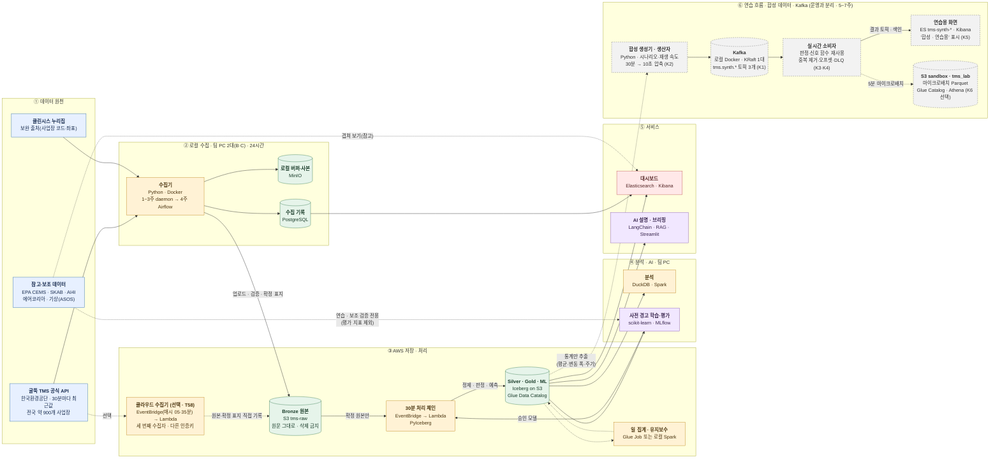

# 간략 흐름도 — 굴뚝 TMS 데이터 파이프라인 및 AI 사전 경고 시스템

Kick-Off 발표용 한 장 요약이다. 상자 하나가 "무엇을 하는가 · 어떤 도구로"를 뜻한다. 세부 경로(조건부·대체·실험 경로, 커밋 주체, 확정 절차)는 [전체 흐름도](전체_흐름도_업무Flow.md)와 [업무 Flow](업무_Flow.md)를 본다.

- **실선**: 반드시 만드는 운영 경로(Must)
- **점선**: 선택 또는 검증 결과에 따라 쓰는 경로(PoC 통과 시 Glue·S3 Tables, 클라우드 수집, 참고 데이터 연습)
- **회색 상자(⑥)**: 합성 데이터 · Kafka 연습 흐름. 운영 Bronze·Silver·Gold와 **데이터가 섞이지 않는다**



## 한 줄씩 읽기

| 단계 | 하는 일 | 핵심 도구 | 담당 |
|---|---|---|---|
| ① 원천 | 공식 API가 30분마다 **가장 최근 값만** 준다. 지난 값은 다시 받을 수 없다 | 공공데이터포털 API | B |
| ② 로컬 수집 | 장비 2대가 같은 구간을 함께 받아 원본을 보존하고, 수집 성공·실패를 기록한다 | Python, Docker Compose, MinIO, PostgreSQL, Airflow | B (C 부담당) |
| ③-0 클라우드 수집 (선택) | 두 PC가 함께 멈춘 구간을 메울 세 번째 수집자. 같은 30분 API를 Lambda가 받아 S3에 바로 쓴다. G1에서 채택 여부 결정 | EventBridge Scheduler, Lambda, S3 | B (A) |
| ③-1 Bronze | 원본을 S3에 올리고 다시 읽어 검증한 뒤 **확정 표지**를 남긴다. 고치거나 지우지 않는다 | Amazon S3 | B·A |
| ③-2 처리 체인 | 매시 15·45분, 확정 원본으로 표준화(Silver) → 판정·이상 신호·사전 경고(Gold) | EventBridge, Lambda, PyIceberg, Iceberg | A·C·E |
| ③-3 배치 | 전국 일 집계, 테이블 유지보수 | Glue Job(검증 통과 시) 또는 로컬 Spark | D·C·A |
| ④ 분석·AI | 탐색 분석, "1시간 안에 경고 단계 진입" 예측 모델 학습·평가 | DuckDB, Spark, scikit-learn, MLflow | E·D |
| ⑤ 서비스 | 누락·신선도·판정·경고를 화면으로, 근거가 붙은 AI 설명 | Elasticsearch, Kibana, LangChain, Streamlit | D |
| ⑥ 연습 흐름 | Silver 통계로 만든 합성 측정값을 Kafka로 흘리고, 같은 판정·신호 함수로 실시간 처리한다. 결과는 연습용 인덱스와 S3 sandbox에만 쌓는다 | Kafka, confluent-kafka, ES·Kibana, (선택) S3·Glue Catalog·Athena | B (A·C·E·D 지원) |

### 실시간 경로에 대한 메모

- **실측은 30분 배치다.** API가 30분마다 한 번 값을 주므로 실측에는 "실시간 수집" 경로가 없다. 클라우드 수집기(③-0)도 같은 30분 주기이며, 목적은 실시간이 아니라 **누락 방지**다.
- **실시간은 합성 데이터로만 연습한다(⑥).** Kafka는 로컬 Docker에서 돌린다(MSK는 비용 때문에 쓰지 않음).
- **Kafka → S3 → Glue는 K6(선택)으로 그린다.** 소비자가 5분마다 묶어 `s3://…/sandbox/synth/`에 Parquet로 쓰고, Glue Catalog `tms_lab`에 등록해 Athena로 조회한다. Glue Streaming Job은 쓰지 않는다. 로컬 Kafka에는 AWS에서 접속할 수 없고, 상시 과금(최소 2 DPU, 하루 약 $20 수준)이라 월 $1 목표와 맞지 않는다.

## 데이터 계층

```text
 원문 응답 ──► Bronze ──────► Silver ─────────► Gold ──────────► 화면 · AI
            (원문 그대로)    (표준화·격리)      (판정·신호·예측)
            S3 tms-raw      tms_silver.*       tms_gold.*        Kibana · Streamlit
```

| 계층 | 내용 | 규칙 |
|---|---|---|
| Bronze | 응답 원문(`.json.gz`) + 매니페스트 | 절대 고치거나 지우지 않는다. 확정 표지가 있는 것만 다음 단계로 |
| Silver | 상태 표기 표준화, 기준대비율 계산, 이상한 값은 격리 | 데이터 계약(3주차)을 지킨 값만 |
| Gold | 단계 판정(정상·주의·경고·초과), 이상 신호 4종, 경고 예측 | 규칙 버전·모델 버전을 함께 기록 |
| ML | 학습·평가 데이터셋 | Iceberg 스냅샷 태그로 고정해 재현 |

## 꼭 기억할 세 가지

1. **놓친 구간은 영원히 사라진다.** 그래서 1주차(10/30)에 수집을 먼저 켜고, 장비 2대로 중복 수집한다.
2. **원본은 불변이다.** 잘못돼도 원본은 그대로 두고, 고친 결과는 Silver 이후에 다시 만든다(재처리).
3. **참고 데이터(EPA 등)는 연습용이다.** 코드와 평가 절차를 미리 만드는 데만 쓰고, 성능 수치는 울산 실측으로만 보고한다.
4. **Kafka 합성 데이터도 연습용이다.** `tms.synth.*` 토픽, `tms-synth-*` 인덱스, S3 `sandbox/`·`tms_lab`에만 두고 운영 테이블·평가 지표에 넣지 않는다.
